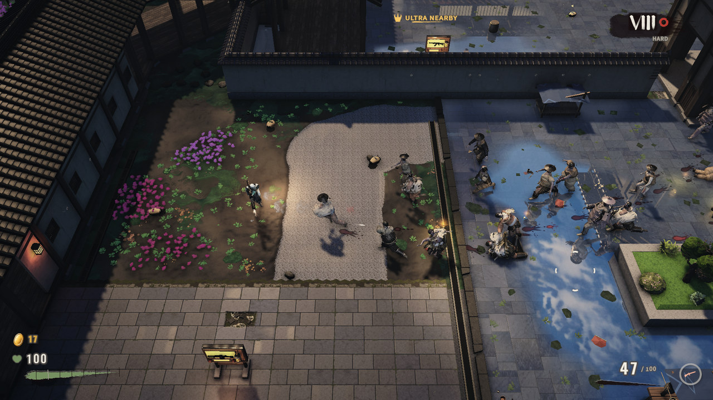
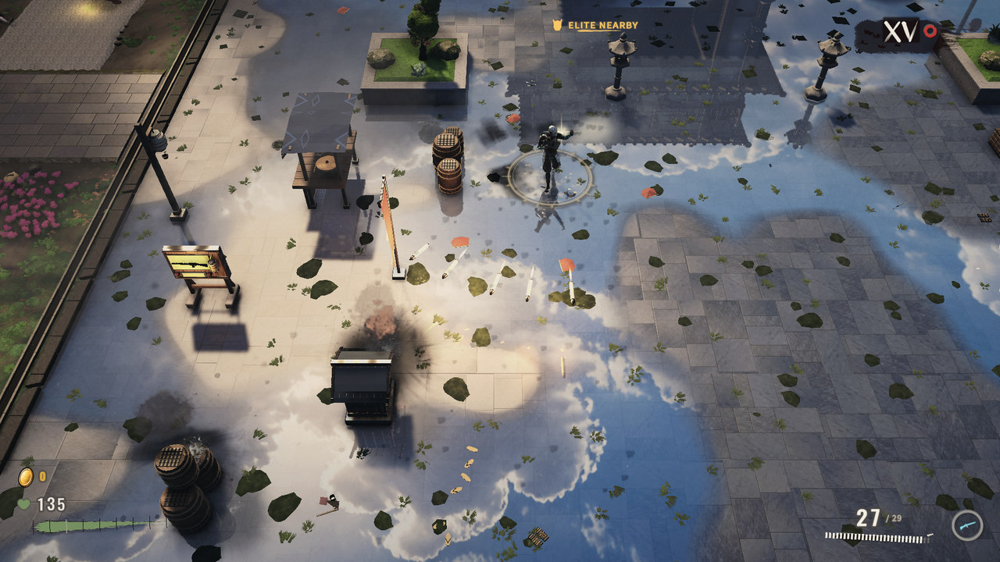
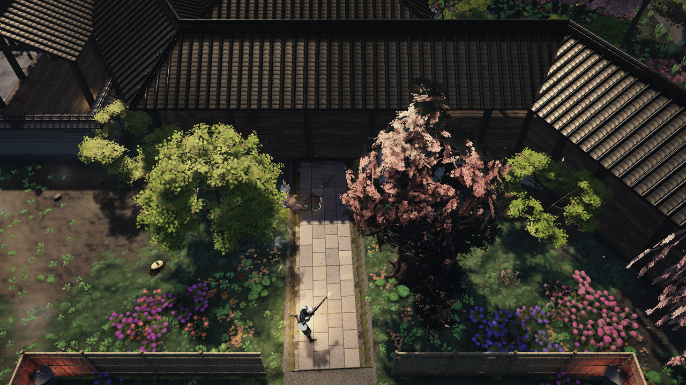
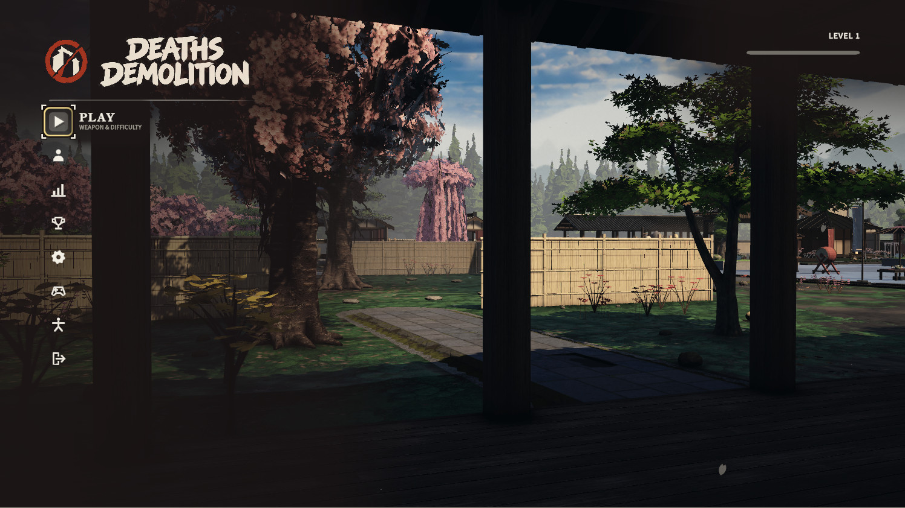
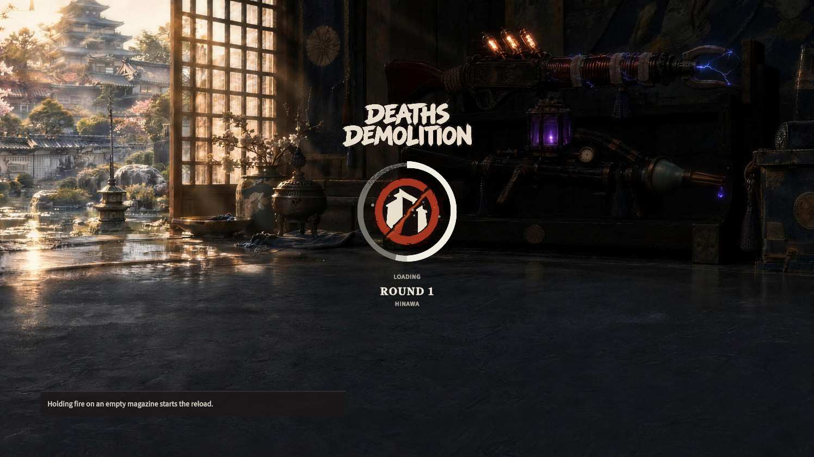
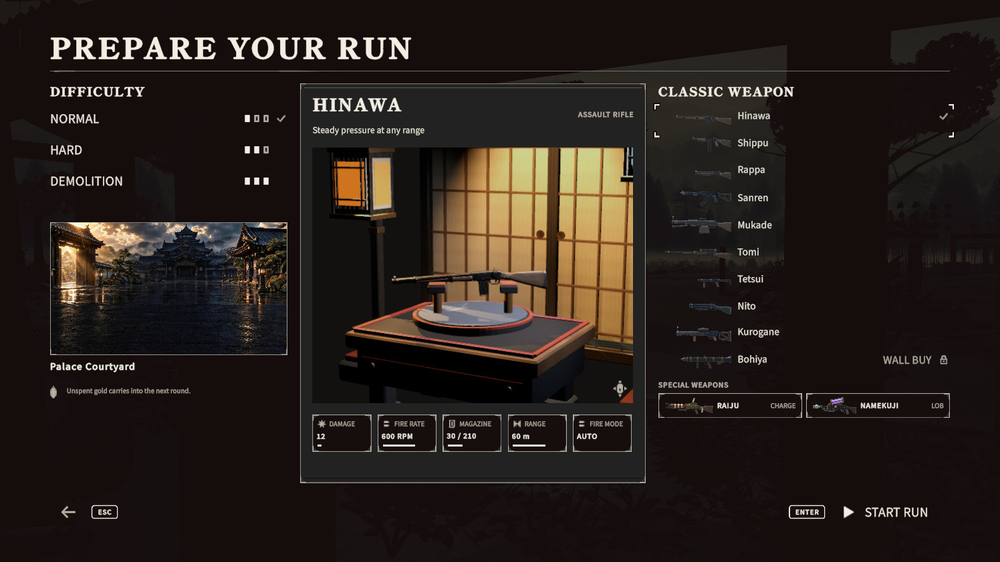
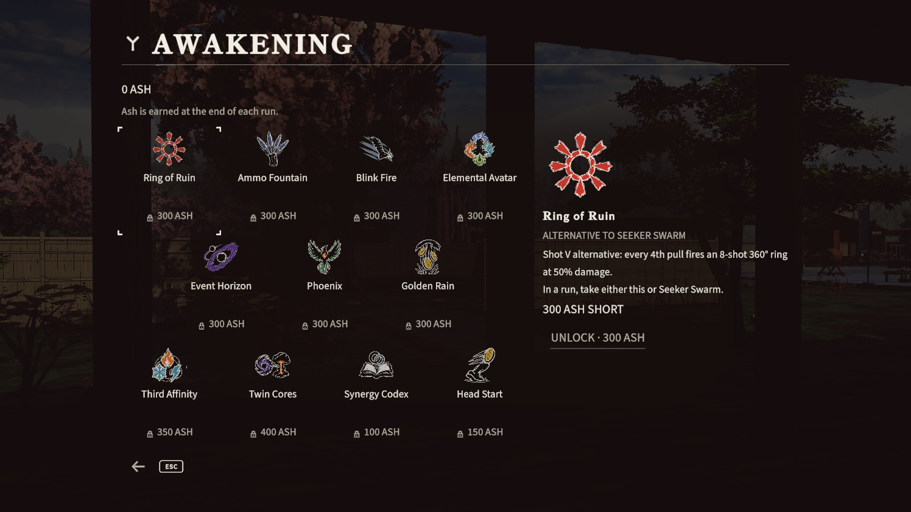
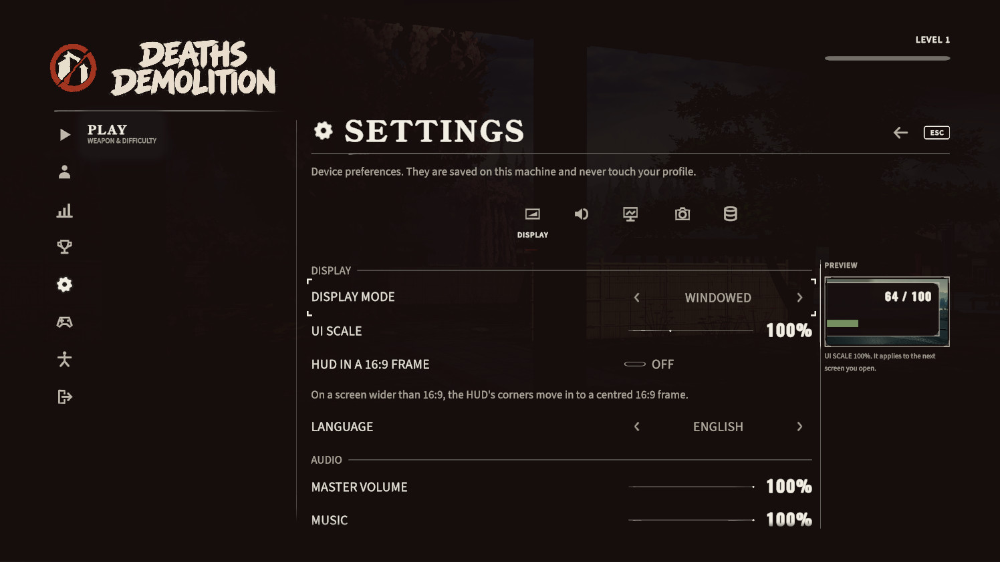
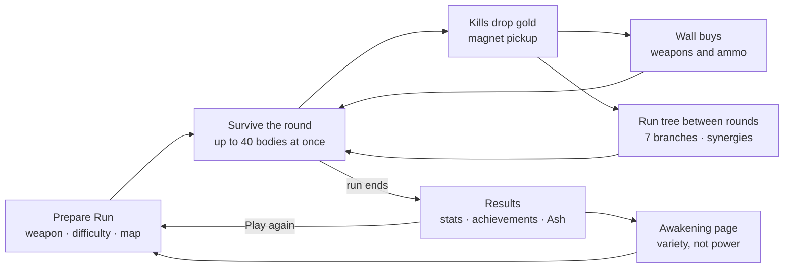
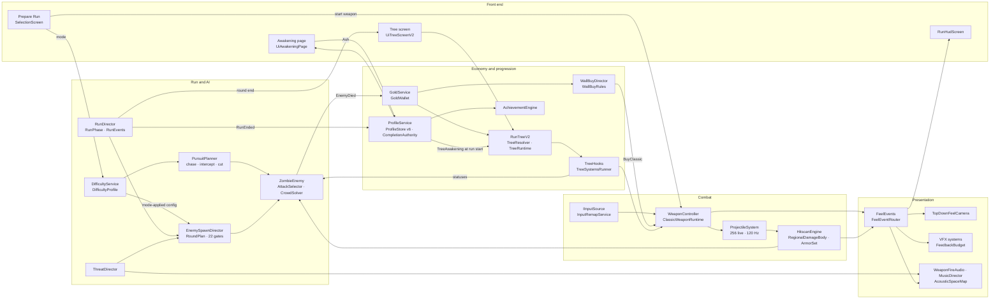

# Deaths Demolition

**A top-down wave-survival zombie shooter in Unity 2022.3 LTS with URP 14.** You hold an old Japanese palace compound against crowds of up to 40 zombies at once. Ten classic weapons, two chain-reaction Specials and ten wall-buy stations feed a feature-based upgrade tree that grows more extreme every round. Three difficulty modes set the pace.

<p align="center">
  
</p>
<p align="center"><sub>Key art</sub></p>

This README is the developer entry point. It covers what the game does today, where each system lives in the code, and how the project is built, tested and kept safe. Deeper material is in [`docs/ARCHITECTURE.md`](docs/ARCHITECTURE.md) and [`docs/SYSTEMS-INDEX.md`](docs/SYSTEMS-INDEX.md).

> **Status (14 Oct 2026):** active development. The project is in milestone **M4**, in revision round **R4**, the final revision round.
> - R3 closed on 11 Oct 2026 after a full scripted acceptance run.
> - The R4 final acceptance run started on 14 Oct 2026 on the R4 game commit `b3424d1f`. It has no verdict yet.
> - Later commits on `main` change documentation and repository hygiene only.
>
> Unless a feature is marked **legacy**, **development builds only** or **not shipped**, it is on `main` and active on the default player path of a release build.

| | |
| --- | --- |
| **Genre** | Top-down wave-survival shooter, single player, offline |
| **Engine** | Unity 2022.3.22f1 LTS · URP 14.0.10 · C# |
| **Platform** | macOS (Metal) release builds; a Windows x64 build path exists in the tooling |
| **Crowd** | Up to 40 zombies at once, 4 tiers, 5 attack styles, 3 pursuit roles |
| **Arsenal** | 10 classic weapons · 2 Specials · 10 wall-buy stations |
| **Progression** | 7-branch run tree (63 nodes, 7 alternative capstones, 10 synergies) · 11-node Awakening page |
| **Modes** | Normal · Hard · Demolition |
| **Languages** | English and Turkish (1,346 string keys, all bilingual) |
| **Codebase** | ≈ 487k lines of C# · 3,591 automated test cases · 142 tool scripts |

---

## Contents

1. [Screenshots](#screenshots)
2. [How a run plays](#how-a-run-plays)
3. [Features and where they live](#features-and-where-they-live)
4. [Tech stack](#tech-stack)
5. [Architecture](#architecture)
6. [Performance](#performance)
7. [Engineering profile](#engineering-profile)
8. [Test strategy](#test-strategy)
9. [Build, CI and machine safety](#build-ci-and-machine-safety)
10. [Repository layout](#repository-layout)
11. [Running the project](#running-the-project)
12. [Assets and Git LFS](#assets-and-git-lfs)
13. [How the game is built](#how-the-game-is-built)
14. [Not shipped and known limitations](#not-shipped-and-known-limitations)
15. [Further reading](#further-reading)

---

## Screenshots

<p align="center">
  
</p>

| | |
| --- | --- |
|  |  |
| Hard mode, round VIII: HUD v4 (gold above health, brush numeral) | Automatic fire: bullets drawn as short-exposure streaks |
|  |  |
| Rockets in flight and a blast scorch, round XV | The Barrage synergy: full-auto rockets |
|  |  |
| Raiju, the chain-lightning Special | Demolition mode, round IV |
|  |  |
| Garden court: instanced flowers and grass | Sakura court: wind and interaction push map |

| | |
| --- | --- |
|  |  |
| Main menu | Loading screen |
|  |  |
| Prepare Run | Run tree |
|  |  |
| Awakening | Settings |

<sub>Captured from build b3424d1f with the game camera; some gameplay shots use a capture camera at 0.8 of the default distance and were played by the scripted test bot.</sub>

---

## How a run plays



Scenes: `Boot → MainMenu → Selection (Prepare Run) → Run (+ World_V6_Greybox, additive) → Results → MainMenu` or **PLAY AGAIN**. `Boot` is the only entry scene.

---

## Features and where they live

Code pointers are relative to `prototype/DeathsDemolition_PlayableConcept/Assets/`.

### Rounds, gold and wall buys

- **Round loop.** Each round has a body pool, a target and a ceiling plan, with a refill clock and an **active ceiling of 40** bodies. A round ends when the last body falls; stuck-body watchdogs recover or remove stragglers.
  `_Prototype/Rounds/RunDirector.cs`, `_Prototype/Spawn/EnemySpawnDirector.cs`, `RoundPlan.cs`, `SpawnRefillClock.cs`; the ceiling is `AbsoluteSafetyCeiling` in `_Prototype/Core/Config/RoundConfigSection.cs`.
- **Late-game curve.** From round 16, enemy health grows ×1.45 per round in every mode (`LateHealthFromRound` / `LateHealthGrowth` in `_Prototype/Core/Resources/PrototypeConfig.asset`), and the late Elite/Ultra share grows with it.
- **Gold.** Kills drop pooled gold orbs pulled in by a magnet, and a gold flight lands on the HUD counter. The in-run wallet uses idempotent transaction ids, and gold never reaches the profile.
  `_Prototype/Economy/GoldOrb.cs`, `GoldService.cs`, `GoldWallet.cs`, `GoldTransaction.cs`; `_Prototype/UI/Runtime/Hud/HudGoldTarget.cs`.
- **Weapon access and wall buys.** There are no level unlocks. Every classic weapon except the launcher is open from the first run, and the run starts with the weapon picked on Prepare Run. **Ten wall stations** sell weapons inside the run:
  - buying the weapon in hand again refills its ammo at half price;
  - every swap is paid again;
  - nothing can be bought while a Special is in hand;
  - the rocket launcher waits at a far bamboo-corner shrine for 2,500 gold.

  `_Prototype/Weapons/WallBuy/` (`WallBuyRules` is pure rules, `WallBuyDirector` and `WallBuyStation` are the scene side, `Resources/WallBuy/wallbuy-v6.json` is the catalog); `_Prototype/UI/Runtime/Hud/HudWallBuyPrompt.cs`.
- **Specials on the field.** The two Specials are never chosen. They appear on the field and park the classic weapon while held. `_Prototype/Weapons/SpecialWeaponDirector.cs`, `SpecialWeaponPickup.cs`.

### Difficulty modes

The mode is chosen on Prepare Run. A Hard or Demolition run shows its mode word on the HUD and in Results.

| Mode | What changes |
| --- | --- |
| **Normal** | The full game: the long late-round climb, with the tree's power fantasy untouched. |
| **Hard** | Damage ×1.4, shorter telegraphs, 55 % of non-flanking bodies pursue predictively, active cap 36, gold ×1.25, one extra attack slot. |
| **Demolition** | Running crowds; Runner, Elite and Ultra tiers from rounds 1, 2 and 3; 60 % of non-flanking bodies intercept and 40 % cut off the escape path; damage ×1.8; active cap 40; gold ×1.8 and 150 starting gold; two extra attack slots. Bots die around round 5–6. |

- `_Prototype/Difficulty/DifficultyService.cs`: `Selected` is what Prepare Run picks. `BeginRun` fixes the run's mode and, for Hard and Demolition only, makes a mode-applied copy of the active config, so every system that reads the config plays the mode without a call site of its own. Normal never clones.
- `_Prototype/Difficulty/DifficultyProfile.cs` (`Defaults()`) holds the per-mode settings; `_Prototype/UI/Runtime/Prepare/PrepareRunDifficulty.cs` is the Prepare Run side.
- `_Prototype/Difficulty/PursuitPlanner.cs` and `ZombieAiRole` in `DifficultyMode.cs` implement the pursuit roles (see [Enemies and AI](#enemies-and-ai)).

### Arsenal

<p align="center">
  
</p>

Each weapon is a `WeaponDefinition` asset referenced by `ArsenalCatalog.asset` (`_Prototype/Weapons/Arsenal/Resources/Arsenal/WD_*.asset`; type in `_Prototype/Core/Weapons/WeaponDefinition.cs`). Wall-buy prices come from `wallbuy-v6.json`.

| id | Weapon | Class | Fire | RPM | Damage | Magazine | Wall buy |
| --- | --- | --- | --- | ---: | ---: | ---: | ---: |
| `ar_1` | Hinawa | Assault rifle | Auto | 600 | 12 | 30 | 250 |
| `ar_2` | Sanren | Assault rifle | 3-round burst | 500 | 16 | 18 | 450 |
| `smg_1` | Shippu | SMG | Auto | 900 | 8 | 42 | 250 |
| `smg_2` | Tetsui | SMG | Auto | 540 | 14 | 24 | 500 |
| `sg_1` | Rappa | Shotgun | Pump | 72 | 9 per pellet | 7 | 300 |
| `sg_2` | Nito | Shotgun | Double barrel | 200 | 11 per pellet | 2 | 550 |
| `lmg_1` | Mukade | LMG | Auto | 720 | 11 | 100 | 600 |
| `lmg_2` | Kurogane | LMG | Auto | 420 | 24 | 60 | 800 |
| `sr_1` | Tomi | Sniper | Bolt action | 48 | 80 | 5 | 650 |
| `rl_1` | Bohiya | Launcher | Single rocket | 20 | 110 | 1 | 2,500 (shrine, wall buy only) |

- **Specials.** **Raiju** (`sw_arc`) is a charged chain-lightning orb with 3 charges. **Namekuji** (`sw_gel`) lobs a slick gel for 8 shots; zombies slip and fall in it. Through the tree, Storm Chain makes Raiju last 30 % longer with two more jumps, and Deep Freeze makes Namekuji's gel freeze. `WD_sw_arc.asset`, `WD_sw_gel.asset`; `_Prototype/Weapons/SpecialWeapon*.cs`, `SpecialGelEffects.cs`.
- **One projectile simulation.** `Bullet`, `Pellet`, `Rocket`, `Orb` and `Gel` share one static simulation: up to 256 live projectiles at a fixed 120 Hz step, swept casts, penetration, and no allocation per frame. `_Prototype/Weapons/Projectiles/ProjectileSystem.cs`.
- **Regional damage and armour.** Bodies have head, upper and lower regions. Helmet, body and leg plates break, and explosions split falloff damage across regions. `_Prototype/Damage/RegionalDamageBody.cs`, `ArmorSet.cs`.
- **Rockets.** Rockets have an arming distance, a self-blast radius, and dud and cluster rules. The tree's *Barrage* synergy (launcher + Full-Auto) gives ×10 RPM, ×0.4 damage and a 12-round magazine. `_Prototype/Weapons/RocketImpacts.cs`.
- **Bullet look.** The nine normal weapons draw their bullets and pellets as a **short-exposure streak**. A procedural ribbon is as long as the round's speed times an artistic shutter time, clamped per weapon class and capped in screen pixels. Element and tier read by shape as well as colour. Projectile positions, speed, collision and damage are never changed by the look. The launcher and the Specials keep their own visuals. Muzzle flashes, impact cards and bullet holes come from a photographic set.
  `_Prototype/Feedback/Vfx/TracerRibbonRenderer.Ap043.cs`, `_Art/VFX/Resources/Shaders/DD_VfxRibbon.shader`, `_Prototype/Feedback/Vfx/Ap041Vfx.cs`, `ImpactSystem.cs`.
- **Upgrades you can see.** Tree upgrades appear on the gun: extended and drum magazines, a twin barrel, a muzzle power ring, an element capsule glowing in the dominant element, and a full-auto box for the launcher (14 attachment prefabs). `_Prototype/Weapons/Attachments/`, `_Prototype/Weapons/Arsenal/Attachments/`; built by `_Art/Editor/ArtAp040WeaponAttachBuilder.cs`.

### Enemies and AI

- **Four tiers on one data-driven zombie:** Standard, Special (Runner), Elite (Guard) and Ultra (Executioner). The tier is data, not a subclass, with its own silhouette slot and body scale. `EnemyTier` in `_Prototype/Core/Config/PrototypeConfigEnums.cs`; `_Prototype/Enemies/ZombieTierLibrary.cs`, `TierSilhouetteSlot.cs`.
- **Five attack styles:** Swipe, Lunge, Sweep, Overhead and Bite-grab. Each tier has a signature style, picked by a deterministic selector. An attack-slot board caps concurrent wind-ups (Hard +1, Demolition +2). Only one grab can be active, and one strong hit breaks it. `_Prototype/Enemies/AttackStyles.cs`, `EnemyAttackState.cs`.
- **Pursuit roles.** Each non-flanking body gets a role for its whole life: *Chase*, *Intercept* or *Cut*. Interceptors walk to where the player will be. Cutters run ahead along the player's escape direction (the open side of the ring around them) when they can get there first. Both fall back to a chase when they stall. Normal always chases. `_Prototype/Difficulty/PursuitPlanner.cs`.
- **Crowd.** NavMesh paths plus a mass-weighted separation solver on a spatial hash, with flanking shares, chokepoint queues and rear awareness. A threat director feeds the music layers, spawn weighting and HUD threat words. `_Prototype/Navigation/CrowdSolver.cs`, `CrowdSpatialGrid.cs`, `CrowdFeelSettings.cs`; `_Prototype/Enemies/ThreatDirector.cs`, `ZombieRear.cs`.
- **Spawning.** There are 22 authored gates: 12 on the ±55 m edge ring and 10 inside. Gates are weighted by path distance, recency, density, visibility, room balance and a cap on spawns behind the camera, and each mode sets its own preferred spawn distances. `_Art/Environment/World/V6/spawn-gates-v6.json`; `_Prototype/Spawn/SpawnWorldProfile.cs`, `SpawnWeightCalculator.cs`, `SpawnRoomBalance.cs`, `RearSpawnShare.cs`.
- **Locomotion v4.** Gait pools mix walk lurch, drag, limp, heavy and stomp walks with feral and stumbling runs. Start, stop and turn transition clips are included (22 clips in total). Cadence follows the body's real ground speed, so feet do not slide. A turn-rate limit, stumble braking, stride calibration and swing-lift foot IK finish the walk. `_Prototype/Enemies/ZombieLocomotionV4.cs`; `_Prototype/Characters/ZombieLocomotionMath.cs`, `ZombieTransitionData.cs`, `CadenceBand.cs`.
- **Reactions and death.** Raiju shocks bodies. On gel they slide, fall, lie downed and get up again. Tree statuses add:
  - ice that stacks a slow and then freezes (shorter for Elite, slow-only for Ultra);
  - stuns, black-hole pull and push waves;
  - status damage that passes armour.

  Deaths hand a `DeathImpulse` to a pooled ragdoll proxy, and one owner handles corpse lifetime. `_Prototype/Enemies/ZombieShock.cs`, `ZombieGel.cs`, `ZombieTreeStatus.cs`, `TreeStatusMath.cs`; `_Prototype/Characters/RagdollProxyPool.cs`, `ZombieDeathFamilies.cs`.
- **Variety.** Modular heads, hats, armour pieces and a tier palette keep a crowd of 40 from looking cloned. `_Prototype/Characters/ZombieModuleLibrary.cs`, `ZombieArmorLibrary.cs`; `_Prototype/Enemies/ZombieAppearance.cs`, `ZombiePalette.cs`.

### Hero

- A single hero model (`_Art/Characters/Player/HeroV2/Hero_v2_TD_LOD0-3.fbx`, four LODs) with 8-way locomotion and start, stop and turn variants (121 clips).
- Foot IK and foot lock, weapon-grip IK, reload clips with part sockets, a secondary chain for the sash, and a readability lift in the shader for top-down.
- `_Prototype/Characters/PlayerSkinnedVisual.cs`, `LocomotionV4.cs`, `FootIkAdapter.cs`, `WeaponGripIk.cs`, `MagazineContactIk.cs`, `SecondaryChainDriver.cs`.

### Progression

**Run tree v2** is feature-based: every node applies to whatever weapon is in hand, so a wall buy never wastes an investment. It is live in the shipped config (`RunTreeV2: 1` in `PrototypeConfig.asset`).

| Branch | Nodes | Direction |
| --- | ---: | --- |
| Shot | 12 | Heavy Rounds up to Seeker Swarm and Ring of Ruin |
| Magazine | 10 | Extended Mag up to Infinity Engine and Ammo Fountain |
| Speed | 9 | Hair Trigger I–III, Wind Step, Full-Auto, Twin Barrel, Overclock |
| Element | 15 | Ember, Frost, Arc and Venom Rounds up to Primal Cataclysm |
| Chaos | 8 | Lucky Strike up to Doomsday Bell and Event Horizon |
| Survival | 9 | Iron Body, Spirit Ward, Life Drain up to Undying Oath and Phoenix |
| Economy | 7 | Coin Sense, Arms Dealer (wall buys −20 %), Interest, Midas Hoard |

- **Catalog.** 63 nodes in tiers I–V, plus 7 Awakening alternative capstones (70 catalog nodes) and 10 synergies. `_Prototype/Rounds/RunTree/Resources/ProgressionTree/run-tree-v2.json`.
- **Synergies.** Barrage, Frozen Gravity, Thunder Cascade, Pinball Storm, Unbroken Line, Wildfire Rounds, Toxic Rail, Crit Meltdown, Judgment Line and Golden Gun. They are free, unlock themselves when their parents are owned and earn a double-seal badge.
- **Forks and caps.** At most two elements per run (three with Third Affinity). Mini Nuke *or* Black Hole (both with Twin Cores). The Coin Sense gold scale is capped at ×1.6.
- **Tree shop rules.** The tree is free to browse and buy on its frontier.
  - A recommendation strip offers three cards at −10 %, and a reroll costs 10 gold, rising by 10.
  - A SET TARGET pin marks a goal, and Hearth stokes add +2 % weapon damage each, up to 20.
  - Tiers open by round, per mode: Normal at rounds 1/3/6/10/14, Hard at 1/3/5/8/11, Demolition at 1–5.
  - One key (CONTINUE) leaves the screen.
- **Code.**
  - `_Prototype/Rounds/RunTree/V2/RunTreeV2.cs` holds the run's state and shop commands.
  - `TreeResolver.cs` turns owned nodes plus the weapon in hand into `TreeStats`, on purchase, equip and run start only, never per frame.
  - `TreeContract.cs` (`TreeRuntime`) publishes the result.
  - `TreeHooks.cs` is read by the fire path.
  - `Systems/` runs statuses, gravity wells, blasts and zones.
- **Tree screen.** A brush-ink screen with fog over tiers not yet open, a state word and glyph for every node (never colour alone), a purchase stamp and synergy seals. `_Prototype/UI/Runtime/Screens/UpgradeTreeV2.cs`, `UiTreeEdges.cs`; `_Prototype/UI/Runtime/Presentation/TreeV2Presenter.cs`, `TreeArt.cs`.
- **Visible power.** The hero gains an aura in three steps when the sum of owned tiers reaches 15, 35 and 60. Projectiles climb a five-step halo ladder, a seeker draws a bending trail, and a tree-multiplied gold orb drops as a koban coin. `_Prototype/Rounds/RunTree/V2/TreeStats.cs`; `_Prototype/Feedback/Vfx/Tree/`.
- **Awakening (meta).** Ash is earned at the end of each run ("AWAKENING +N Ash") and spent on the **Awakening page**. The page buys variety, never power. It has 11 nodes:
  - 7 alternative capstones: Ring of Ruin, Ammo Fountain, Blink Fire, Elemental Avatar, Event Horizon, Phoenix and Golden Rain;
  - 2 fork widenings: Third Affinity and Twin Cores;
  - 2 aids: Synergy Codex, and Head Start (+40 gold in round 1 on Normal and Hard).

  A node unlocks with a 500 ms hold, and the page opens from Results. The run reads the owned unlocks once at run start. `meta-tree.json` (page `awakening`); `_Prototype/Rounds/RunTree/V2/TreeAwakening.cs`; `_Prototype/Profile/MetaPath/ProfileService.Awakening.cs`; `_Prototype/UI/Runtime/Screens/AwakeningPage.cs`, `_Prototype/UI/Runtime/Flow/UiTreeScreenRoute.cs`.
- **Respec migration.** Moving a profile from schema v5 to v6 gives a full free respec, after a byte-for-byte `.v5.bak` copy is kept. `_Prototype/Profile/ProfileStore.cs`, `ProfileMigration.cs`.
- **Profile.** XP, levels, titles, badges and HUD indicators. **53 achievements are defined**, 6 of them tied to Hard and Demolition, plus 9 unlockables. Each achievement is granted exactly once, inside the same commit as the run that earned it. `_Prototype/Achievements/Resources/Achievements/achievement-catalog.json`, `unlock-catalog.json`; `_Prototype/Achievements/AchievementEngine.cs`.
- **Retired.** The first tree (`run-tree.json`, the v1 types in `_Prototype/Rounds/RunTree/`) is still built for compatibility but no longer sold. The old meta path's 16 passives and 10 Special leanings stay in `meta-tree.json` for save compatibility, and the R4 menu has no page for them.

### World and look

- **One map, the Palace Courtyard.** It is an old palace compound with gardens, a ±55 m playable square (110 × 110 m), five regions and twelve interiors. `_Art/Environment/World/V6/regions-v6.json`.
- **Built by code.** `_Art/Editor/GreyboxV6Builder.cs` builds the world headlessly from `layout-v6.json`:
  - 1,064 placements, 11 buildings, 22 zones and 68 clusters;
  - 130 old Japanese lanterns lighting the interiors;
  - a top-down visibility audit, NavMesh and light bake.

  `_Art/Editor/TdVisibilityAudit.cs` decides which content the top-down camera can never see. That content moves to `World_FPTPOnly`, which is loaded only for the legacy cameras (`_Art/Editor/WorldFptpSplit.cs`, `_Art/Runtime/WorldFptpOnlyLoader.cs`).
- **Living ground.** About 59,800 GPU-instanced grass, flower and moss instances sit in 8 m chunks with frustum culling. Three LODs cross-fade with dithering, wind moves them, and an interaction push map lets the player, zombies and blasts bend the grass. `_Prototype/World/Vegetation/VegetationSystem.cs`, `VegetationPushMap.cs`.
- **Plaza and colour pass.** A world kit of 47 families (110 prefabs with LOD groups) dresses the plaza corners and gardens. Pink, purple and momiji litter replaced much of the green carpet, cutting the green share by 22 % over eight fixed top-down poses. `_Art/Editor/ArtAp040WorldKit.cs`.
- **Walk anywhere.** Wherever nothing is drawn, the hero can walk. Colliders fit the drawn meshes, and a walk scan with the player capsule on a 0.5 m grid reports zero invisible blockers. `_Art/Editor/WorldWalkScan.cs`.
- **Readable from above.** Roofs fade, and tree crowns between the camera and the hero thin with a 4×4 Bayer screen-door cone while their shadows stay intact. Only the game camera reveals. `_Prototype/Camera/CameraOcclusionFader.cs`, `TreeCanopyReveal.cs`.
- **After-rain light.**
  - Wet slate with planar reflection, and volumetric sun shafts (a URP 14 raymarch through the shadow map).
  - Baked lightmaps and probes, a sky with a sun disc, cloud shadows, lantern flames, water and a LUT post pass.

  `_Art/Runtime/PlanarReflection.cs`, `VolumetricLightFeature.cs`, `SunDisc.cs`, `LookV3Post.cs`; `_Prototype/World/CloudShadowDriver.cs`, `WorldAtmosphere.cs`; `_Prototype/Feedback/Vfx/LanternFlames.cs`, `WaterLook.cs`.
- **Quality tiers.** Performance, High and Cinematic (the default) each have their own URP asset (`Settings/DD_URP_Performance.asset`, `DD_URP_PipelineAsset.asset`, `DD_URP_Cinematic.asset`). One tier authority caps shadows, draw distance and features (`_Prototype/Core/Quality/QualityTiers.cs`, `_Prototype/Rendering/QualityModeApplier.cs`). On High top-down, planar reflection renders every 8th frame (sky only), shadows stop at 40 m and small shadow casters are trimmed.
- **Breakables.** Breakable props with VFX profiles. `_Prototype/Props/BreakableProp.cs`.

### Camera

- **Top-down is the default and the only developed and tested mode.** `_Prototype/Camera/TopDownFeelCamera.cs` provides fire and world trauma, a kick spring inside a 0.22 m cap, fire lean, zoom punch and look-ahead.
- **Third- and first-person views are legacy.** They are still selectable from the Pause menu's CAMERA row (`_Prototype/Camera/CameraModeService.cs`), but they have been frozen since 6 Oct 2026 and are outside test and acceptance scope. First-person viewmodel arms show for 6 of the 10 classic weapons.

### Game feel

- **One feel event source.** `_Prototype/Feedback/FeelEvents.cs` defines 15 moments, each raised once from its authoritative place: shot, hit, kill, multi-kill, explosion, damage taken, low health, reload start and end, dry fire, gold, round start and end, last zombie and heartbeat. Camera, hit-stop, zombie reactions, VFX, audio, HUD and gold subscribe. `FeelEventRouter.cs` is the allocation-free same-frame arbiter: one shake or hit-stop per trigger pull.
- **Data-driven profile.** `_Prototype/Feedback/FeelProfileTD.cs` and `_Prototype/Core/Resources/DD_FeelConfig.asset` hold 13 weapon rows, 23 event rows and a switch for every layer.
- **Time.** A global hit-stop plays only on big moments, and the last zombie gets a slow-motion beat, all through one clock arbiter. The local hit-stop never touches `Time.timeScale`. `_Prototype/Feedback/FeelHitStopTD.cs`, `HitStopService.cs`, `FeelTimeScale.cs`.
- **Other layers.** Top-down gamepad rumble, a low-health heartbeat, a TD muzzle light, a damage vignette, GPU-instanced blood and decals, brush-ink feel VFX, and pooled damage numbers with crit starbursts. `_Prototype/Input/GamepadRumble.TopDown.cs`; `_Prototype/Feedback/Vfx/BloodSystem.cs`, `FeelBrushVfxSystem.cs`, `DamageVignetteLayer.cs`; `_Prototype/UI/Runtime/Fx/UiWorldNumbers.cs`.
- **Measured cost.** Turning the feel layers on adds about +0.01 ms CPU at the 40-body ceiling, with GC allocation events unchanged (R3 acceptance run).

### Audio

- **Weapon audio v5.** Fire is layered per weapon. Automatic weapons use a per-shot transient over an RPM-locked body. Slapback reflections come from eight acoustic probe rays (delay = 2d / 343 m/s). A tail bed keeps at most two overlapping tails, and wet tails change for open ground, corridors and halls. `_Prototype/Audio/Runtime/WeaponFireAudio.cs`, `WeaponReflections.cs`, `WeaponTailBed.cs`, `AcousticProbe.cs`.
- **Acoustic map.** A baked map of the world (`_Art/Environment/World/V6/acoustic-spaces-v6.json` → `AcousticSpaceMap`) tells the fire model which space the listener is in. The integration gate refuses an unbaked map (`tools/qa/acoustic_bake.py`).
- **Score.** A hybrid Japanese-cinematic score in four vertical layers (base, taiko percussion, tension, and an Elite/Ultra/Special accent) is mixed by one threat-driven parameter. `_Prototype/Audio/Runtime/MusicDirector.cs`.
- **R4 sounds.** 33 new sounds cover wall buys, the Hard and Demolition select stingers, the tree screen and the tree's moments (shield, ricochet, Barrage rockets, zones, black hole). Each sound has a voice cap, so a Barrage stays readable. New bullet impacts and a sniper crack layer were also added. `_Prototype/Audio/Runtime/TreeAudio.cs`.
- **Other.** An after-rain ambience bed follows the space you stand in. Impact, foley, casing and footstep sets, the Special sets and rocket blasts complete the mix. Master, music, effects and UI buses have their own sliders. `AfterRainAmbience.cs`, `ImpactAudio.cs`, `SpecialAudio.cs`, `RocketBlastAudio.cs`, `AudioMixerBridge.cs`.
- **Assets.** 1,962 WAV files from licensed sound libraries (including Sonniss) and in-house sound design.

### Interface and accessibility

- **Brush-ink design language.** A brush UI kit provides frameless brush panes, ink scrims, brush titles and dividers, selection marks, buttons, tabs, sliders, toggles and tooltips. Icons are lit from SDF height. `_Prototype/UI/Runtime/Kit/Components/UiBrushKit*.cs`, `UiBrushPane.cs`; `Kit/UiBrushTokens.cs`; `Fx/UiIconShade.cs`.
- **HUD v4.** The HUD is boxless ink.
  - Gold sits above the health stroke.
  - The round shows as a brush-painted Roman numeral at the top right, next to a vermilion seal.
  - There is no zombie counter.
  - The health stroke breaks, trails, glows on heal and beats when low.
  - It also carries the magazine readout, reticle pops, rear-threat arcs, threat words (BEHIND YOU, SURROUNDED, ELITE/ULTRA NEARBY), the wall-buy prompt and the mode word.
  - A test caps the persistent HUD at 1.5 % of the screen.

  `_Prototype/UI/Runtime/Screens/RunHudScreen*.cs`, `HudPlayerArcs.cs`, `HudReticle.cs`; `Hud/HudRoundNumeral.cs`, `HudGoldReadout.cs`; `Kit/UiHudInk.cs`.
- **Front end.**
  - **Main menu.** The title is the brush wordmark with its seal, over a cinematic of the real world (five shots of 12 s each). The rail holds PLAY, PROFILE, STATISTICS, ACHIEVEMENTS, SETTINGS, CONTROLS, ACCESSIBILITY and QUIT. `MainMenuScreen.cs`, `MenuCinematic.cs`.
  - **Loading.** On the lacquer-door curtain, the seal drops into an ensō progress ring. Progress is honest, key art comes from a shuffle bag, and tips include beginner hints for the first three runs. `Flow/UiCurtain.cs`, `UiLoadingTips.cs`, `KeyArtRotation.cs`, `UiLogoAnimator.cs`.
  - **Prepare Run** has three columns:
    - Setup: difficulty rows, the map card and a tip.
    - Stage: the chosen weapon on a 3D turntable with five stat cards.
    - Weapons: the list, with the Specials marked "found on the field" and the launcher marked "WALL BUY".

    `Screens/SelectionScreen.cs`, `Prepare/PrepareRunLayout.cs`, `PrepareRunStage.cs`.
  - **Pause** holds RESUME, a settings page, the legacy CAMERA row, a camera-shake slider and END RUN with a confirmation. The game pauses itself when the window loses focus. `Screens/PauseScreen.cs`.
  - **Results** shows the mode, an AWAKENING +N Ash line, a door to the Awakening page, and PLAY AGAIN. `Screens/ResultsScreen.cs`.
- **Accessibility.**
  - Text scale (100 / 110 / 125 %) and UI scale.
  - A colour-blind-safe palette in which every state also has a shape and a word.
  - Reduced motion, reduced flashes and a camera-shake slider.
  - Full rebinding for keyboard and gamepad, with device-aware glyphs.
  - Rumble toggle, aim assist, stick dead zone, hint toggle and an English/Turkish switch.

  `_Prototype/Input/InputRemapService.cs`; `_Prototype/UI/Runtime/Kit/UiInputGlyphs.cs`, `UiSettings.cs`.
- **Strings.** 1,346 keys, every one in English and Turkish. `_Prototype/UI/Resources/Strings/r1-strings.json`.
- **Branding.** A release build shows **"Deaths Demolition"** in the Dock, menu bar, About box and window title. A post-build step writes the Info.plist name (`tools/app-display-name.sh`). The Unity product name stays unchanged on purpose, so the save-data path does not move. The animated logo plays on the loading screen and in a one-time menu intro; the app icon is in `_Prototype/Core/AppIcon/`.

### Save and profile

- **Crash-safe store.** The candidate is written with fsync, read back and verified. A verified `.bak` is kept, the replace is atomic (`File.Replace`), corrupt files go to quarantine, and a fail-closed OS lock lease guards the file. `_Prototype/Profile/ProfileStore.cs`.
- **Schema v6.** v6 adds the Awakening respec and per-mode statistics. Migrations from v1 are lossless. `_Prototype/Profile/ProfileData.cs`, `ProfileMigration.cs`.
- **Exactly-once run commit.** A lineage and a monotonic completion ordinal make sure each finished run is applied once. Achievements are granted inside the same commit. `_Prototype/Profile/CompletionAuthority.cs`, `ProfileRunCommitter.cs`.

---

## Tech stack

| | |
| --- | --- |
| Engine | Unity **2022.3.22f1** (LTS), pinned |
| Rendering | Universal Render Pipeline **14.0.10**; three quality tiers on separate URP assets; custom volumetric light, screen atmosphere and planar reflection features; 28 hand-written shaders, 11 HLSL includes, 1 compute shader, no Shader Graph |
| Input | Input System 1.7.0: keyboard/mouse and gamepad, runtime rebinding |
| Navigation | AI Navigation 1.1.5 (NavMesh) plus a custom crowd layer |
| Other packages | Cinemachine 2.9.5, TextMesh Pro 3.0.6, ProBuilder 5.2.2, Animation Rigging 1.2.1, Test Framework 1.1.33 |
| Language | C#, ≈ 487k lines across `_Prototype` and `_Art`, tests included |
| Tooling | zsh and Python 3 (build, test, CI, QA, capture, integration and safety scripts in `tools/`), two Swift helpers for video capture, Blender for the asset pipeline |
| Platforms | macOS (Metal) release builds; Windows x64 Mono player through `tools/build.sh --target win64` (no R3/R4 Windows release) |
| Network | None. The game runs fully offline. |

---

## Architecture

`Boot` is the only entry scene. It loads `PrototypeConfig`, the single data layer for every tunable, and brings up the persistent services (`_Prototype/Core/Boot/PrototypeBootstrapper.cs`). Systems talk through static event buses with struct payloads; producers never know their consumers.



Principles that run through the code (details in [`docs/ARCHITECTURE.md`](docs/ARCHITECTURE.md)):

- **Data before code.** Every tunable lives in `PrototypeConfig` sections, ScriptableObjects or JSON catalogs: weapons, the tree, the Awakening page, difficulty profiles, wall buys, the world layout and strings. Values that still wait for a product decision carry `[PrototypeOnly(...)]`, which names the open decision ([`PROTOTYPE-ONLY.md`](prototype/DeathsDemolition_PlayableConcept/PROTOTYPE-ONLY.md)).
- **No allocations on hot paths.** Shots, projectiles, damage events, armour, crowd steps, tree hooks and feel events run on pre-allocated buffers. Static state resets on `SubsystemRegistration`, so the project also works with domain reload off.
- **One owner per concern.** One tier authority, one clock arbiter for time scale, one corpse-lifetime owner, one writer of global render settings and one writer of player data.
- **Per-frame work is resolved ahead of time.** The tree resolves its stats on purchase, equip and run start, and hooks read flat fields. Difficulty is applied once per run by swapping in a mode-applied config.

---

## Performance

The acceptance gates are measured on an **Apple M1 Pro** (Metal) at **1920 × 1080**, with the top-down camera and a **forced crowd of 40 zombies**, on a release-probe build (release settings plus the perf probe). Each tier is judged on three counted 60-second windows on a quiet machine. These are the numbers from the R3 acceptance run on 11 Oct 2026 (commit `b46a3ca4`):

| Quality tier | Gate (mean frame) | Measured mean frame | p99 (filtered) | ≈ fps |
| --- | ---: | ---: | ---: | ---: |
| **High** | ≤ 8.0 ms | **7.49 ms** median window, **7.60 ms** worst | 8.70–8.90 ms | ≈ 133 |
| **Cinematic** (default) | ≤ 14.71 ms | **12.02 ms** worst window | 24.7–30.7 ms | ≈ 83 |

- The nominal tier targets in `QualityTiers.cs` (Cinematic ≤ 33.3 ms, High ≤ 16.6 ms, Performance ≤ 8.0 ms) are much looser than these acceptance gates.
- The R4 final acceptance run measures the same tiers again. It adds two more cells, Demolition and a worst-case end-of-tree loadout with full-auto rockets, both against the 8.0 ms High gate. It also adds budgets for the tree systems (≤ 0.35 ms mean, ≤ 1.0 ms p99) and for the new bullet look and canopy reveal (≤ 0.1 ms each).
- The worst menu-cinematic frame cut was 59.7 ms against a 50 ms target in R3. It is recorded as known and measured again in R4.
- The macOS release build is 1,348 MB (LZ4HC), under a 5 GB footprint gate.

---

## Engineering profile

Counted from git objects at the R4 game commit `b3424d1f` (14 Oct 2026).

| Area | Snapshot |
| --- | ---: |
| C# total | 1,309 files · 487,364 lines |
| Gameplay runtime (`_Prototype`) | 680 files · ≈ 254,000 lines |
| Editor and art-pipeline code | 148 files · ≈ 53,000 lines |
| Test code | 481 files · ≈ 180,500 lines |
| Automated test cases | 3,591 (2,613 EditMode · 978 PlayMode) in 9 test assemblies; 3,208 test methods |
| Assembly definitions | 23 (4 runtime, 10 editor, 9 test) |
| Shaders | 28 shaders · 11 HLSL includes · 1 compute shader (8,586 lines, hand-written) |
| Content | 903 models · 385 animation clips · 1,032 textures · 1,962 sound files · 578 prefabs · 426 materials |
| Scenes | 11 (8 in the build list) |
| Tooling | 142 scripts (115 Python, 25 shell, 2 Swift) · ≈ 48,000 lines · 1,504 Python test functions |
| History | 1,737 commits, 10 Sep → 14 Oct 2026 |

---

## Test strategy

Unity Test Framework with NUnit. Counts are static attribute counts (`[Test]`, `[TestCase]`, `[UnityTest]`) at `b3424d1f`; two `[TestCaseSource]` methods expand further at run time.

| Suite | Assembly | Mode | Files | Test cases |
| --- | --- | --- | ---: | ---: |
| Gameplay | `DD.Prototype.Tests.EditMode` | EditMode | 203 | 2,166 |
| Audio | `DD.Prototype.Tests.EditMode.Audio` | EditMode | 8 | 67 |
| Art pipeline | `DD.Art.Tests.EditMode` | EditMode | 49 | 362 |
| QA tooling | `DD.Prototype.Qa.Tests.EditMode` | EditMode | 3 | 18 |
| Gameplay | `DD.Prototype.Tests` | PlayMode | 172 | 832 |
| Art and world | `DD.Art.Tests` | PlayMode | 42 | 142 |
| QA bot | `DD.Prototype.Qa.Tests` | PlayMode | 2 | 4 |
| Shared helpers | `DD.Prototype.Tests.Shared`, `.SharedRuntime` | helper | 2 | — |
| **Total** | 9 assemblies | | **481** | **3,591** |

- **EditMode** covers pure logic and contracts: attack selection, pursuit roles, wall-buy rules, the tree resolver and shop rules, difficulty settings, the save chain under fault injection, schema migration to v6, weapon-definition validation, the animation-event contract, quality-tier picking, and repository integrity (pinned package hashes, the `PlayerPrefs` allow-list, required `tools/` scripts, LFS and art-gate policies).
- **PlayMode** runs vertical slices in real scenes: combat, projectiles and Specials, tree effects on the fire path, wall buys, attack variety, second-run reset, world walks and top-down captures, audio routing. All PlayMode tests run under `TestProfileIsolation`, so they never write the real profile.
- **Allocation tests** use Unity's `Is.Not.AllocatingGCMemory()` constraint with a positive control.
- **Source-scan tests** keep capture agents, probes and QA-bot files inside `#if DEVELOPMENT_BUILD || UNITY_EDITOR`; `tools/compile-check.sh --player release` catches the rest.
- **Python tool tests.** 60 test files with 1,504 test functions cover the guard, slot lock, integration gate, CI summary, capture tools and acceptance judges (`tools/tests/`, `tools/qa/tests/`).
- **Last full run.** The R3 acceptance run passed EditMode 2,133 / 2,133, PlayMode core 254 / 254 and the isolated tests 2 / 2.
- **R4 policy.** Each change runs one short filtered pass of the suites it touches. The full chain runs once, in the R4 final acceptance run.

---

## Build, CI and machine safety

One Mac, one Unity install and one real player profile are shared by every automated job. The scripts in `tools/` let those jobs run in parallel without breaking `main`, each other or the player's data. The full, detailed reference is [`tools/README.md`](tools/README.md).

| Script | Purpose |
| --- | --- |
| `integrate.sh <commit> --tag <name> [--apply]` | **The integration gate.** Dry run by default. It checks for a single parent, a clean source, allowed paths only, a secret scan on added lines, a baked acoustic map, LFS objects present and the commit-message format. `--apply` then fast-forwards or makes a verified cherry-pick, tags, and runs `post-integrate.sh` (backup, cleanup dry run, disk and LFS report). It never resets, rebases or force-pushes. |
| `compile-check.sh [ref] [--player dev\|release\|release-probe]` | A fast "does it compile" gate in a warm CI checkout. Green needs Unity exit 0 **and** a compile trace in the log. `--player <mode>` also compiles the player scripts of that build mode, so code a release player lacks fails in minutes instead of in a ten-minute build. |
| `main-ci.sh <sha>` | **Continuous verification of `main`.** A detached CI worktree runs the full EditMode suite and the PlayMode core suites (`ci-suites.txt`, ≈ 25 min). Tests listed in `ci-isolated.txt` then run alone. Every red is mapped to its owner (`ci-owners.tsv`), and reds that are new since the previous run are flagged. |
| `test.sh editmode\|playmode [--filter] [--category]` | Unity test runs under a log-stall watchdog, with NUnit XML and duration tables. |
| `build.sh dev\|release\|release-probe [--smoke] [--target mac\|win64]` | Headless player builds. Each build writes a version stamp, a build and footprint report against the 5 GB cap, and an app manifest (SHA-256 per file). Release builds use LZ4HC and get their display name from `app-display-name.sh`. `release-probe` = release settings plus the compiled-in perf probe; it is never distributed. |
| `smoke.sh <app> <out>` | Flagless launches of a built player. It captures the main menu and a direct-to-run frame, scans for exceptions, and backs up, restores and hash-verifies the user's data around the run. |
| `release-publish.sh <build dir>` | Hands over a checked macOS release. It refuses unless the build report, smoke, footprint gate, app manifest and `codesign --verify --deep --strict` all pass. It then copies with APFS clones, verifies the copy and never overwrites. |
| `td-capture.sh` | The visual-evidence standard: 8 fixed top-down pose stills and a top-down gameplay MP4 (H.264 + AAC, same seed every time) from a development build, inside one guard window. It also supports bot scenarios and walk routes. Reference: [`docs/TD-CAPTURE.md`](docs/TD-CAPTURE.md). |
| `mk-capture.sh` | Marketing capture. QA bots play scripted segments while a development-only capture agent keeps highlight clips. The output is MP4s and stills in 9:16, 3:4, 4:5 and 1:1. `--final-sha` refuses any build that is not the accepted release commit. Reference: [`docs/MK-CAPTURE.md`](docs/MK-CAPTURE.md). |
| `userdata-guard.sh snapshot\|restore <dir> [--scope]` | **Player data is sacred.** It snapshots the real profile, settings and preference files before any Player or PlayMode run. Afterwards it restores exactly that snapshot, moves aside anything the run created, and verifies the result (`verified=1`). |
| `ug-step.sh`, `guard-queue.py` | `ug-step.sh` runs one Unity or Player step in its own guard window, so long chains do not block the FIFO queue. `guard-queue.py` is a read-only report of open windows and waiting runs. |
| `player-run.sh <app> [args]` | Every Player launch (captures, bots, perf probes) goes through one machine-wide `player` slot. A launch without an explicit profile path gets a fresh profile sandbox. |
| `slot.sh acquire\|release\|status` | A FIFO machine-slot lock: 2 Unity batch editors (3 when the machine is idle), 1 heavy Blender job, 1 smoke run and 1 Player. It detects stale locks by process start time, and disk and swap gates stop new Unity or Player work on a starved machine. |
| `qa/rc.sh`, `qa/regression.sh` | The release-candidate chain: suites, release build and smoke, bot soak, readability and window-mode checks, and a crash-report scan, aggregated into one report. |
| `backup-repo.sh`, `cleanup-merged.sh`, `disk-report.sh` | A verified `git bundle` plus LFS backup, a dry-run-first cleanup of finished worktrees and builds, and a workspace disk report. |

The game reads `-dd…` command-line flags for automation, for example `-ddDirectToRun`, `-ddDifficulty normal|hard|demolition`, `-ddQaBot <dir>`, `-ddTreePreset <name>`, `-ddProfilePath <file>` and `-ddTelemetry 0`. Evidence for shipping is always taken on the flagless path the player uses.

---

## Repository layout

```
.
├── prototype/DeathsDemolition_PlayableConcept/   Unity project (the game)
│   ├── Assets/_Prototype/        gameplay code, scenes, config, tests (DD.Prototype.*)
│   │   ├── Core/                 boot, config, pooling, input, camera/quality contracts, weapon data, F1 panel
│   │   ├── Difficulty/           difficulty modes, pursuit roles
│   │   ├── Weapons/ Damage/      firing, projectiles, Specials, wall buys, attachments, regional damage
│   │   ├── Enemies/ Navigation/  zombie runtime, attacks, reactions, threat director, crowd + NavMesh
│   │   ├── Spawn/ Rounds/        spawn planning, run director, round-end shop, run tree v2 (Rounds/RunTree/V2)
│   │   ├── Economy/ Profile/ Achievements/   gold, save, Awakening, unlocks
│   │   ├── Camera/ Player/ Characters/       top-down camera, player, hero and zombie animation, ragdoll
│   │   ├── Feedback/ Audio/ UI/ Rendering/ World/ Props/
│   │   ├── Diagnostics/          QA bots, capture agents, probes, telemetry, crash log
│   │   └── Tests/                EditMode + PlayMode suites
│   ├── Assets/_Art/              art pipeline (DD.Art): import contracts, world V6 builders, look, art tests
│   ├── Assets/Settings/          URP assets per quality tier
│   ├── Packages/ ProjectSettings/
│   ├── README.md                 running the project, controls, debug panel
│   └── PROTOTYPE-ONLY.md         census of values awaiting a product decision
├── planning/                     project plan, requirements, roadmap, work-package specs, reviews
├── tools/                        build / test / CI / QA / capture / integration / safety scripts
├── docs/                         ARCHITECTURE.md, SYSTEMS-INDEX.md, capture references, images/
└── game/                         reserved (empty)
```

---

## Running the project

1. Install Git LFS and clone with LFS objects; without them the project has pointer files instead of models, textures and audio.
2. Open `prototype/DeathsDemolition_PlayableConcept` with **Unity 2022.3.22f1** (decline any upgrade prompt). The first import takes several minutes.
3. Open `Assets/_Prototype/Scenes/Boot.unity` and press **Play**.

Controls, the development-only F1 debug panel and the command-line flags are described in the [project README](prototype/DeathsDemolition_PlayableConcept/README.md).

---

## Assets and Git LFS

Binary assets (FBX/GLB/Blend models, textures, audio, fonts, lighting data) are tracked with **Git LFS** (see `.gitattributes`). A clone without LFS contains pointer files only. The images in `docs/images/` are plain-Git JPGs, so this page renders from any clone. Raw asset-production material (sources, renders, intermediate exports) is kept outside the repository, and only game-ready files are referenced by the project. Code, tests, tools and planning documents are complete without the binaries.

Assets come from licensed libraries (including Sonniss and Mixamo) and in-house work in Blender. Imported packages carry provenance records and license lists.

---

## How the game is built

I own the design and every product decision, and I run the project with the discipline of a studio pipeline: domain work packages, automated gates, test suites, a user-data guard and a scripted build line.

- **Domain packages.** Work is split by domain: foundation, combat, enemy AI, economy, world, animation, VFX, audio, UI and QA, plus environment, character, weapon and UI art packages. Each package lands with a written specification and acceptance criteria (`planning/work-packages/`).
- **Gates on every change.** Every change passes the integration gate, the compile gate for its build mode and CI on `main`, which maps every red test to its owner. Each release build gets an app manifest, a footprint gate and a smoke run.
- **Playtest-driven rounds.** M4 runs in revision rounds: I play a release build, list what is missing, and the list becomes the next round of work packages. Each round closes with a scripted acceptance run with machine-readable verdicts: test chains, captures, quiet-window performance cells, a sound pass and a release check.
- **Player data is sacred.** The shared machine runs every automated Player or PlayMode job inside the user-data guard and the machine-slot lock. History is never rewritten: no force pushes, no rebases of shared history, no amending a reported commit.
- **Traceability.** Owner decisions (DEC-NNN), requirements (REQ-NNN) and per-package technical decisions (ADR-…) are numbered in `planning/` (mostly in Turkish), and code comments cite these ids.

---

## Not shipped and known limitations

- **R4 final verdict.** The acceptance run started on 14 Oct 2026, so there is no R4 perf, sound or release verdict yet.
- **Legacy cameras.** Third- and first-person views are frozen and untested (see [Camera](#camera)).
- **Developer flags in release.** A few gameplay and visual A/B flags (`-ddDifficulty`, `-ddQualityTier`, `-ddVegetationOff` …) are still read by a release player when passed on the command line. Moving them behind development guards is planned.
- **Executable name.** The executable and bundle id still contain "Playable Concept"; only Activity Monitor shows it. Renaming is planned after R4.
- **Achievements.** Seven achievements read counters of the retired v1 tree and are probably not earnable under tree v2 (unverified). They are counted in the 53 defined.
- **Bullet look.** The short-exposure streak ships with known test findings, accepted for R4: a dark-trace metric on wet stone reads zero, an older colour-share metric does not fit the new shape, and the seeker's bending trail reports zero visible length.
- **Deferred polish.** Tree VFX polish (chain-beam length scale, textured element ribbons, black-hole lens bending, Barrage launch flame, seeker trail on light stone) and restoring the "Second Thoughts" Awakening node.
- **Windows.** The build path exists, but no R3 or R4 Windows release was made.

---

## Further reading

- [`docs/ARCHITECTURE.md`](docs/ARCHITECTURE.md): module boundaries, data contracts, event flows, performance rules, save durability, tooling safety
- [`docs/SYSTEMS-INDEX.md`](docs/SYSTEMS-INDEX.md): every major system with folder, main types and status
- [`prototype/DeathsDemolition_PlayableConcept/README.md`](prototype/DeathsDemolition_PlayableConcept/README.md): running the game, controls, debug panel, flags
- [`docs/TD-CAPTURE.md`](docs/TD-CAPTURE.md) and [`docs/MK-CAPTURE.md`](docs/MK-CAPTURE.md): capture tooling
- [`tools/README.md`](tools/README.md): full tooling reference
