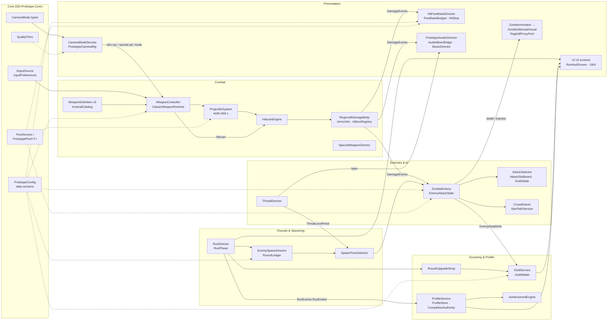

# Deaths Demolition

**A wave-survival zombie shooter in Unity 2022.3 with URP. Players fight 40-body crowds in round-based arenas, with regional armour, a two-layer economy, and top-down, third-person and first-person cameras that can be switched at runtime.**

The game is written in data-driven C#: 620 runtime, editor and test scripts under `Assets/_Prototype` and 113 in the art pipeline under `Assets/_Art`. Around 1,300 automated tests cover it. The project follows strict zero-allocation hot-path rules and uses a multi-agent production pipeline that gates every change through a scripted integration check.

> **Status:** active development, milestone M4 (Integration & Polish). M0–M3 are complete. Features marked *in development* below come from signed design documents or slices that are partly integrated. Everything else is on `main` and backed by code and tests.

---

## Contents

1. [Features](#features)
2. [Tech stack](#tech-stack)
3. [Architecture overview](#architecture-overview)
4. [Quality tiers](#quality-tiers)
5. [Test strategy](#test-strategy)
6. [Build and tooling](#build-and-tooling)
7. [Repository layout](#repository-layout)
8. [How this was built](#how-this-was-built)
9. [Assets and Git LFS](#assets-and-git-lfs)
10. [Further reading](#further-reading)

---

## Features

### On `main` (code + tests)

**Combat and weapons**
- **Weapons:** an assault rifle, an auto SMG and a combat shotgun, defined by **WeaponDefinition v3** ScriptableObjects (`Assets/_Prototype/Core/Weapons/WeaponDefinition.cs`, `ArsenalCatalog.asset`). The definitions hold spread tables per camera mode, plus ammo, projectile and upgrade blocks.
- **Projectiles:** a pooled, struct-based **projectile simulation** (ADR-069-1). It runs up to 256 live projectiles at a fixed 120 Hz step with swept ray and sphere casts, penetration, and zero allocations per frame (`Weapons/Projectiles/ProjectileSystem.cs`).
- **Damage:**
  - **Regional damage and armour.** Bodies have head, upper-body and lower-body regions. Helmet, body and leg plates absorb hits until they break. Exposed regions take head 2× / upper 1× / lower 0.8× damage. Explosions deal falloff damage split across regions (`Damage/RegionalDamageBody.cs`, `Damage/ArmorSet.cs`).
  - **Upgrade branches:** piercing, ricochet, explosion and chain.
- **Special weapons:** three map pickups, each with its own lifecycle: Kagura Bell, Ofuda Loom and Tide Jewel (`Weapons/SpecialWeaponDirector.cs`).

**Enemies and AI**
- **Four tiers:** Standard, Special (Runner), Elite (Guard) and Ultra (Executioner). One data-driven `ZombieEnemy` covers all four: tier is data, not a subclass.
- **Crowd movement:** NavMesh paths plus a custom mass-weighted separation solver on a spatial hash (`Navigation/CrowdSolver.cs`).
- **Attacks (AI v3):** five attack styles (Swipe, Lunge, Sweep, Overhead, Bite-grab). A deterministic selector picks the style, and a crowd slot board caps concurrent wind-ups. At most one grab on the player at a time (`Enemies/AttackStyles.cs`).
- **Threat director:** read-only. It scores proximity, encirclement, tier presence and player danger, and drives music layers and spawn-point weighting (`Enemies/ThreatDirector.cs`).

**Rounds and spawning**
- **Round flow:** a round ledger, a pool/target/ceiling plan per round, and a refill clock (`Spawn/EnemySpawnDirector.cs`, `Rounds/RunDirector.cs`).
- **Spawn points:** twelve authored points, chosen by weighted selection on path distance, recency, density and visibility, with staged rule relaxation when no point qualifies.

**Economy and progression**
- **Gold:** kill rewards (tier base + spawn-armour bonus) drop as pooled gold orbs pulled in by a proximity magnet. An in-run gold wallet uses idempotent transaction ids.
- **Round-end shop:** three priced cards, one paid reroll, and branch unlocks tied to profile level.
- **Persistent profile:**
  - Crash-safe saves: fsync, read-back verification, atomic `File.Replace`, a verified backup, quarantine for corrupt files, and a fail-closed OS lock lease.
  - Exactly-once run commits through a lineage and a monotonic completion ordinal (`Profile/ProfileStore.cs`, `Profile/CompletionAuthority.cs`).
  - Save schema v4 with lossless migrations from v1 to v3.
- **Achievements and cosmetics:** 27 achievements and 9 unlockables (titles, badges, HUD indicators), granted exactly once inside the profile commit.

**Camera**
- **Three modes:** top-down, third-person over the shoulder (with a shoulder swap) and first-person (with a viewmodel overlay camera). They switch at runtime with eased transitions, a transition lock during the death sequence, and occluder-fade policies per mode (`Camera/CameraModeService.cs`).

**Animation**
- **Contracts:** a validated animation-event contract (v3, 76 named events with int payloads) and a generated Animator parameter contract.
- **Ragdoll deaths:** a **ragdoll proxy pool** gives physics deaths without a Rigidbody on every zombie (`Characters/RagdollProxyPool.cs`).
- **Other systems:** foot IK, look-at, verlet secondary chains and animator LOD.

**VFX and game feel**
- **Feedback budgets:** 11 feedback categories, each capped by a pool ceiling, a per-frame cap and a proximity merge (`Feedback/FeedbackBudget.cs`).
- **Hit-stop:** a local time envelope that never touches `Time.timeScale`.
- **Clamped effects:** capped screen shake, a damage vignette and a player death beat.
- **Blood:** GPU-instanced droplets and decal merging.

**Audio**
- **Mixer:** an AudioMixer with Music, Ambience, SFX-World, SFX-Player and UI groups, four snapshots (Run, RoundBreak, Pause, Menu) and a master limiter.
- **Voice pools:** retrigger, instance and priority gates.
- **Music and ambience:** layered music driven by the threat level, and region-based ambience.
- **Clips:** a deterministic synthesis fallback (`Audio/Synthesis/SynthOps.cs`) behind a catalog of produced clips.

**UI**
- **Construction:** UGUI + TextMesh Pro, built entirely in code from a token-based kit (buttons, cards, sliders, steppers, modals and more).
- **Screens:** main menu, selection, HUD, upgrade shop, pause and results. A navigation model defines which layers may stack.
- **Accessibility:** UI scale, text scale, an alternate (colour-blind-safe) palette, reduced motion and reduced flashes.
- **Input:** input remapping and gamepad glyphs.

**Diagnostics**
- **QA bot:** a seeded QA bot drives the real menu → run flow through a virtual gamepad (`Diagnostics/Qa/QaRunBot.cs`).
- **Logs:** local run telemetry (no identity data) and a masked local crash log. Nothing is uploaded.

### In development (M4-R1 revision round)

These come from the signed direction documents in `planning/work-packages/`. Items marked **B1 on main** already have their first code slice integrated.

| Package | Scope | State |
|---|---|---|
| WP-068 UI v3 | "Seal and brush" ink HUD, typography and colour v3, one motion engine | Many slices on main; ongoing |
| WP-069 Arsenal v3 | 10 classic weapons + 2 new Specials (chain lightning, slick gel), per-class projectile profiles | **B1 on main** (definition contract, projectile core, 3 migrated weapons) |
| WP-070 Camera modes | Top-down / third-person / first-person | B1–B4, B6, B7 on main |
| WP-071 Animation v3 | Four zombie death families, powered ragdoll, AP-022 clip set | **B1 on main** (event contract v3, ragdoll proxy pool) |
| WP-072 Audio v3 | 5-layer weapon sound model, class loudness targets, space and perspective | Direction only |
| WP-073 VFX & Feel v3 | Per-class muzzle, tracer, casing and impact profiles; Special VFX | Direction only |
| WP-074 World v5 | New level plan against the target style | Direction only |
| WP-075 Atmosphere & Look v3 | Quality tiers v2 | **C1 on main** (`QualityTiers` API, three URP assets) |
| WP-076 AI v3 | Five attack styles, a `DeathImpulse` struct, Special interactions | **B1 on main** (selector, slot board, grab) |
| WP-077 Progression tree v2 | In-run 25-node gold tree + meta path tree (DEC-095) | Direction only |
| WP-078 M4-R1 acceptance | QA bot in all three camera modes, per-tier perf protocol | Plan only |

---

## Tech stack

| | |
|---|---|
| Engine | Unity **2022.3.22f1** (LTS), pinned |
| Rendering | Universal Render Pipeline **14.0.10**, three quality tiers on separate URP assets |
| Input | Input System 1.7.0 (`Input/Resources/DD_Controls.inputactions`), keyboard/mouse + gamepad, runtime rebinding |
| Navigation | AI Navigation 1.1.5 (NavMesh) + a custom crowd layer |
| Other packages | Cinemachine 2.9.5, ProBuilder 5.2.2, TextMesh Pro 3.0.6, Test Framework 1.1.33 |
| Language | C# (about 229k lines across `_Prototype` and `_Art`, tests included) |
| Tooling | Bash + Python 3 (build, test, QA and integration scripts in `tools/`) |
| Platforms built | macOS (Metal); Windows x64 Mono player via `tools/build.sh --target win64` |
| Network | None. The game runs fully offline. |

---

## Architecture overview

Scenes: `Boot → MainMenu → Selection → Run → Results → MainMenu`. `Boot` is the only valid entry scene. It loads `PrototypeConfig`, which is the single data layer for every tunable, and brings up the persistent services (`Core/Boot/PrototypeBootstrapper.cs`).



Principles that run through the code (details in [`docs/ARCHITECTURE.md`](docs/ARCHITECTURE.md)):

- **Data before code.** Every tunable lives in `PrototypeConfig` sections or ScriptableObjects. Unapproved placeholder values carry a `[PrototypeOnly(...)]` attribute that names the open decision, and the attribute shows in the Inspector and in the F1 debug panel.
- **Event buses carry struct payloads** (`DamageEvents`, `RunEvents`, `ProjectileEvents`). Consumers such as VFX, audio, UI and economy subscribe; the producers do not know them.
- **Zero allocations on hot paths.** Shots, projectiles, damage events and armour absorption all run on pre-allocated buffers. Static state resets on `SubsystemRegistration`, so the project also works with domain reload turned off.
- **One owner per concern.** Examples: one tier authority (`TierSelectionPolicy`), one corpse-lifetime owner, one writer of global render settings.

---

## Quality tiers

Quality tiers v2 (`Assets/_Prototype/Core/Quality/QualityTiers.cs`, contract in `planning/work-packages/QUALITY-TIERS-V2.md`) define three levels, each on its own URP asset:

| Tier | Purpose | Frame target (1080p, reference Mac) |
|---|---|---|
| **Performance** | High refresh rate / weaker GPUs | mean ≤ 8.0 ms, p99 ≤ 10 ms |
| **High** (default) | Target look | mean ≤ 16.6 ms, p99 ≤ 20 ms in all three camera modes (DEC-092) |
| **Cinematic** | Trailers / strong machines | 45 fps floor; measured and reported, not gated |

Each feature owner reads its own value with `QualityTiers.Pick(p, h, c)` and re-reads it on `QualityTiers.Changed`. Tier values are never hard-coded at call sites. The core API applies tier caps to LOD bias, shadow distance and cascades, and streaming budget, and combines them with the per-camera-mode `CameraModeProfile`. The projectile simulation is deliberately tier-independent because it is a game rule.

---

## Test strategy

The project uses the Unity Test Framework with NUnit. Counts are static counts of the `[Test]`/`[UnityTest]` attributes in the test folders. Parameterised `[TestCase]` rows add more cases.

| Suite | Assembly | Fixtures | Test methods | Extra `[TestCase]` rows |
|---|---|---|---|---|
| Gameplay EditMode | `DD.Prototype.Tests.EditMode` (`Assets/_Prototype/Tests/EditMode`) | 88 | 764 | 173 |
| Audio EditMode | `DD.Prototype.Tests.EditMode.Audio` | 1 | 19 | — |
| Gameplay PlayMode | `DD.Prototype.Tests` (`Assets/_Prototype/Tests/PlayMode`) | 66 | 285 | — |
| Art pipeline EditMode | `DD.Art.Tests.EditMode` (`Assets/_Art/Tests/EditMode`) | 25 | 181 | 38 |
| Art PlayMode | `DD.Art.Tests` (`Assets/_Art/Tests/PlayMode`) | 30 | 81 | — |
| QA EditMode | `DD.Prototype.Qa.Tests.EditMode` | 2 | 11 | — |
| QA PlayMode | `DD.Prototype.Qa.Tests` | 1 | 4 | — |
| **Total** | | **213** | **1,345** | **211** |

What the suites cover:

- **EditMode:** pure logic and contracts. This includes the attack selector, the economy formulas, the save chain under fault injection, schema migration, the WeaponDefinition validation, the animation-event contract, quality-tier picking, and repository integrity: pinned package hashes, the `PlayerPrefs` allow-list, and that the `tools/` scripts are present.
- **PlayMode:** vertical slices run in real scenes: core combat, projectile slices, attack variety (for example "6 Standards for 20 s → 42 swings, peak 4 wind-ups, never three of one style in a row"), second-run reset, and pause-fire. All PlayMode tests run under a `TestProfileIsolation` fixture, so they never write the real player profile.
- **Performance and soak:**
  - `PilotPerfProbe` measures frame-time windows.
  - The QA bot runs a seeded 12-round soak.
  - The spawn-mix simulator runs 1,000 spawns per round to check fairness ceilings.
  - Allocation scans check the hot paths.
- **Runner:** `tools/test.sh {editmode|playmode}` wraps each run in a runner-level watchdog and prints a table of per-test durations.

---

## Build and tooling

All scripts live in `tools/` (full reference: [`tools/README.md`](tools/README.md)).

| Script | Purpose |
|---|---|
| `build.sh {dev\|release}` | Headless player build for macOS or Windows x64 (`--target win64`). It stamps `build-info.json`, writes build and footprint reports, and can chain a smoke run. Release builds default to LZ4HC. |
| `smoke.sh` | Launches the built player: captures the main-menu and direct-to-run frames and scans for exceptions. It backs up, restores and hash-verifies user-data files so a smoke run never alters the real profile. |
| `test.sh` | EditMode and PlayMode runs with a watchdog, NUnit XML and duration tables (`test-durations.py`). |
| `build-report.sh` | Parses Unity's build report: size by category and by folder, top assets, and a check against the size cap. |
| `integrate.sh` | **The integration gate.** Dry run by default: single parent, clean source, allowed paths only, secret scan on added lines, DEC/REQ numbering consistency, a free tag name, and an LFS object count. `--apply` does a fast-forward merge or a verified cherry-pick, creates an annotated tag, and runs `post-integrate.sh`. |
| `post-integrate.sh` | After a merge: backup, cleanup dry run, disk report, LFS check. |
| `backup-repo.sh` / `cleanup-merged.sh` / `disk-report.sh` | `git bundle` + LFS backups, reclaiming space from merged worktrees, and a workspace disk breakdown. |
| `slot.sh` / `dd-env.sh` | A FIFO machine-slot lock (at most 2 Unity batch editors, 1 Blender and 1 player smoke run at a time) shared by parallel agent sessions. |
| `qa/rc.sh`, `qa/regression.sh` | Release-candidate gate: full test suites, release build and smoke, the dev-player regression, bot soak, readability and window-mode checks, and a crash-report scan. Results are aggregated into `qa-report.json` (`dd-qa-report-v1`). |

The game also reads command-line flags for automation. Examples: `-ddDirectToRun`, `-ddCameraMode topdown|tp|fp`, `-ddQaBot <dir>`, `-ddProfilePath <file>` for a sandboxed profile, and `-ddTelemetry 0`.

---

## Repository layout

```
.
├── prototype/DeathsDemolition_PlayableConcept/   Unity project (the game)
│   ├── Assets/_Prototype/        gameplay code, scenes, config, tests (DD.Prototype.*)
│   │   ├── Core/                 boot, config, pooling, input abstraction, camera/quality contracts, weapon data
│   │   ├── Weapons/ Damage/      firing, projectiles, hitscan, regional damage, Specials
│   │   ├── Enemies/ Navigation/  zombie runtime, attacks, threat director, crowd + NavMesh
│   │   ├── Spawn/ Rounds/        spawn planning/points, run director, upgrade shop
│   │   ├── Economy/ Profile/ Achievements/
│   │   ├── Camera/ Player/ Characters/   camera modes, player, animation/ragdoll
│   │   ├── Feedback/ Audio/ UI/ Rendering/ World/ Props/
│   │   ├── Diagnostics/          probes, QA bot, telemetry, crash log
│   │   └── Tests/                EditMode + PlayMode suites
│   ├── Assets/_Art/              art pipeline (DD.Art): import contracts, builders, visual regression, tests
│   ├── Packages/ ProjectSettings/
│   ├── README.md                 detailed run/controls/debug-panel guide
│   └── PROTOTYPE-ONLY.md         census of placeholder values awaiting decisions
├── planning/                     project plan, requirements, flows/architecture, roadmap, work packages, reviews
├── tools/                        build / test / QA / integration scripts
├── docs/                         ARCHITECTURE.md, SYSTEMS-INDEX.md
└── game/                         reserved (empty)
```

To run the game, open `prototype/DeathsDemolition_PlayableConcept` with Unity 2022.3.22f1, open `Assets/_Prototype/Scenes/Boot.unity` and press Play. See the [project README](prototype/DeathsDemolition_PlayableConcept/README.md) for controls and the F1 debug panel.

---

## How this was built

The game is produced by a coordinated set of AI agent sessions under a human owner. The owner makes every product decision. The process is documented in `planning/` (mostly in Turkish):

- **Topic sessions S-01 … S-10.** Each owns one domain (`planning/04-IMPLEMENTATION-PLAN.md`):
  - S-01 Technical foundation & integration
  - S-02 Core gameplay & combat
  - S-03 Enemies, AI, rounds & spawning
  - S-04 Economy, progression & save
  - S-05 World, environment & lighting (also owns the quality-tier contract)
  - S-06 Animation
  - S-07 VFX & game feel
  - S-08 Audio
  - S-09 UI/UX & accessibility
  - S-10 QA, performance & final integration
- **Asset-production sessions P-05 … P-07.** These produce environment/VFX, character/animation and weapon assets in asset packages (AP-NNN) outside the Unity project. A work package then imports them through the `_Art` pipeline contracts.
- **Coordinator C-00.** Writes package prompts, relays the owner's decisions, assigns decision numbers and runs integration.
- **Work-package flow:**
  1. The package prompt is recorded verbatim as `planning/work-packages/WP-NNN-*.md`.
  2. **Phase A:** a council of specialist agents writes a signed `*-DIRECTION.md`.
  3. **Phase B:** the owning session builds small atomic slices (B1…Bn) on its own branch and worktree, with one writer per package.
  4. C-00 runs **`tools/integrate.sh`** as the gate, which fast-forwards or does a verified cherry-pick.
  5. An annotated `wp-*` tag is created and `post-integrate.sh` backs up the repository.
- **Traceability:**
  - **DEC-NNN:** owner-approved decisions (`planning/00-PROJECT-PLAN.md`).
  - **REQ-NNN:** requirements (`planning/01-REQUIREMENTS.md`).
  - **ADR-<WP>-<n>:** technical decisions scoped to a package (for example ADR-069-1, the projectile system).

  Code comments cite these ids, so any rule can be traced back to its decision.
- **Milestones** (`planning/03-ROADMAP.md`):
  - M0 production baseline
  - M1 playable vertical slice
  - M2 complete systems
  - M3 production quality
  - M4 integration & polish (current)
- **Reviews.** Independent correctness reviews are stored in `planning/reviews/` (for example `CLOUD-REVIEW-R1-A.md`). They record findings only and change no code.

---

## Assets and Git LFS

Binary assets (FBX/GLB/Blend models, textures, audio, fonts, lighting data) are tracked with **Git LFS** (see `.gitattributes`). A plain clone without LFS contains pointer files only, so the project will not look complete. Not all production assets are published: the raw asset-production source tree (source files, renders, intermediate exports) is kept outside the repository, and only the imported, game-ready files are referenced by the project. The code, tests, tools and planning documents are complete without the binaries.

---

## Further reading

- [`docs/ARCHITECTURE.md`](docs/ARCHITECTURE.md): module boundaries, data contracts, event flows, performance rules, save durability
- [`docs/SYSTEMS-INDEX.md`](docs/SYSTEMS-INDEX.md): every major system with folder, main types, owning package and status
- [`prototype/DeathsDemolition_PlayableConcept/README.md`](prototype/DeathsDemolition_PlayableConcept/README.md): running the game, controls, debug panel
- [`tools/README.md`](tools/README.md): full tooling reference
