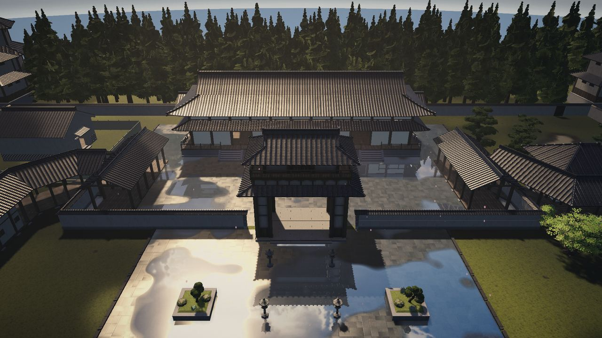
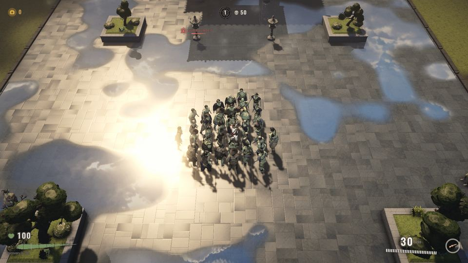
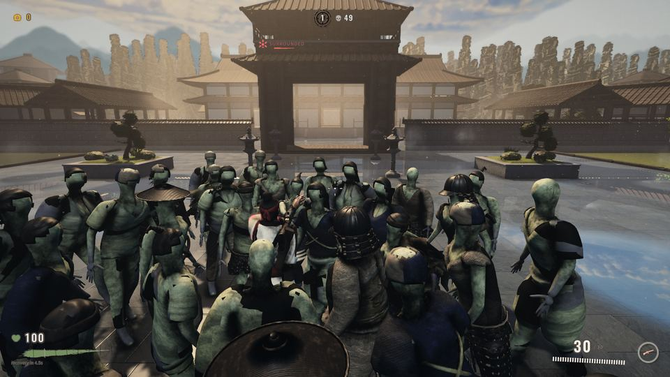
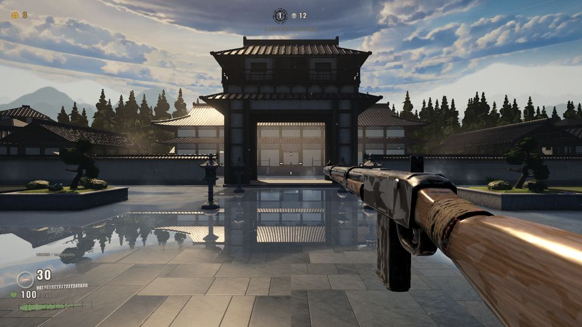
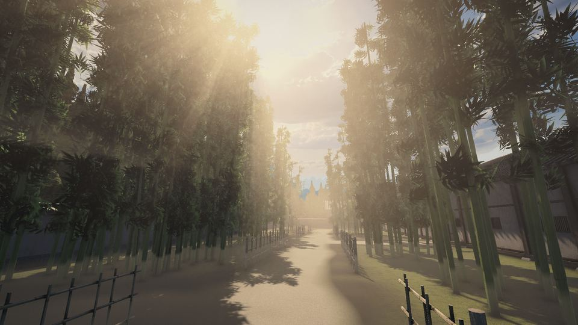
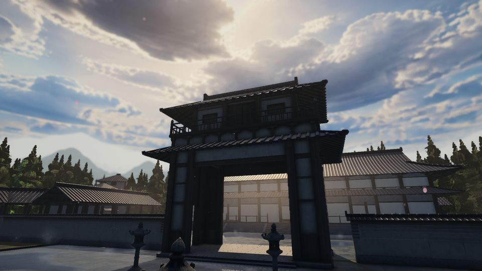
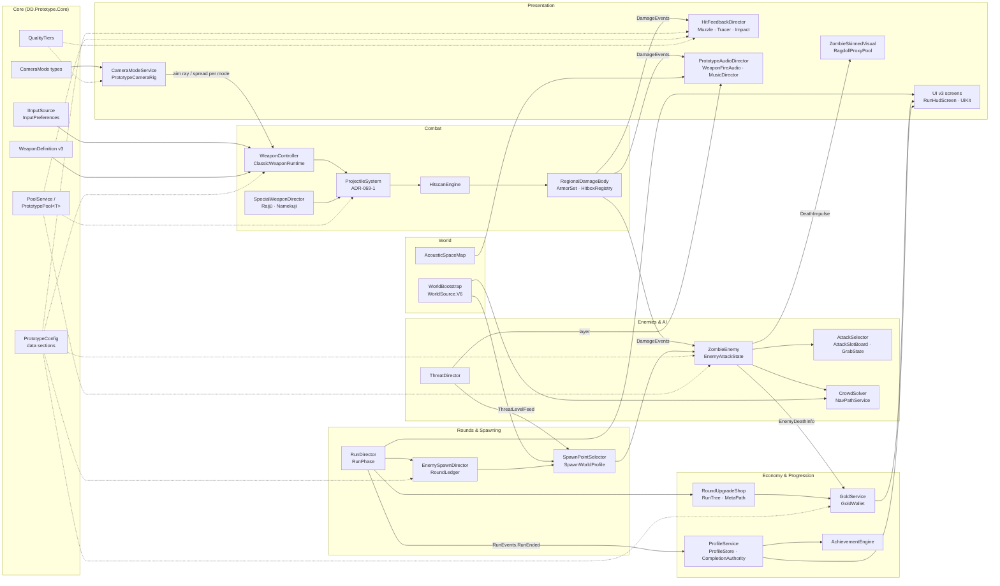

# Deaths Demolition

**A wave-survival zombie shooter in Unity 2022.3 with URP. You hold an old Japanese palace compound against 40-body crowds, with ten classic weapons, two chain-reaction Specials, regional armour, a two-layer progression tree, and top-down, third-person and first-person cameras that switch at runtime.**



The game is written in data-driven C#: 749 scripts under `Assets/_Prototype` and 138 in the art pipeline under `Assets/_Art` (about 281k lines, tests included). 1,719 automated tests in seven assemblies cover it. Hot paths follow strict zero-allocation rules. The project is built by a multi-agent production pipeline in which every change passes a scripted integration gate, a compile gate and a continuous `main` CI run, and no Player run may alter the real player's data.

> **Status:** active development, milestone M4 (Integration & Polish), revision round M4-R1. M0–M3 are complete. Everything described below is on `main` and backed by code and tests unless it is marked *in progress*.

| Top-down | Third-person | First-person |
|---|---|---|
|  |  |  |

---

## Contents

1. [Features](#features)
2. [The V6 world and the look](#the-v6-world-and-the-look)
3. [Tech stack](#tech-stack)
4. [Architecture overview](#architecture-overview)
5. [Quality tiers](#quality-tiers)
6. [Test strategy](#test-strategy)
7. [Build, CI and machine safety](#build-ci-and-machine-safety)
8. [Repository layout](#repository-layout)
9. [How this was built](#how-this-was-built)
10. [Assets and Git LFS](#assets-and-git-lfs)
11. [Further reading](#further-reading)

---

## Features

**Arsenal v3 (WP-069, DEC-094/097/099)**
- **Ten classic weapons in six classes**, each a `WeaponDefinition` v3 ScriptableObject in `ArsenalCatalog.asset`: assault rifles `ar_1` Hinawa and `ar_2` Sanren (3-round burst), SMGs `smg_1` Shippū and `smg_2` Tetsui, shotguns `sg_1` Rappa and `sg_2` Nitō, LMGs `lmg_1` Mukade and `lmg_2` Kurogane, the sniper `sr_1` Tomi and the launcher `rl_1` Bōhiya (rocket, blast, dud and cluster rules).
- **Two Specials (DEC-094)** replace the three M3 pickups: **Raijū** (`sw_arc`), a chain-lightning orb that jumps between bodies, and **Namekuji** (`sw_gel`), a slick gel that leaves puddles zombies slide and fall in. Names and models are original.
- **One projectile simulation for everything** (ADR-069-1): `ProjectileKind { Bullet, Pellet, Rocket, Orb, Gel }`, up to 256 live projectiles at a fixed 120 Hz step with swept ray/sphere casts, penetration, and zero allocations per frame (`Weapons/Projectiles/ProjectileSystem.cs`).
- **Per-mode accuracy and per-weapon first-person pose:** each definition carries hip/ADS spread for each camera mode and its own `fpView` pose (`Weapons/FpViewPoseDriver.cs`).
- **Regional damage and armour:** head / upper / lower regions with helmet, body and leg plates that break; explosions split falloff damage across regions (`Damage/RegionalDamageBody.cs`, `Damage/ArmorSet.cs`).

**Enemies and AI v3 (WP-076, DEC-096)**
- **Four tiers** (Standard, Special/Runner, Elite/Guard, Ultra/Executioner) on one data-driven `ZombieEnemy`: tier is data, not a subclass.
- **Five attack styles** (Swipe, Lunge, Sweep, Overhead, Bite-grab) from a deterministic selector; a crowd slot board caps concurrent wind-ups; at most one grab on the player, broken by one strong hit (`Enemies/AttackStyles.cs`).
- **Special reactions:** electrocution under Raijū (`Enemies/ZombieShock.cs`); slide, fall, downed and get-up on gel (`Enemies/ZombieGel.cs`, `GelPuddleRegistry.cs`).
- **Death hand-off:** gameplay emits a `DeathImpulse` struct (direction, force, source, weapon class); animation picks the death family and a pooled ragdoll proxy. One owner controls corpse lifetime.
- **Crowd movement:** NavMesh paths plus a mass-weighted separation solver on a spatial hash (`Navigation/CrowdSolver.cs`), and a rear-awareness level for bodies behind the player (`Enemies/ZombieRear.cs`).
- **Threat director:** scores proximity, encirclement, tier presence and player danger; drives music layers and spawn weighting (`Enemies/ThreatDirector.cs`).

**Rounds and spawning**
- **Round flow:** a round ledger, a pool / target / ceiling plan per round (ceiling 40), and a refill clock (`Spawn/EnemySpawnDirector.cs`, `Rounds/RunDirector.cs`).
- **World-aware spawning:** 22 authored gates in V6 (12 outer, 10 inner), weighted by path distance, recency, density, visibility, room balance and a cap on spawns behind the camera, with staged relaxation when no gate qualifies (`Spawn/SpawnWorldProfile.cs`, `SpawnRoomBalance.cs`, `RearSpawnShare.cs`).

**Progression tree v2 (WP-077, DEC-095/098)**
- **In-run gold tree:** the round-end shop offers cards from a branching tree (`Rounds/RunTree/`, `run-tree.json`): 13 branch keystones, body forks and capstone, purse and hearth, 4 Special links, and a seal / fork / capstone path for each of the ten weapons. A pinned path guarantees its next step.
- **Persistent meta path:** 38 nodes (10 weapon locks, 10 Special leanings, 18 passives) carried between runs (`Profile/MetaPath/`, `meta-tree.json`).
- **Gold:** kill rewards drop as pooled gold orbs pulled in by a magnet; the in-run wallet uses idempotent transaction ids. Gold never reaches the profile.

**Profile and save**
- **Crash-safe saves:** fsync, read-back verification, atomic `File.Replace`, a verified backup, quarantine for corrupt files and a fail-closed OS lock lease.
- **Exactly-once run commits** through a lineage and a monotonic completion ordinal (`Profile/CompletionAuthority.cs`); schema v4 with lossless migrations.
- **Achievements and cosmetics:** 27 achievements and 9 unlockables, granted exactly once inside the profile commit.

**Camera (WP-070)**
- **Three modes:** top-down (default), third-person over the shoulder with a shoulder swap, and first-person with a viewmodel overlay camera. Runtime switching from the pause menu with eased transitions, a transition lock during the death sequence, occluder-fade policies and per-mode feel (`Camera/CameraModeService.cs`, `Camera/CameraModesFeel.cs`).

**Animation (WP-071)**
- **Contracts:** a validated animation-event contract (v3) and a generated Animator parameter contract; third- and first-person clips must put mechanism events on identical frames.
- **AP-022 clip set:** four zombie death families, six attacks, electro and gel reactions; weapon grip IK and twist correction.
- **Ragdoll proxy pool:** physics deaths without a Rigidbody on every zombie (`Characters/RagdollProxyPool.cs`).
- *In progress:* first-person arms (`Characters/FirstPersonArms.cs`, 29 clips) are built but ship disabled until the hand-orientation pass lands.

**VFX and game feel (WP-073)**
- **Weapon fire backbone:** per-class muzzle, tracer ribbons, casings and impacts (`Feedback/Vfx/MuzzleSystem`, `TracerRibbonRenderer`, `ImpactSystem`), plus arc, gel and ground-fire systems for the Specials and the launcher.
- **Budgets:** every feedback category is capped by a pool ceiling, a per-frame cap and a proximity merge (`Feedback/FeedbackBudget.cs`).
- **Feel:** a local hit-stop that never touches `Time.timeScale`, clamped shake per camera mode, damage vignette, a death beat and GPU-instanced blood.

**Audio (WP-072)**
- **Weapon fire v3:** each of the ten classics is a five-layer pre-mix with variations; automatic weapons use a per-shot transient over an RPM-locked body loop; wet tails exist per class for open, corridor and hall spaces. Foley, impacts and dedicated Raijū / Namekuji and rocket-cluster sets complete it.
- **Acoustic spaces:** a baked map of the V6 world tells the fire model whether the listener is in the open, a corridor or a hall (`Audio/Runtime/AcousticSpaceMap.cs`), with 1 m hysteresis.
- **Mix:** Music, Ambience, SFX-World, SFX-Player and UI groups, four snapshots and a master limiter; threat-driven music layers and an after-rain ambience bed.

**UI v3 (WP-068)**
- **"Seal and brush" ink HUD** that covers about 1 % of the screen, a reticle driven by the weapon's current spread, rear-threat edges, and an optional 16:9 HUD frame.
- **Screens built in code** from a token-based kit: main menu, selection, run HUD, the upgrade tree, pause (with the camera selector), and Results v3.
- **Accessibility:** UI and text scale, a colour-blind-safe palette, reduced motion and reduced flashes; input remapping and gamepad glyphs. The UI reads devices only through the `InputSourceRegistry` abstraction.

**Diagnostics**
- **QA bot:** a seeded bot drives the real menu → run flow through a virtual gamepad in all three camera modes (`Diagnostics/Qa/QaRunBot.cs`).
- **Local only:** run telemetry without identity data and a masked crash log. Nothing is uploaded.

---

## The V6 world and the look

| | |
|---|---|
|  |  |

**World V6** (WP-074, `WorldSource.V6`, scene `World_V6_Greybox`) is the default world in every build, including release players started without flags.
- **Layout:** a ±55 m walled compound. A ring *tsuiji* wall with side doors at the corner spawn gates, the *chūmon* middle gate, the palace hall, *kairō* roofed corridors with angled corners, a pavilion, storehouse, tea house and arbour (rooms R1–R6), ponds with a bridge and causeway, and a west bamboo grove with canopy gaps along the lanes.
- **Vista:** a 58–84 m band of 1,143 trees (layered-cone sugi, black pine, sakura, momiji) and a keep, then horizon plates at 260 / 330 / 420 m.
- **Built by code:** `GreyboxV6Builder` (layout, NavMesh v5 with 2,734 triangles, spawn gates, regions, acoustic spaces) and `WorldV5Dress` (the AP-023 architecture and planting kit), then a lighting bake. The whole world can be rebuilt headlessly.

**Look (WP-075, DEC-100/101/102)**
- **DEC-101 tone:** cool blue-grey shadows, low saturation, dark wet ground; warmth only where the sun lands.
- **DEC-102 light:** a broken-cloud sky, a high warm sun in the north-north-west for back-lit framing, after-rain wet surfaces with planar reflection, and real volumetric sun shafts (URP 14 raymarch through the shadow map and a cloud cookie) that fall through trees, bamboo, eaves and gates. Full on Cinematic, reduced on High, off on Performance.
- **DEC-100:** Cinematic is the default quality tier (see [Quality tiers](#quality-tiers)).

---

## Tech stack

| | |
|---|---|
| Engine | Unity **2022.3.22f1** (LTS), pinned |
| Rendering | Universal Render Pipeline **14.0.10**, three quality tiers on separate URP assets, custom volumetric light, screen atmosphere and planar reflection features |
| Input | Input System 1.7.0, keyboard/mouse + gamepad, runtime rebinding |
| Navigation | AI Navigation 1.1.5 (NavMesh) + a custom crowd layer |
| Other packages | Cinemachine 2.9.5, ProBuilder 5.2.2, TextMesh Pro 3.0.6, Test Framework 1.1.33 |
| Language | C#, about 281k lines across `_Prototype` and `_Art`, tests included |
| Tooling | zsh/Bash + Python 3 (build, test, CI, QA and integration scripts in `tools/`); Blender for the asset pipeline |
| Platforms built | macOS (Metal); Windows x64 Mono player via `tools/build.sh --target win64` |
| Network | None. The game runs fully offline. |

---

## Architecture overview

Scenes: `Boot → MainMenu → Selection → Run (+ World_V6_Greybox) → Results → MainMenu`. `Boot` is the only valid entry scene. It loads `PrototypeConfig`, the single data layer for every tunable, and brings up the persistent services (`Core/Boot/PrototypeBootstrapper.cs`).



Principles that run through the code (details in [`docs/ARCHITECTURE.md`](docs/ARCHITECTURE.md)):

- **Data before code.** Every tunable lives in `PrototypeConfig` sections, ScriptableObjects or JSON catalogs. Unapproved placeholder values carry `[PrototypeOnly(...)]`, which names the open decision and shows in the Inspector and the F1 debug panel.
- **Event buses carry struct payloads** (`DamageEvents`, `RunEvents`, `ProjectileEvents`). Consumers such as VFX, audio, UI and economy subscribe; producers do not know them.
- **Zero allocations on hot paths.** Shots, projectiles, damage events and armour absorption run on pre-allocated buffers. Static state resets on `SubsystemRegistration`, so the project also works with domain reload off.
- **One owner per concern.** One tier authority, one corpse-lifetime owner, one writer of global render settings, one writer of user data.

---

## Quality tiers

Quality tiers v2 (`Core/Quality/QualityTiers.cs`, contract `planning/work-packages/QUALITY-TIERS-V2.md`) put each level on its own URP asset:

| Tier | Purpose | Frame target (1080p, reference Mac) |
|---|---|---|
| **Cinematic** (default, DEC-100) | Best look: full volumetric shafts, planar reflection | 30 fps: mean ≤ 33.3 ms, p99 ≤ 40 ms |
| **High** | 60 fps with reduced shafts (DEC-092) | mean ≤ 16.6 ms, p99 ≤ 20 ms |
| **Performance** | High refresh rate / weaker GPUs, shafts off | mean ≤ 8.0 ms, p99 ≤ 10 ms |

Each feature owner reads its own value with `QualityTiers.Pick(p, h, c)` and re-reads it on `QualityTiers.Changed`; tier values are never hard-coded at call sites. The projectile simulation is deliberately tier-independent because it is a game rule.

---

## Test strategy

Unity Test Framework with NUnit. Counts are static counts on `main` of methods carrying `[Test]`, `[UnityTest]` or `[TestCase]`.

| Suite | Assembly | Files with tests | Test methods | Extra `[TestCase]` rows |
|---|---|---|---|---|
| Gameplay EditMode | `DD.Prototype.Tests.EditMode` | 121 | 1,015 | 181 |
| Audio EditMode | `DD.Prototype.Tests.EditMode.Audio` | 1 | 24 | — |
| Gameplay PlayMode | `DD.Prototype.Tests` | 85 | 365 | — |
| Art pipeline EditMode | `DD.Art.Tests.EditMode` | 27 | 202 | 38 |
| Art PlayMode | `DD.Art.Tests` | 32 | 98 | — |
| QA EditMode | `DD.Prototype.Qa.Tests.EditMode` | 2 | 11 | — |
| QA PlayMode | `DD.Prototype.Qa.Tests` | 1 | 4 | — |
| **Total** | 7 assemblies | **269** | **1,719** | **219** |

- **EditMode:** pure logic and contracts: the attack selector, economy and tree rules, the save chain under fault injection, schema migration, weapon-definition validation, the animation-event contract, quality-tier picking, world-profile resolution, and repository integrity (pinned package hashes, the `PlayerPrefs` allow-list, required `tools/` scripts, LFS and art-gate policies).
- **PlayMode:** vertical slices in real scenes: combat, projectiles and Specials, attack variety, second-run reset, V6 world walks and captures, audio routing. All PlayMode tests run under `TestProfileIsolation`, so they never write the real profile.
- **Allocation tests** use Unity's `Is.Not.AllocatingGCMemory()` constraint with a positive control, because Mono's per-thread byte counter always reads 0.
- **Performance and soak:** `PilotPerfProbe` frame windows on a quiet machine, a seeded 12-round bot soak, and a spawn-mix simulator.

---

## Build, CI and machine safety

Several agent sessions share one Mac, one Unity licence and one real player profile. The tooling in `tools/` (full reference: [`tools/README.md`](tools/README.md)) exists so that they can work in parallel without breaking `main`, each other, or the player's data.

| Script | Purpose |
|---|---|
| `build.sh {dev\|release}` | Headless player build for macOS or Windows x64. Stamps `build-info.json`, writes build and footprint reports against the 5 GB cap (DEC-093), and can chain a smoke run. Release builds use LZ4HC. |
| `smoke.sh` | Launches the built player without flags: main-menu and run frames, an exception scan, and a check that the default world loaded. |
| `main-ci.sh <sha>` | **Continuous verification of `main`.** A detached CI worktree compiles and runs the full EditMode suite plus the PlayMode core suites, then maps every red test to its owner session and marks the ones that are new since the previous run. |
| `compile-check.sh` | A fast "does it compile" gate after a multi-session batch: counts `error CS` lines and treats success as Unity exit 0 **and** a compile trace in the log, so an aborted Unity is never reported green. |
| `integrate.sh` | **The integration gate.** Dry run by default: single parent, clean source, allowed paths only, secret scan on added lines, DEC/REQ numbering, tag name and LFS object count. `--apply` fast-forwards or does a verified cherry-pick, tags, and runs `post-integrate.sh` (backup, cleanup dry run, disk report). |
| `userdata-guard.sh snapshot\|restore` | **User data is sacred.** Snapshots the player's profile, settings and telemetry before any Player or PlayMode run and restores exactly that snapshot afterwards, removing anything the run added. A player-scope window refuses to start while a Player is alive and refuses to restore display settings that deviate from known-good values. |
| `player-run.sh` | Every Player launch (captures, bots, perf probes) goes through one machine-wide `player` slot, so two Players never share the audio device and window focus, and none runs during CI. |
| `slot.sh` | A FIFO machine-slot lock shared by all sessions: 2 Unity batch editors (3 when the machine is idle), 1 heavy Blender job, 1 smoke run and 1 Player, with stale-lock detection by process start time. |
| `test.sh` | EditMode/PlayMode runs under a log-stall watchdog, with NUnit XML and duration tables. |
| `qa/rc.sh`, `qa/regression.sh` | Release-candidate gate: suites, release build and smoke, bot soak, readability and window-mode checks, crash-report scan → `qa-report.json`. |

The game reads command-line flags for automation, for example `-ddDirectToRun`, `-ddCameraMode topdown|tp|fp`, `-ddWorldSource V6|AP005|Procedural`, `-ddQaBot <dir>`, `-ddProfilePath <file>` and `-ddTelemetry 0`. Evidence for shipping, however, is always taken on the flagless path the player uses.

---

## Repository layout

```
.
├── prototype/DeathsDemolition_PlayableConcept/   Unity project (the game)
│   ├── Assets/_Prototype/        gameplay code, scenes, config, tests (DD.Prototype.*)
│   │   ├── Core/                 boot, config, pooling, input, camera/quality contracts, weapon data
│   │   ├── Weapons/ Damage/      firing, projectiles, Specials, regional damage, death impulse
│   │   ├── Enemies/ Navigation/  zombie runtime, attacks, reactions, threat director, crowd + NavMesh
│   │   ├── Spawn/ Rounds/        spawn planning and world profiles, run director, shop, run tree
│   │   ├── Economy/ Profile/ Achievements/   gold, save, meta path, unlocks
│   │   ├── Camera/ Player/ Characters/       camera modes, player, animation/ragdoll
│   │   ├── Feedback/ Audio/ UI/ Rendering/ World/ Props/
│   │   ├── Diagnostics/          probes, QA bot, telemetry, crash log
│   │   └── Tests/                EditMode + PlayMode suites
│   ├── Assets/_Art/              art pipeline (DD.Art): import contracts, world V6 builders, look, tests
│   ├── Packages/ ProjectSettings/
│   ├── README.md                 run / controls / debug-panel guide
│   └── PROTOTYPE-ONLY.md         census of placeholder values awaiting decisions
├── planning/                     project plan (DEC table), requirements, roadmap, work packages, reviews
├── tools/                        build / test / CI / QA / integration / safety scripts
├── docs/                         ARCHITECTURE.md, SYSTEMS-INDEX.md, images/
└── game/                         reserved (empty)
```

To run the game, open `prototype/DeathsDemolition_PlayableConcept` with Unity 2022.3.22f1, open `Assets/_Prototype/Scenes/Boot.unity` and press Play. See the [project README](prototype/DeathsDemolition_PlayableConcept/README.md) for controls and the F1 debug panel.

---

## How this was built

The game is produced by a coordinated set of AI agent sessions under a human owner, who makes every product decision. The process is documented in `planning/` (mostly in Turkish):

- **Topic sessions S-01 … S-10**, each owning one domain (`planning/04-IMPLEMENTATION-PLAN.md`): S-01 technical foundation & integration, S-02 combat, S-03 enemies/AI/spawning, S-04 economy/progression/save, S-05 world & lighting, S-06 animation, S-07 VFX & feel, S-08 audio, S-09 UI/UX, S-10 QA & final integration.
- **Asset-production sessions P-05 … P-07** produce environment, character/animation and weapon assets as asset packages (AP-NNN), imported through the `_Art` pipeline contracts.
- **Coordinator C-00** writes package prompts, relays the owner's decisions, assigns decision numbers, integrates, and is the single source of decisions for the other sessions.
- **Work-package flow:** the prompt is recorded as `planning/work-packages/WP-NNN-*.md` → a council of specialist agents writes a signed `*-DIRECTION.md` → the owning session builds small slices on its own branch and worktree → C-00 runs `integrate.sh` → `compile-check.sh` after a batch → `main-ci.sh` → a release build with a flagless smoke run.
- **Rules that keep it safe:** no history rewrites, no force pushes, no amending a reported commit; one writer per package; changed suites must be green before "ready"; every Player run inside the user-data guard; no session stops another session's processes.
- **Traceability:** DEC-NNN (owner decisions, `planning/00-PROJECT-PLAN.md`), REQ-NNN (requirements) and ADR-<WP>-<n> (technical decisions per package). Code comments cite these ids.
- **Milestones:** M0 baseline, M1 vertical slice, M2 complete systems, M3 production quality, M4 integration & polish (current). M4 runs in revision rounds: the owner plays a release build, lists what is missing, and the list becomes the next round of packages.

---

## Assets and Git LFS

Binary assets (FBX/GLB/Blend models, textures, audio, fonts, lighting data) are tracked with **Git LFS** (see `.gitattributes`). A clone without LFS contains pointer files only. The screenshots in `docs/images/` are small JPGs kept in plain Git so this page renders from any clone. The raw asset-production tree (sources, renders, intermediate exports) is kept outside the repository; only game-ready files are referenced by the project. Code, tests, tools and planning documents are complete without the binaries.

---

## Further reading

- [`docs/ARCHITECTURE.md`](docs/ARCHITECTURE.md): module boundaries, data contracts, event flows, performance rules, save durability, tooling safety
- [`docs/SYSTEMS-INDEX.md`](docs/SYSTEMS-INDEX.md): every major system with folder, main types, owning package and status
- [`prototype/DeathsDemolition_PlayableConcept/README.md`](prototype/DeathsDemolition_PlayableConcept/README.md): running the game, controls, debug panel
- [`tools/README.md`](tools/README.md): full tooling reference
