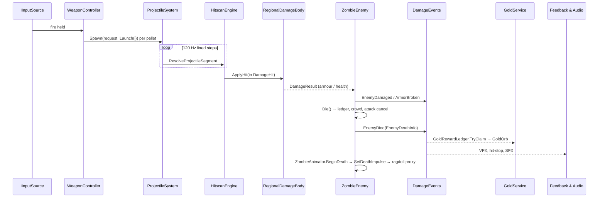

# Deaths Demolition: Architecture

This document describes the runtime architecture of the Unity project in `prototype/DeathsDemolition_PlayableConcept/`. Paths are relative to `Assets/_Prototype/` (shown as `P/`) or `Assets/_Art/` (shown as `A/`) unless written in full. Every claim points to the file it comes from. Items marked *planned* exist only in the design documents under `planning/work-packages/`.

## Contents

1. [Assemblies and module boundaries](#1-assemblies-and-module-boundaries)
2. [Boot, scenes and composition](#2-boot-scenes-and-composition)
3. [Key data contracts](#3-key-data-contracts)
4. [Event flows](#4-event-flows)
5. [Allocation and performance rules](#5-allocation-and-performance-rules)
6. [Save and profile durability](#6-save-and-profile-durability)
7. [Diagnostics and automation hooks](#7-diagnostics-and-automation-hooks)

---

## 1. Assemblies and module boundaries

### 1.1 Assembly definitions

| Assembly | Location | References | Role |
|---|---|---|---|
| `DD.Prototype.Core` | `P/Core/` | Input System only | Contracts and data that everything else depends on: config, pooling, input abstraction, camera and quality types, weapon definitions, boot |
| `DD.Prototype.Runtime` | `P/` (every folder except Core, Tests and editor code) | Core, URP, Input System, TextMesh Pro, AI Navigation, Cinemachine, ProBuilder, UGUI | All gameplay and presentation systems |
| `DD.Art.Runtime` | `A/Runtime/` | Core, Runtime, AI Navigation, URP | Art library manifests, world bootstraps, readability thresholds, visual regression |
| `DD.Art.Pipeline.Editor` | `A/Editor/` | — | Import contracts and builders: animation clip/event contracts, animator, armour, weapon, VFX, lighting and sky builders |
| `DD.Prototype.Qa` (+ `.Editor`, `.Tests*`) | `P/Diagnostics/Qa/` | Core, Runtime, Art.Runtime, Input System | QA bot, readability and window-mode gates |
| Editor assemblies | `P/Core/Editor`, `P/UI/Editor`, `P/Audio/Editor`, `P/Weapons/Editor`, `P/World/Editor`, `P/Rendering/Editor`, `P/Diagnostics/Editor` | — | Scene and asset builders, build entry point (`DdBuild`), simulators |
| Tests | `P/Tests/EditMode`, `P/Tests/EditMode/Audio`, `P/Tests/PlayMode`, `A/Tests/*`, `P/Diagnostics/Qa/Tests/*` | — | See the README test table |

Dependencies point one way: **Core → Runtime → Art.Runtime → Qa**. Core never references Runtime (`P/Core/DD.Prototype.Core.asmdef`). This is why the types that several systems share live in Core even though they are about gameplay:
- `WeaponDefinition` (`P/Core/Weapons/`)
- `CameraMode` (`P/Core/Camera/CameraModeTypes.cs`)
- `QualityTiers` (`P/Core/Quality/`)
- `EnemyTier` and `UpgradeBranch` (`P/Core/Config/PrototypeConfigEnums.cs`)
- `IInputSource` (`P/Core/Input/`)

### 1.2 Namespaces inside `DD.Prototype.Runtime`

Inside the Runtime assembly, each folder has its own namespace and a narrow crossing point:

| Folder | Namespace | Boundary rule |
|---|---|---|
| `Weapons/`, `Weapons/Projectiles/` | `DD.Prototype.Weapons` | Fires through `IWeaponHost` / `IAimSource` (`Weapons/IAimSource.cs`) and applies damage only through `Damage` contracts |
| `Damage/` | `DD.Prototype.Damage` | `DamageContracts.cs` is marked *"CROSS-TASK CONTRACT - DO NOT CHANGE THESE SIGNATURES"* |
| `Enemies/` | `DD.Prototype.Enemies` | Only `ZombieCrowdBinding.cs` touches Navigation (`ICrowdMember`) and only `ZombieSpawnBinding.cs` touches Spawn (`ISpawnedEnemy`) |
| `Navigation/` | `DD.Prototype.Navigation` | Knows nothing of enemies; talks to them only through `ICrowdMember` |
| `Spawn/`, `Rounds/` | `DD.Prototype.Spawn`, `DD.Prototype.Rounds` | Spawn owns the enemy pool and the round ledger. Rounds owns the run phase and the shop |
| `Economy/`, `Profile/`, `Achievements/` | `DD.Prototype.Economy` / `.Profile` / `.Achievements` | Gold lives only inside a run (`Economy/GoldWallet.cs`). The profile never stores gold |
| `Camera/` | `DD.Prototype.CameraSystem` | Mode state is a static service; the rig reads it |
| `Characters/` | `DD.Prototype.Characters` | Enemies drive visuals only through `IZombieAnimationDriver` |
| `Feedback/`, `Feedback/Vfx/` | `DD.Prototype.Feedback(.Vfx)` | Subscribes to events and never changes gameplay state |
| `Audio/` | `DD.Prototype.Audio` | Subscribes to events and sets mixer snapshots |
| `UI/Runtime/**` | `DD.Prototype.UI` | Reads view models and feeds (`Presentation/`) and calls the run director for player actions |
| `Diagnostics/` | `DD.Prototype.Diagnostics(.Telemetry)` | Probes and telemetry, only active with command-line flags |

---

## 2. Boot, scenes and composition

- **Scene order** (`ProjectSettings/EditorBuildSettings.asset`): Boot → MainMenu → Selection → Run → Results. `Boot` is the only valid entry scene.
- **Boot** (`P/Core/Boot/PrototypeBootstrapper.cs`):
  1. Loads `P/Core/Resources/PrototypeConfig.asset`.
  2. Applies vSync, target frame rate and the fixed timestep.
  3. Creates the persistent `PoolService.Root` and the F1 `PrototypeDebugPanel`.
  4. Loads the first scene. `PrototypeBootFlags` decides which one: session override → define → `-ddDirectToRun` → config → PlayerPrefs.
- **Config:** `PrototypeConfig` (`P/Core/Config/`) is the single data layer, split into Economy, Enemy, Feedback, Player, Progression, Round and Weapon sections. Placeholder values that are not yet approved carry `[PrototypeOnly(...)]` (`P/Core/Config/PrototypeOnlyAttribute.cs`). The census of these values is kept in `PROTOTYPE-ONLY.md`.
- **Run scene composition:**
  - `WorldBootstrap` (`P/World/`) builds or loads the world. `WorldSource` is Procedural or AP005; AP005 loads `A/Scenes/World_AP005.unity` additively and falls back to Procedural.
  - `RunSystemsInstaller` (`P/Rounds/`) wires the run systems.
  - `PrototypeUiInstaller` (`P/UI/Runtime/Flow/`) injects the screens.
- **UI is generated in code.** `UiFactory` (`P/UI/Runtime/Kit/UiFactory.cs`) builds the canvases, and `UiSceneBuilder` (`P/UI/Editor/`) generates the meta scenes. No screen is hand-laid in a scene.

---

## 3. Key data contracts

### 3.1 WeaponDefinition v3 (WP-069 B1)

`P/Core/Weapons/WeaponDefinition.cs` is a ScriptableObject created from the menu *Deaths Demolition/Weapon Definition v3*. "v3" is the contract generation named in the doc comment; there is no serialized version field.

- **Identity:** `weaponId` (for example `ar_1`), `id : ClassicWeaponId`, `slot` (Classic/Special), `weaponClass` (AssaultRifle, Smg, Shotgun, Lmg, Sniper, Launcher, Special), display names, `legacyNames[]`, and a silhouette.
- **Blocks:** `fire` (`WeaponFireMode { Single, Burst, Auto }`, rpm, burst and charge fields), `ammo`, `projectile`, `accuracy`, `explosive`, `rocket`, `arcChain`, `gelPuddle`, `specialLifecycle`, `upgrade`, `unlock`, `presentation` (sockets).
- **Accuracy per camera mode:**
  - `WeaponAccuracyBlock` holds a hip/ADS `SpreadPair` for each of top-down, third-person and first-person.
  - `SpreadFor(int cameraMode)` selects the pair. `P/Weapons/ClassicWeaponRuntime.cs` calls it with `CameraModeService.Current`.
- **Catalog and lookup:**
  - `ArsenalCatalog` (`Resources/Arsenal/ArsenalCatalog.asset`) validates the whole list.
  - The static `Arsenal` class does lookups without allocating.
  - `WeaponIdMigration` maps legacy ids.
  - `CreateLegacySettings()` converts a definition to the M3 `ClassicWeaponSettings`, so the older systems keep working.
- **Authoring:** assets are written deterministically by `P/Weapons/Editor/ArsenalAssetBuilder.cs`.
- **Shipped weapons:** `WD_ar_1` (Auto, 510 rpm, 30 rounds), `WD_smg_1` (Auto, 780 rpm, 42 rounds), `WD_sg_1` (8 pellets, 7 shells).
- *Planned (WP-069 B2+):* seven more classic weapons and the two new Specials. The `explosive`, `rocket`, `arcChain` and `gelPuddle` blocks exist in the schema, but no runtime code reads them yet.

### 3.2 ProjectileSystem (ADR-069-1)

`P/Weapons/Projectiles/ProjectileSystem.cs` is a static simulation with no GameObject per projectile.

- **Storage:** `ProjectileState` structs in one flat array (`Capacity = 256`) plus a spawn-order index. When the array is full, the oldest projectile is retired and `OverflowCount` is incremented.
- **Stepping:**
  - Fixed step `1/120 s`, at most 8 steps per tick; any remainder is swept in one step.
  - Runs on scaled time, so pause and hit-stop freeze projectiles.
  - `ProjectileDriver` (`[DefaultExecutionOrder(60)]`) ticks it once per frame.
- **Collision:**
  - Each step sweeps the segment through `HitscanEngine.ResolveProjectileSegment`, using `Physics.RaycastNonAlloc`, or `SphereCastNonAlloc` when the projectile has a sweep radius.
  - Hits resolve through the same path as hitscan shots, inside one `DamageTransaction` resumed each step.
  - Each projectile keeps an inline set of up to 8 bodies it has already damaged (ADR-034-1).
  - Penetration budget: `TargetsLeft = 1 + PierceTargets + Penetration`.
- **Firing:** `WeaponController` calls `ProjectileSystem.Spawn(request, _classic.Launch(i))` once per pellet.
- **Events:** `ProjectileEvents` (`Spawned`, `Impact`, `Expired`) carry struct payloads.
- **Tests:** `P/Tests/EditMode/ArsenalV3Tests.cs`, `P/Tests/PlayMode/ProjectileSliceTests.cs`. Test hooks are `Step`, `SimulateFor` and `Clear`, and the system clears itself on scene unload.
- **Quality tiers:** the simulation does not change with the tier because it is a game rule (`planning/work-packages/QUALITY-TIERS-V2.md`).

### 3.3 CameraMode API (WP-070)

The types live in Core (`P/Core/Camera/CameraModeTypes.cs`) and the service in Runtime (`P/Camera/CameraModeService.cs`).

- **Types:**
  - `enum CameraMode { TopDown = 0, ThirdPerson = 1, FirstPerson = 2 }`, plus `CameraShoulder`, `CameraOccluderPolicy { FadeAll, FadeCameraLine, None }` and `CameraCursorIntent`.
  - `CameraModeSettings`: sensitivity, invert Y, FOVs (first-person defaults to 90° horizontal), shoulder, head-bob scale, reduced motion; with `Sanitize()` and `Clone()`.
  - `CameraModeProfile`: LOD bias factor, shadow distance and cascades, clip planes, occluder policy and shake scale for each mode.
- **Service contract:**
  - `Request(mode, instant)` returns a bool. Requesting the current mode is a no-op.
  - `Current` flips at the start of a transition. `Transition01` and `IsTransitioning` exist only for visual easing.
  - `Changed` fires once per accepted request.
  - `LockModeChanges(id)` / `UnlockModeChanges(id)` queue requests while locked; the death sequence uses this.
  - Transition times: TopDown↔Third 0.45 s, Third↔First 0.30 s, TopDown↔First 0.55 s; 0 with reduced motion.
  - The service never writes to disk. Look preferences are saved through `InputPreferences` (`P/Core/Input/`) and reach the service through `CameraInputPreferencesBridge`.
- **Aim:** in third- and first-person, `PlayerWeaponBinding` aims at the camera's 3D aim point (`CameraAimRay` in `P/Camera/CameraReactions.cs`).
- **Start mode:** the command-line flag `-ddCameraMode topdown|tp|fp` overrides it (`ResolveStartMode()`).

### 3.4 QualityTiers (quality tiers v2, WP-075 C1)

`P/Core/Quality/QualityTiers.cs` defines `enum QualityTier { Performans, Yuksek, Sinematik }`, shown in the UI as Performance / High / Cinematic. Each tier has its own URP asset, configured by `P/Core/Editor/QualityTierSetup.cs`.

- **Current** is derived from `QualitySettings.GetQualityLevel()`, and `Changed` is raised when it changes.
- **`Pick<T>(p, h, c)`** is the only way a feature reads a tier value, so no call site hard-codes one.
- **Built-in caps:**

  | Cap | Performance | High | Cinematic |
  |---|---|---|---|
  | LOD bias base | 1 | 2 | 2.5 |
  | Shadow distance | 45 | 60 | 80 |
  | Shadow cascades | 2 | 4 | 4 |
  | Streaming budget | 512 MB | 1024 MB | 2048 MB |

  Final values are combined with the camera mode: `LodBias = max(1, base × modeFactor)`, and shadow distance and cascades are the minimum of the tier cap and the mode value.
- **Ownership** (from the contract, `planning/work-packages/QUALITY-TIERS-V2.md`): S-05 writes the global render settings and S-01 writes the camera-local ones. Every feature owner has its own row in the contract (animation, AI, VFX, projectiles) and reads it through `Pick`.
- **Tests:** `P/Tests/EditMode/QualityTiersTests.cs`.

### 3.5 Animation event contract v3 (WP-071 B1)

- **Runtime side** (`P/Characters/CharacterAnimationEvents.cs`, "THE ANIMATION EVENT CONTRACT", ADR-018-1):
  - `enum CharacterAnimationEvent` covers the v1 events (fire, hit windows, footsteps, death end, rise end…), the WP-032C mechanism events, the v3 events with an int payload (foot lift-off, `grab_start` / `grab_end`, `attack_recover`, `ragdoll_handoff`, weapon mechanism steps…), and the AP-022 additions `fall_start` and `telegraph_start`.
  - `Names[]` holds the canonical snake_case strings, and `Aliases` rejects spellings that are not canonical.
  - Owners subscribe to the instance event `Raised`. VFX and audio subscribe to the static `Any`.
- **Import side** (`A/Editor/ArtAnimationEventContract.cs`) validates clips whose names start with `AP022_`. Every event must:
  - use a known canonical name;
  - lie within the clip's frame range;
  - fire on frame 0 only if it is one of the whitelisted events;
  - not repeat within 2 frames;
  - if it opens or closes a hit window, have exactly one window of 3–8 frames that does not start in the first 6 frames.

  In addition, third-person / first-person pairs must put their **mechanism events** (`fire`, `eject`, `mag_in`, `bolt_back`…) on identical frames. Tests: `A/Tests/EditMode/ArtAnimationEventContractTests.cs`.
- **Animator parameters** are fixed by `CharacterAnimatorContract` (`P/Characters/CharacterAnimationSet.cs`), and controllers are generated from `CharacterAnimationSet` by `A/Editor/ArtAnimatorBuilder.cs`.
- **Clip-driven attack timing:** the enemy attack state machine uses the clip's `hit_window_start` / `hit_window_end` events to move from Windup to Active to Recovery, and falls back to timers when there is no clip (`P/Enemies/EnemyAttackState.cs`, `IAttackWindowSink`).

### 3.6 Death impulse and ragdoll hand-off

- **Current contract (on main):**
  - Interface: `IZombieAnimationDriver.SetDeathImpulse(Vector3 worldPush, float intensity)` (`P/Characters/IZombieAnimationDriver.cs:41`), which must be called before `PlayDeath`.
  - Caller: `ZombieAnimator.BeginDeath` (`P/Enemies/ZombieAnimator.cs:484`). It passes the killing hit's direction, with `DamageHit.ImpactForce` (in `DamageForce` units) as the intensity.
- **Consumer:** `ZombieSkinnedVisual` (`P/Characters/ZombieSkinnedVisual.cs:401`).
  1. It flattens and stores the push.
  2. At the `ragdoll_handoff` event, or on a timer per death family, it acquires a proxy skeleton from `RagdollProxyPool` with velocity = push × `Clamp(1 + 0.9·intensity, 1.4, 4.5)`.
  3. The death family comes from `ZombieDeathFamily` (`P/Characters/ZombieDeathFamilies.cs`): FallBack, FallForward, SpinSide, LegsOut, UltraTimber, ArcElectro, GelSlip.
- **`RagdollProxyPool`** (`P/Characters/RagdollProxyPool.cs`):
  - Zombies carry no Rigidbody. The pool holds proxy skeletons of 11 bodies and 10 joints each.
  - Default capacity is 6 concurrent ragdolls, with a hard maximum of 10.
  - A proxy stays active for 0.5–3.0 s and its pose is copied onto the zombie's bones in LateUpdate.
  - When the pool is exhausted, the authored death clip plays instead.
- *Planned (WP-076 direction §2.1, DEC-096):* a `readonly struct DeathImpulse` in `DD.Prototype.Damage` (`P/Damage/DeathImpulse.cs`) replaces the `(Vector3, float)` pair.
  - S-03 (AI) supplies the impulse from `Die()`, and S-06 (animation) picks the family and ragdoll. After death, gameplay never attaches to the body again.
  - A single owner (S-03) controls corpse lifetime.

### 3.7 Damage contract

`P/Damage/DamageContracts.cs` defines:
- `BodyRegion { Head, UpperBody, LowerBody }` and `DamageSourceKind { Bullet, Pellet, Explosion, Chain, Ricochet }`.
- `struct DamageHit { Amount, Region, Point, Direction, ImpactForce, Source }` and `struct DamageResult`.
- `IDamageReceiver.ApplyHit(in DamageHit)` and `IExplosionReceiver`.
- The `DamageForce` constants and `DamageRegions` (region → armour slot, and the critical-hit rule).

How damage resolves:
- **Region lookup:** `HitboxRegistry` looks up the region by collider instance id. `DamageTargetResolver` falls back to the collider name, then to height ratio, and counts each fallback.
- **Armour** (`ArmorSet`, `RegionalDamageBody`): an armoured region sends the whole hit into its plate, and any damage left over once the plate breaks is discarded.
- **Explosions** spread their damage over the regions by configured shares, with linear falloff to the rim (`HitscanEngine.Explode`).

### 3.8 Attack selection (WP-076 B1)

`P/Enemies/AttackStyles.cs` contains four pieces:
- **`AttackStyleProfile`:** per-style multipliers, normalised to each tier's signature style (Standard Swipe, Special Lunge, Elite Sweep, Ultra Overhead).
- **`AttackSelector.Select`:** a deterministic draw from the spawn seed, scored as tier weight × range fit × angle fit × variety × slot availability.
  - Never three of the same style in a row.
  - `-ddAiV3 0` restricts every body to its signature style.
- **`AttackSlotBoard`:** a static crowd budget.
  - Concurrent slots per style: Swipe 3, every other style 1.
  - A cooldown after each commit.
  - At most 4 wind-ups at once, or 2 while the player is grabbed. No Lunge during a grab.
- **`GrabState`:** at most one grab on the player.
  - The bite pays 60 % of its damage on hit and 40 % at the end of the grab.
  - A single hit with impact ≥ 0.85 on the holder breaks the grab.

---

## 4. Event flows

All buses are static C# events with **struct payloads**. Producers do not know who consumes them.

| Bus | File | Events |
|---|---|---|
| `DamageEvents` | `P/Damage/DamageEvents.cs` | `ArmorBroken`, `EnemyDamaged`, `EnemyDied`, `PlayerAttacked` |
| `RunEvents` | `P/Rounds/RunEvents.cs` | `RunStarted`, `RoundStarted`, `RoundCompleted`, `RoundPoolExhausted`, `GoldChanged`, `PhaseChanged`, `CountdownTick`, `RunEnded` |
| `ProjectileEvents` | `P/Weapons/Projectiles/ProjectileEvents.cs` | `Spawned`, `Impact`, `Expired` |
| `CameraModeService` | `P/Camera/CameraModeService.cs` | `Changed`, `SettingsChanged`, `ProfilesChanged` |
| `QualityTiers` | `P/Core/Quality/QualityTiers.cs` | `Changed` |
| `CharacterAnimationEvents` | `P/Characters/CharacterAnimationEvents.cs` | `Raised` (per instance), `Any` (static) |
| `GrabState` | `P/Enemies/AttackStyles.cs` | `Started`, `Ended` |

### 4.1 Shot → kill → reward

### 4.2 Round loop

`RunDirector` (`P/Rounds/RunDirector.cs`) moves through `RunPhase { Fighting, RoundComplete, Upgrading, Countdown, Dead }`:

1. **Fighting.** `EnemySpawnDirector` (`P/Spawn/`) resolves a `RoundPlan` (pool total, target active, ceiling ≤ 40). Every 0.45 s, `SpawnRefillClock` spawns up to 2 bodies while `RoundLedger.CanSpawn` allows it. Spawn points are picked by `SpawnPointSelector` / `SpawnWeightCalculator`, and `SpawnRelaxation` loosens the rules when no point qualifies. The spawn weighting reads `ThreatDirector`'s layer through `ThreatLevelFeed` (`P/Navigation/`).
2. **RoundComplete.** The round is complete when the pool is empty and nothing is alive (corpses do not count). The freeze is a named hold on `RunFlowClock` and never touches `Time.timeScale`. `GoldService.CollectOutstanding` credits any gold still on the floor.
3. **Upgrading.** `RoundUpgradeShop` offers three priced cards from `UpgradeOfferPolicy`, with one paid reroll before a purchase.
4. **Countdown.** Three seconds with the simulation running, then back to Fighting.
5. **Dead.** Player death ends the run. `RunEvents.RunEnded(RunSummary)` → `ProfileRunCommitter` commits synchronously (§6) → Results.

### 4.3 Presentation consumers

- **Feedback:** `HitFeedbackDirector`, `FeelEventRouter` and `VfxEventBinder` turn damage events into pooled effects, gated by `FeedbackBudget`.
- **Audio:** `AudioEventRouter` maps events to cues on the `AudioVoicePool`s. `MusicDirector` follows the threat layer. `PrototypeAudioDirector` moves `AudioMixerBridge` between the Run, RoundBreak and Pause snapshots as the run phase changes.
- **UI:** reads `RunHudViewModel` / `ResultsViewModel` (`P/UI/Runtime/Presentation/`) and feeds such as `ThreatHudFeed`.

---

## 5. Allocation and performance rules

The rules are written in the code and enforced by allocation scans and performance probes:

- **Hot paths allocate nothing.**
  - `HitscanEngine` (`P/Weapons/HitscanEngine.cs`): *"All buffers are static and reused. One shot allocates nothing: no LINQ, no GetComponent…, no array creation, no closure."* It uses non-alloc physics queries with fixed buffers (`OverlapBufferSize = 192`, with saturation counted).
  - `ProjectileSystem`: "Zero allocation per frame".
  - `DamageEvents`: raising an event costs zero allocations with 40 enemies under automatic fire.
  - `HitboxRegistry`: no `GetComponent` or `Find` on the bullet path; lookups go by collider instance id.
  - `ArmorSet`: allocation-free after construction.
  - `Arsenal` lookups never allocate, and `WeaponDefinition.AudioId` is cached for the fire path.
- **Pooling everywhere.**
  - `PrototypePool<T>` / `PoolService` (`P/Core/Pooling/`): a stack-based free list. Pools are prewarmed and fetched once in `Awake`, never per spawn.
  - The exhaustion policy can be `ReturnNull`, `RecycleOldest` or `GrowWithWarning`.
  - Enemies share one pool with a ceiling of 40. Gold orbs, VFX, casings and ragdoll proxies are pooled too.
- **Budgets instead of unbounded spawning.**
  - `FeedbackBudget` applies a concurrent ceiling, a per-frame cap and a proximity merge to each category.
  - `AudioVoicePool` applies retrigger, instance and priority gates.
  - `ProjectileSystem` retires its oldest projectile at 256.
  - `RagdollProxyPool` caps concurrent ragdolls.
  - Corpses linger for a shorter time when the body count nears the ceiling (`CrowdFeelSettings.CorpseLingerFor`).
- **Time:**
  - Hit-stop is a local visual time envelope (`P/Feedback/HitStopService.cs`: *"It never owns Time.timeScale"*).
  - Round freezes use named holds on `RunFlowClock`.
  - Projectiles run on scaled time.
- **Domain reload off.** Static state resets on `[RuntimeInitializeOnLoadMethod(SubsystemRegistration)]`. Over 130 call sites under `P/` use this.
- **Crowd cost:**
  - Separation uses a spatial hash (`CrowdSpatialGrid`).
  - Path repaths share a budget (`NavPathFollower`, every 0.35 s).
  - `CharacterAnimatorLod` culls animators off screen and steps them manually at distance.
- **Performance targets:**
  - DEC-092: on the High tier, mean ≤ 16.6 ms and p99 ≤ 20 ms at 1080p.
  - Performance tier: mean ≤ 8.0 ms and p99 ≤ 10 ms.
  - They are measured with `PilotPerfProbe` in clean windows by `tools/qa/regression.sh`.

---

## 6. Save and profile durability

`P/Profile/ProfileStore.cs` keeps all its files in `Application.persistentDataPath`:

| File | Role |
|---|---|
| `prototype-profile.json` | Primary |
| `….writing` | Save candidate |
| `….bak` | Last verified backup |
| `….bak.writing` | Staging file for refreshing the backup |
| `….corrupt.<ticks>.json` | Quarantined unreadable primary, never deleted |
| `….lock` | Write lease |

**Save chain.** `ProfileSaveStage` has a fault-injection hook at every stage:

1. Sanitize, serialize (`JsonUtility`, UTF-8), and check that the text parses back.
2. Write the candidate to `.writing` and fsync it (`Flush(true)`).
3. Read the candidate back and compare it byte for byte.
4. If the current primary validates, refresh `.bak` atomically: stage it, verify it, then `File.Replace`.
5. `File.Replace(candidate → primary)`, a single rename.
6. Read the primary back to verify it. On mismatch, `RecoverAfterFailedReplace` restores from the backup.

Failures never throw; they return a `ProfileSaveResult`.

**Load and recovery** (`ProfileLoadRecovery`):
- A valid primary wins, and any orphan candidate is deleted.
- If the primary is missing, the store rolls forward to a validated candidate, then to a validated backup, then starts fresh.
- If the primary is corrupt, it is quarantined and the store falls back to the backup.
- If any file comes from a newer schema, the session opens **read-only** and no file is touched.

**Lock lease.**
- A `FileStream.Lock` byte-range lock (fcntl on Unix) is held for the life of the process.
- It is fail-closed: if another process holds it, this session is read-only.
- The lock file is never deleted.

**Schema** (`ProfileData.CurrentVersion = 4`, `P/Profile/ProfileMigration.cs`):
- Migrations are lossless: v1→v2 adds unattributed kills; v2→v3 adds a profile lineage and completion ordinal; v3→v4 adds Special pickups, flawless rounds and unlocked content.
- Ids are stored as strings, never as enum ordinals.

**Exactly-once run commits** (`P/Profile/CompletionAuthority.cs`, WP-009H):
- Each run receives a capability token `ddc1:<lineage>:<ordinal>:<nonce>`.
- Validation checks, in order: format, schema, lineage, `ordinal ≤ mark` (already applied), gap, and live capability.
- The capability is consumed only after the save is on disk, so a failed save can be retried with the same token.
- `ProfileService.ApplyRun` computes on a candidate copy, saves it, and only then publishes and raises `Changed`. Achievements (`AchievementEngine`) are evaluated inside this commit, so each one is granted exactly once.
- This design replaced an earlier ring of 8 applied ids, which let a run replay after nine further runs (documented in the project README).

**Isolation.**
- PlayMode tests run under `TestProfileIsolation` and never point the profile at the real path.
- Development players accept `-ddProfilePath`.
- `tools/smoke.sh` backs up, restores and hash-verifies every user-data file around a release smoke run.
- `ProjectIntegrityTests` restricts `PlayerPrefs` to an allow-list.

---

## 7. Diagnostics and automation hooks

- **QA bot** (`P/Diagnostics/Qa/QaRunBot.cs`, development builds and the Editor only):
  - Drives the real flow through a virtual Input System gamepad (`QaVirtualGamepad`) with a seeded, pure `QaBotBrain`.
  - Writes `qa-report.json` (schema `dd-qa-report-v1`), with a spawn-sequence hash so runs can be reproduced.
  - WP-070 B7 runs it in all three camera modes.
- **Probes** (`P/Diagnostics/`): lifecycle, round, gold, armour, economy, profile, Special-weapon, enemy-version, pilot-performance and render-texture probes. Each is armed by a `-dd…` flag.
- **Telemetry** (`P/Diagnostics/Telemetry/RunTelemetry.cs`): schema `dd-run-telemetry-v1`, local JSON under 200 KB, preallocated buffers, no identity data. `-ddTelemetry 0` disables it.
- **Crash log** (`P/Diagnostics/CrashLogReporter.cs`): writes local text files with the home directory and account name masked, keeps the newest 10 files, and uploads nothing.
- **Build stamp** (`P/Core/Build/BuildInfo.cs`): reads `Resources/build-info.json`, which `tools/build.sh` stamps and then restores to its placeholder.
