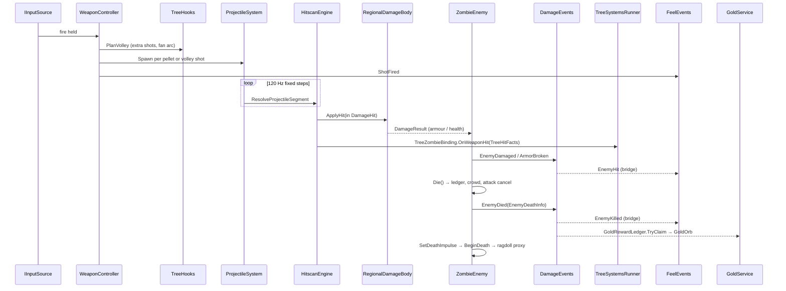

# Deaths Demolition: Architecture

This document describes the runtime architecture of the Unity project in `prototype/DeathsDemolition_PlayableConcept/` as it stands in revision round R4 of milestone M4 (R4 game commit `b3424d1f`, 14 Oct 2026). Paths are relative to `Assets/_Prototype/` (shown as `P/`) or `Assets/_Art/` (shown as `A/`) unless written in full. Every claim points to the file it comes from. Work-package specifications are in `planning/work-packages/`.

The game is a **top-down** shooter. Third- and first-person views still exist in the code and in the Pause menu, but they have been **legacy** since 6 Oct 2026: frozen and outside test and acceptance scope. Sections that touch them say so.

## Contents

1. [Assemblies and module boundaries](#1-assemblies-and-module-boundaries)
2. [Boot, scenes and composition](#2-boot-scenes-and-composition)
3. [Key data contracts](#3-key-data-contracts)
4. [Event flows](#4-event-flows)
5. [Allocation and performance rules](#5-allocation-and-performance-rules)
6. [Save and profile durability](#6-save-and-profile-durability)
7. [Diagnostics and automation hooks](#7-diagnostics-and-automation-hooks)
8. [Build, CI and user-data safety](#8-build-ci-and-user-data-safety)

---

## 1. Assemblies and module boundaries

### 1.1 Assembly definitions

There are 23 assembly definitions: 4 runtime, 10 editor and 9 test.

| Assembly | Location | References | Role |
| --- | --- | --- | --- |
| `DD.Prototype.Core` | `P/Core/` | Input System only | Contracts and data that everything else depends on: config, pooling, input abstraction, camera and quality types, weapon definitions, boot, the F1 panel |
| `DD.Prototype.Runtime` | `P/` (every folder except Core, Tests and editor code) | Core, Input System, URP (Core + Universal), TextMesh Pro, AI Navigation, Cinemachine, ProBuilder, UGUI | All gameplay and presentation systems |
| `DD.Art.Runtime` | `A/Runtime/` | Core, Runtime, AI Navigation, URP | World bootstraps and loaders, render features (planar reflection, volumetric light, screen atmosphere, LUT post), art library manifests, readability thresholds, visual regression |
| `DD.Prototype.Qa` | `P/Diagnostics/Qa/` | Core, Runtime, Art.Runtime, Input System, AI Navigation | QA bots and gates (development builds and the Editor only) |
| Editor assemblies | `A/Editor/` (`DD.Art.Pipeline.Editor`), `P/Core/Editor`, `P/UI/Editor`, `P/Audio/Editor`, `P/Weapons/Editor`, `P/World/Editor`, `P/Rendering/Editor`, `P/Feedback/Vfx/Editor`, `P/Diagnostics/Editor`, `P/Diagnostics/Qa/Editor` | — | Import contracts, world and asset builders, the build entry point (`DdBuild`), simulators |
| Tests | `P/Tests/EditMode`, `P/Tests/EditMode/Audio`, `P/Tests` (PlayMode), `P/Tests/Shared`, `P/Tests/SharedRuntime`, `A/Tests/*`, `P/Diagnostics/Qa/Tests/*` | — | 4 EditMode, 3 PlayMode and 2 shared helper assemblies (see the README test table) |

Dependencies point one way: **Core → Runtime → Art.Runtime → Qa**. Core never references Runtime (`P/Core/DD.Prototype.Core.asmdef`). This is why the types that several systems share live in Core even though they are about gameplay:

- `WeaponDefinition` (`P/Core/Weapons/`)
- `CameraMode` (`P/Core/Camera/CameraModeTypes.cs`)
- `QualityTiers` (`P/Core/Quality/`)
- `EnemyTier` and `UpgradeBranch` (`P/Core/Config/PrototypeConfigEnums.cs`)
- `IInputSource` and its extension interfaces (`P/Core/Input/`)

### 1.2 Namespaces inside `DD.Prototype.Runtime`

Inside the Runtime assembly, each folder has its own namespace and a narrow crossing point:

| Folder | Namespace | Boundary rule |
| --- | --- | --- |
| `Weapons/`, `Weapons/Projectiles/`, `Weapons/WallBuy/` | `DD.Prototype.Weapons` | Fires through `IWeaponHost` / `IAimSource` (`Weapons/IAimSource.cs`) and applies damage only through `Damage` contracts. Wall buys spend gold only through `GoldWallet.TrySpend` and change weapons only through `WeaponController.BuyClassic`. |
| `Weapons/Attachments/` | `DD.Prototype.Weapons.Attachments` | Presentation of tree upgrades on the gun; reads the resolved tree stats, never writes gameplay state |
| `Damage/` | `DD.Prototype.Damage` | `DamageContracts.cs` is marked *"CROSS-TASK CONTRACT - DO NOT CHANGE THESE SIGNATURES"* |
| `Difficulty/` | `DD.Prototype.Difficulty` | `DifficultyService` owns the run's mode. Most systems see it only through the mode-applied config (§3.5); the crowd AI, attack slots, chokepoint queue and gait pools read `DifficultyService.Current` |
| `Enemies/` | `DD.Prototype.Enemies` | Spawn is reached only through `ZombieSpawnBinding.cs` (`ISpawnedEnemy`). Tree statuses arrive through `ITreeStatusReceiver` (`ZombieTreeStatus.cs`) |
| `Navigation/` | `DD.Prototype.Navigation` | Knows nothing of enemies; talks to them only through `ICrowdMember` |
| `Spawn/`, `Rounds/` | `DD.Prototype.Spawn`, `DD.Prototype.Rounds` | Spawn owns the enemy pool and the round ledger. Rounds owns the run phase, the round-end shop and the run tree (`Rounds/RunTree/V2/`, same namespace) |
| `Economy/`, `Profile/`, `Achievements/` | `DD.Prototype.Economy` / `.Profile` / `.Achievements` | Gold lives only inside a run (`Economy/GoldWallet.cs`). The profile never stores gold; Ash is a profile currency |
| `Camera/` | `DD.Prototype.CameraSystem` | Mode state is a static service; the rig and the top-down feel camera read it |
| `Characters/` | `DD.Prototype.Characters` | Enemies drive visuals only through `IZombieAnimationDriver` |
| `Feedback/`, `Feedback/Vfx/` | `DD.Prototype.Feedback(.Vfx)` | Subscribes to events and never changes gameplay state |
| `Audio/` | `DD.Prototype.Audio` | Subscribes to events and sets mixer snapshots |
| `World/`, `World/Vegetation/` | `DD.Prototype.World(.Vegetation)` | Builds or binds the world; vegetation is bound to the loaded world from `DD.Art` (`VegetationWorldHookup`) |
| `UI/Runtime/**` | `DD.Prototype.UI` | Reads view models and feeds (`Presentation/`) and calls the run director or the tree's shop commands for player actions |
| `Diagnostics/` | `DD.Prototype.Diagnostics(.Telemetry)` | Probes, capture agents and telemetry; probes and agents are active only with command-line flags and mostly compiled only into development builds (§7) |

---

## 2. Boot, scenes and composition

- **Scene order** (`ProjectSettings/EditorBuildSettings.asset`), eight enabled scenes:
  1. `Boot`
  2. `MainMenu`
  3. `Selection` (Prepare Run)
  4. `Run`
  5. `Results`
  6. `World_AP005` (the older world, kept for A/B)
  7. `World_V6_Greybox` (the game's world)
  8. `World_FPTPOnly` (content only the legacy cameras can see)

  `Boot` is the only valid entry scene. Results returns to MainMenu or, with **PLAY AGAIN**, to Prepare Run with the last selection.
- **Boot** (`P/Core/Boot/PrototypeBootstrapper.cs`):
  1. Loads `P/Core/Resources/PrototypeConfig.asset`.
  2. Applies vSync, target frame rate and the fixed timestep.
  3. Creates the persistent `PoolService.Root` and the F1 `PrototypeDebugPanel`. The panel opens only in development builds and the Editor; a release build never draws it (`P/Core/Debug/PrototypeDebugPanel.cs`).
  4. Loads the first scene. `PrototypeBootFlags` decides which one: session override → define → the process-local `-ddDirectToRun` flag → (development builds only) the config field and the stored PlayerPrefs switch. A release player never skips the main menu on a stored switch.
- **Config:** `PrototypeConfig` (`P/Core/Config/`) is the single data layer, split into sections (Economy, Enemy, Feedback, Player, Progression, Round, Weapon and others). Values that still wait for a product decision carry `[PrototypeOnly(...)]` (`P/Core/Config/PrototypeOnlyAttribute.cs`); the census is kept in `PROTOTYPE-ONLY.md`. The shipped config switches tree v2 on (`RunTreeV2: 1`) and sets the late-game health curve (`LateHealthFromRound: 16`, `LateHealthGrowth: 1.45`).
- **Difficulty at run start:** `DifficultyService.BeginRun` (§3.5) fixes the run's mode when the Run scene loads and, for Hard and Demolition, swaps in a mode-applied copy of the config. `EndRun` puts the shipped instance back.
- **Run scene composition:**
  - `WorldBootstrap` (`P/World/`) builds or loads the world. `WorldSource { Procedural, AP005, V6 }`; the default comes from `A/Resources/DD_WorldSource.asset` and is **V6**, which loads `A/Scenes/World_V6_Greybox.unity` additively (§3.12). `-ddWorldSource` or `DD_WORLD_SOURCE` override it.
  - `WorldFptpOnlyLoader` (`A/Runtime/`) loads `World_FPTPOnly` additively only when a legacy camera (or the menu's cinematic backdrop) can see it. Top-down never loads it. Colliders, NavMesh, spawn and audio data stay in the world scene, so the split changes only pixels.
  - `VegetationSystem` (one per process) is bound to the loaded world (§3.13).
  - `RunSystemsInstaller` (`P/Rounds/`) wires the run systems; `RunDirector` brings the gold service and the `WallBuyDirector` (§3.8).
  - `PrototypeUiInstaller` (`P/UI/Runtime/Flow/`) injects the screens.
- **UI is generated in code.** `UiFactory` (`P/UI/Runtime/Kit/UiFactory.cs`) builds the canvases, the brush kit (`P/UI/Runtime/Kit/Components/UiBrushKit*.cs`, `UiBrushPane.cs`, tokens in `UiBrushTokens.cs`) draws the panes, and `UiSceneBuilder` (`P/UI/Editor/`) generates the meta scenes. The Prepare Run turntable stage is built by `P/UI/Editor/PrepareRunStageBuilder.cs`.

---

## 3. Key data contracts

### 3.1 WeaponDefinition v3

`P/Core/Weapons/WeaponDefinition.cs` is a ScriptableObject created from the menu *Deaths Demolition/Weapon Definition v3*. "v3" is the contract generation named in the doc comment; there is no serialized version field.

- **Identity:** `weaponId` (for example `ar_1`), `id : ClassicWeaponId`, `slot` (Classic/Special), `weaponClass` (AssaultRifle, Smg, Shotgun, Lmg, Sniper, Launcher, Special), display names, `legacyNames[]` and a silhouette.
- **Blocks:** `fire` (`WeaponFireMode { Single, Burst, Auto }`, rpm, burst and charge fields), `ammo`, `projectile`, `accuracy`, `explosive`, `rocket`, `arcChain`, `gelPuddle`, `specialLifecycle`, `upgrade`, `unlock`, `presentation` (sockets and, for the legacy first-person view, `fpView`).
- **Accuracy:** `WeaponAccuracyBlock` holds a hip/focus `SpreadPair` per camera mode, and `SpreadFor(int cameraMode)` selects it. In top-down, *Focus* (right mouse button / left trigger) narrows the cone and slows the step.
- **Catalog and lookup:**
  - `ArsenalCatalog` (`P/Weapons/Arsenal/Resources/Arsenal/ArsenalCatalog.asset`) validates the whole list.
  - The static `Arsenal` class does lookups without allocating.
  - `WeaponIdMigration` maps legacy ids.
  - `CreateLegacySettings()` converts a definition to the older `ClassicWeaponSettings`, so earlier systems keep working.
- **Authoring:** assets are written deterministically by `P/Weapons/Editor/ArsenalAssetBuilder.cs`.
- **Catalog (12 definitions):** ten classics (`ar_1` Hinawa, `ar_2` Sanren, `smg_1` Shippu, `smg_2` Tetsui, `sg_1` Rappa, `sg_2` Nito, `lmg_1` Mukade, `lmg_2` Kurogane, `sr_1` Tomi, `rl_1` Bohiya) and two Specials in the Special slot (`sw_arc` Raiju, chain lightning; `sw_gel` Namekuji, slick gel).
- **Access:** every classic weapon except `rl_1` is open from the first run, and there are no level unlocks. `rl_1` can only be bought at its wall station (§3.8).
- **Blocks in use:** `rocket` and `explosive` drive `rl_1` (blast, dud and cluster rules, `P/Weapons/RocketImpacts.cs`); `arcChain` and `gelPuddle` drive the Specials (`SpecialImpacts`, `SpecialGelEffects`).
- **Tree profile:** on every equip, `WeaponController` asks `RunTreeV2.ProfileOf(id)` for the weapon's `TreeWeaponProfile` and calls `TreeHooks.OnClassicEquipping` **before** the magazine and reserve are read, so tree stats re-resolve for the new weapon (`P/Weapons/WeaponController.cs`).

### 3.2 ProjectileSystem

`P/Weapons/Projectiles/ProjectileSystem.cs` is a static simulation with no GameObject per projectile.

- **Storage:** `ProjectileState` structs in one flat array (`Capacity = 256`) plus a spawn-order index. When the array is full, the oldest projectile is retired and `OverflowCount` is incremented.
- **Stepping:**
  - Fixed step `1/120 s` (`FixedStep`), at most 8 steps per tick (`MaxStepsPerTick`); any remainder is swept in one step.
  - Runs on scaled time, so pause and hit-stop freeze projectiles.
  - `ProjectileDriver` ticks it once per frame.
- **Collision:**
  - Each step sweeps the segment through `HitscanEngine.ResolveProjectileSegment`, using `Physics.RaycastNonAlloc`, or `SphereCastNonAlloc` when the projectile has a sweep radius.
  - Hits resolve through the same path as hitscan shots, inside one `DamageTransaction` resumed each step.
  - Each projectile keeps an inline set of the bodies it has already damaged.
  - Penetration budget: `TargetsLeft = 1 + PierceTargets + Penetration`; the tree's pierce and ricochet hooks (`TreeHooks.PierceCount`, `RicochetBounces`) adjust it.
- **Kinds:** `ProjectileKind { Bullet, Pellet, Rocket, Orb, Gel }`: Bullet for rifles, SMGs, LMGs and the sniper, Pellet for shotguns, Rocket for `rl_1`, Orb for Raiju and Gel for Namekuji.
- **Firing:** `WeaponController` plans the volley with `TreeHooks.PlanVolley` (extra shots, fan arc) and calls `ProjectileSystem.Spawn` once per pellet or volley shot.
- **Events:** `ProjectileEvents` (`Spawned`, `Impact`, `Expired`) carry struct payloads.
- **Rendering:** `TracerRibbonRenderer` draws flight from projectile state. For Bullet and Pellet on the nine normal weapons, `TracerRibbonRenderer.Ap043.cs` draws a **short-exposure streak**: a procedural ribbon (`A/VFX/Resources/Shaders/DD_VfxRibbon.shader`) whose length is the round's speed times an artistic shutter time, clamped per class and capped in screen pixels. Rendering never changes positions, speed, collision or damage.
- **Quality tiers:** the simulation does not change with the tier because it is a game rule.

### 3.3 Camera

The mode types live in Core (`P/Core/Camera/CameraModeTypes.cs`) and the service in Runtime (`P/Camera/CameraModeService.cs`).

- **Top-down (shipped, default):**
  - `TopDownFeelCamera` (`P/Camera/TopDownFeelCamera.cs`) layers fire and world trauma, a kick spring inside a 0.22 m cap, fire lean, zoom punch and look-ahead, all driven by feel events (§4.3) under one clock arbiter.
  - `CameraOcclusionFader` fades whole roofs between the camera and the hero.
  - `TreeCanopyReveal` thins tree crowns per pixel with a 4×4 Bayer screen-door cone (`DD_TreeReveal.hlsl`). Only the game camera reveals; the planar-reflection camera and capture cameras render crowns as authored, and shadows never change.
- **Mode service:** `enum CameraMode { TopDown = 0, ThirdPerson = 1, FirstPerson = 2 }`. `Request(mode, instant)` returns a bool and `Changed` fires once per accepted request. `LockModeChanges` / `UnlockModeChanges` queue requests during the death sequence. `-ddCameraMode topdown|tp|fp` overrides the start mode.
- **Third- and first-person (legacy):** the Pause menu's CAMERA row still switches to them. Their pieces stay on `main` but are frozen: `CameraModesFeel`, `FpAdsLens`, `PlayerWeaponBinding`'s 3D aim point (`CameraAimRay` in `P/Camera/CameraReactions.cs`), `FirstPersonArms` (viewmodel arms for 6 of the 10 classic weapons), `WeaponHoldIk` and `WorldFptpOnlyLoader`.

### 3.4 QualityTiers

`P/Core/Quality/QualityTiers.cs` defines `enum QualityTier { Performans, Yuksek, Sinematik }`, shown in the UI as Performance / High / Cinematic. Each tier has its own URP asset (`Settings/DD_URP_Performance.asset`, `DD_URP_PipelineAsset.asset`, `DD_URP_Cinematic.asset`), configured by `P/Core/Editor/QualityTierSetup.cs`.

- **Default:** `QualityTiers.DefaultTier = QualityTier.Sinematik`.
- **Current** is derived from `QualitySettings.GetQualityLevel()`, and `Changed` is raised when it changes.
- **`Pick<T>(p, h, c)`** is the only way a feature reads a tier value, so no call site hard-codes one.
- **Built-in caps:**

  | Cap | Performance | High | Cinematic |
  | --- | --- | --- | --- |
  | LOD bias base | 1 | 2 | 3 |
  | Shadow distance cap | 45 m | 60 m | 120 m |
  | Shadow cascade cap | 2 | 3 | 4 |
  | Texture streaming budget | 512 MB | 1024 MB | 3072 MB |

  Final values are combined with the camera mode: `LodBias = max(1, base × modeFactor)`, and shadow distance and cascades are the minimum of the tier cap and the mode value. High top-down also caps shadows at 40 m (`TopDownHighShadowDistance`).
- **Ownership:** `P/Rendering/QualityModeApplier.cs` is the one writer of global render settings for a tier and camera mode. On High top-down it trims planar reflection to every 8th frame (sky only) and drops small shadow casters (`P/Rendering/SmallShadowCasters.cs`).
- **Nominal targets** in the code comment are Cinematic ≤ 33.3 ms, High ≤ 16.6 ms and Performance ≤ 8.0 ms. The acceptance gates are much tighter (§5).

### 3.5 Difficulty modes and pursuit

- **Modes:** `enum DifficultyMode { Normal, Hard, Demolition }` (`P/Difficulty/DifficultyMode.cs`). The numeric value is persisted in profile and score keys, so it is never reordered.
- **Settings:** `DifficultyModeSettings` and `DifficultyProfile.Defaults(mode)` (`P/Difficulty/DifficultyProfile.cs`) hold the per-mode numbers: damage multiplier, telegraph scale, intercept and cut shares, active cap, gold multiplier, starting gold, tier introduction rounds, attack-slot bonus, preferred spawn distances, running gaits.
- **Service** (`P/Difficulty/DifficultyService.cs`):
  - `Selected` is what Prepare Run picks (`P/UI/Runtime/Prepare/PrepareRunDifficulty.cs`). A launch override (`-ddDifficulty normal|hard|demolition`) wins over the menu, so a bot or a measurement run plays the mode it was started with.
  - `BeginRun` fixes `RunMode` and, for Hard and Demolition only, makes a mode-applied copy of the active `PrototypeConfig` the active one. Every system that reads the config (stats, rounds, tier mix, armour, spawn placement) then plays the mode without a call site of its own. Normal never clones.
  - `Current` (null in Normal) is read by the crowd AI, the attack slots (`AttackSlotBonus`), the chokepoint queue and the gait pools; `StartingGold` is credited by `GoldService`.
  - Events: `SelectedChanged` (mode-select sound, badge) and `RunStarted` (HUD mode word).
- **Pursuit roles** (`P/Difficulty/PursuitPlanner.cs`, `ZombieAiRole { Chase, Intercept, Cut }`):
  - Each non-flanking body draws a role for its whole life. Normal always chases.
  - *Intercept* walks to the player's position plus velocity × lead, with the lead capped by distance over the body's own speed.
  - *Cut* walks to a point ahead along the player's escape direction when the body can get there first. A standing player's escape direction is the least occupied slice of the ring around them.
  - Both roles fall back to a chase when they stall. The planner reads the player once per frame into a cache.

### 3.6 Run tree v2

The run tree is feature-based: its effects apply to whatever weapon is in hand. It is live in the shipped config (`RunTreeV2: 1`); `RoundUpgradeShop` routes the round-end screen to it.

- **Catalog:** `P/Rounds/RunTree/Resources/ProgressionTree/run-tree-v2.json` (schema `dd-run-tree-v2`), loaded by `TreeCatalogV2` (`TreeNodeDefV2`, `TreeSynergyDefV2`, `TreeArgV2`).
  - 70 nodes in 7 branches: Shot 12, Magazine 10, Speed 9, Element 15, Chaos 8, Survival 9, Economy 7.
  - 63 base nodes in tiers I–V, plus 7 alternative capstones gated by Awakening.
  - 10 synergies, and per-mode tier gates.
  - `TreeContract.cs` holds the shared enums (`TreeBranch`, `TreeElement` …), `TreeRuntime` and the profiler markers.
- **State and commands:** `RunTreeV2` (`P/Rounds/RunTree/V2/RunTreeV2.cs`) is one run's tree. It owns:
  - the owned nodes and the round-end rules: fog by round gate per mode, parents, the element cap (F1), the chaos-core fork (F2) and capstone ↔ Awakening alternatives;
  - the free-tree commands of `ITreeShopCommands`: buy anything on the frontier, a recommendation strip at −10 % with a 10-gold reroll, Target with its path, Hearth stokes and a one-key Continue;
  - interest and the mode's starting gold.

  It never runs per frame: every method runs on a screen command, a purchase, an equip or the run boundary.
- **Resolution:** `TreeResolver` turns owned nodes plus the weapon in hand into `TreeStats` (`TreeStats.cs`): flat numbers only, so a hook is one field read.
  - Same-line tiers replace each other and different nodes multiply.
  - Power over a cap goes to damage.
  - Element and chaos damage is a share of `WeaponPower`, so every weapon class gains the same ratio.

  `TreeRuntime.Publish` stores the result; `TreeRuntime.Current` is `Neutral` (×1, +0, off) outside a run.
- **Hooks:** `TreeHooks` (`TreeHooks.cs`, partial) is what the fire path, magazine, economy and survival code read: volley planning (`PlanVolley`, fan arc, extra-shot damage), pierce and ricochet, projectile size, magazine and ammo price, shield and undying state. `TreeFeelOverride` keeps a converted weapon (for example Full-Auto on a single-shot gun) from punching the camera or freezing the world on every round.
- **Systems:** `P/Rounds/RunTree/V2/Systems/` runs the world-side effects:
  - `TreeSystemsRunner` receives `TreeHitFacts` from the fire path and keeps `TreeSystemsCounters`;
  - `TreeStatusSystem` handles ice, stun and status damage;
  - `TreeGravityWells` handles black-hole pull;
  - `TreeBlastQueue` handles blasts and Mini Nuke;
  - `TreeAreaPool` handles zones.

  Zombies receive statuses through `ITreeStatusReceiver` (`P/Enemies/ZombieTreeStatus.cs`, maths in `TreeStatusMath.cs`).
- **Presentation:**
  - The tree screen is `UiTreeScreenV2` (`P/UI/Runtime/Screens/UpgradeTreeV2.cs`, edges in `UiTreeEdges.cs`, rows and layout in `P/UI/Runtime/Presentation/TreeV2Presenter.cs`, art in `TreeArt.cs`).
  - Projectile and hero visuals live in `P/Feedback/Vfx/Tree/` and `TracerRibbonRenderer.Tree.cs`.
  - Gun attachments live in `P/Weapons/Attachments/`.
  - Tree sounds are in `P/Audio/Runtime/TreeAudio.cs`, with per-sound voice caps.
- **Presets for tests and bots:** `TreePresetsV2` applies a named preset (`-ddTreePreset`, for example `perf_worst`) and a start round (`-ddStartRound`).
- **Retired v1:** `run-tree.json` (`dd-run-tree-v1`) and `RunTreeCatalog` / `RunTreeGraph` / `RunTreeState` / `RunTreeHooks` in `P/Rounds/RunTree/` are still built but no longer sold.

### 3.7 Awakening and Ash

- **Catalog:** `meta-tree.json` (schema `dd-meta-tree-v1`) has 37 nodes. The 11 on page `awakening` are the live meta progression:
  - 7 alternative capstones;
  - 2 fork widenings: `aw_third` (a third element) and `aw_twincore` (both chaos cores);
  - 2 aids: `aw_codex` (Synergy Codex) and `aw_headstart` (+40 gold in round 1 on Normal and Hard).

  The other 26 (16 passives, 10 Special leanings) stay for save compatibility and have no page in the R4 menu.
- **Earning and spending:** Results converts a run into Ash ("AWAKENING +N Ash"). The Awakening page (`UiAwakeningPage`, `P/UI/Runtime/Screens/AwakeningPage.cs`, routed by `P/UI/Runtime/Flow/UiTreeScreenRoute.cs`) unlocks a node with a 500 ms hold and writes it through `ProfileService.Awakening` (`P/Profile/MetaPath/ProfileService.Awakening.cs`) inside the profile commit (§6).
- **Run side:** `TreeAwakening` (`P/Rounds/RunTree/V2/TreeAwakening.cs`) is a plain value read **once** at run start by `RunTreeV2`. It opens alternative capstones and widens the forks; the run never writes the profile. Awakening buys variety, never power.
- **Refund notice:** "Second Thoughts" (`aw_rethink`) was removed from the release because no system read it. Owners get 150 Ash back once, through `UiAshRefundNotice`.

### 3.8 Wall buys

- **Rules** (`P/Weapons/WallBuy/WallBuyRules.cs`) are pure, with no scene:
  - a different weapon is a `Buy` at the full price;
  - the weapon in hand is a `Refill` at the refill price, and it is refused when the ammo is already full;
  - a Special in hand blocks both, and so does a frozen or missing run;
  - not enough gold blocks last, so the prompt can name the price the player is short of.
- **Data** (`WallBuyCatalog`, `Resources/WallBuy/wallbuy-v6.json`, schema `dd-wallbuy-v1`): ten stations with positions and facing, prices per weapon (250–800, launcher 2,500), `refillShare` 0.5 and the interact and NavMesh-snap radii. Both prices pass through the tree's hooks (`TreeHooks.WallBuyPrice`, `TreeHooks.AmmoPrice`), which is where Arms Dealer takes its −20 %.
- **Scene side** (`WallBuyDirector`, brought by `RunDirector`):
  1. Once the world is up, the director builds one `WallBuyStation` per catalog point, snapped to the NavMesh.
  2. Every frame it finds the station within reach of the player and publishes `WallBuyEvents.PromptChanged`, only when the prompt changes.
  3. On *Interact* (E / gamepad A) it runs `GoldWallet.TrySpend` with `GoldSource.WallBuy`, then `WeaponController.BuyClassic`. Gold is taken only when the weapon side can go through.
  4. `WallBuyEvents.Resolved` reports the outcome.

  Nothing allocates per frame. The HUD prompt is `P/UI/Runtime/Hud/HudWallBuyPrompt.cs`.

### 3.9 Death impulse and ragdoll hand-off

- **Contract:** `readonly struct DeathImpulse` (`P/Damage/DeathImpulse.cs`) carries:
  - the unit direction and the force, in `DamageForce` units after the knockback governor;
  - the `DamageSourceKind`, the `WeaponClass` and whether the weapon is known;
  - the body region and the world hit point;
  - the flat body speed and a `ZombieBodyState`.

  `DeathImpulse.Build` guarantees a unit direction (falling back to the body's forward), force ≥ 0 and speed ≥ 0.
- **Split of ownership:** the AI fills the impulse once in `Die()` and hands it to the animation driver through `IZombieAnimationDriver.SetDeathImpulse(in DeathImpulse)` before `BeginDeath`; the AI knows no bones. Animation picks the death family, onset, ragdoll hand-off and settle from it. After death, gameplay never attaches to the body again, and one owner controls corpse lifetime.
- **Consumer:** `ZombieSkinnedVisual` (`P/Characters/ZombieSkinnedVisual.cs`) chooses a `ZombieDeathFamily` (FallBack, FallForward, SpinSide, LegsOut, UltraTimber, ArcElectro, GelSlip). At the `ragdoll_handoff` event or on a per-family timer, it acquires a proxy skeleton from `RagdollProxyPool`.
- **`RagdollProxyPool`** (`P/Characters/RagdollProxyPool.cs`):
  - Zombies carry no Rigidbody. Proxy skeletons have 11 bodies each, and at most 10 run at once.
  - A proxy stays active for 0.5–3.0 s, and its pose is copied onto the zombie's bones in LateUpdate.
  - When the pool is exhausted, the authored death clip plays instead. `-ddRagdoll 0` turns proxies off for A/B.

### 3.10 Damage contract

`P/Damage/DamageContracts.cs` defines:

- `BodyRegion { Head, UpperBody, LowerBody }` and `DamageSourceKind { Bullet, Pellet, Explosion, Chain, Ricochet }`.
- `struct DamageHit { Amount, Region, Point, Direction, ImpactForce, Source }` and `struct DamageResult`.
- `IDamageReceiver.ApplyHit(in DamageHit)` and `IExplosionReceiver`.
- The `DamageForce` constants and `DamageRegions` (region → armour slot, and the critical-hit rule).

How damage resolves:

- **Region lookup:** `HitboxRegistry` looks up the region by collider instance id. `DamageTargetResolver` falls back to the collider name, then to height ratio, and counts each fallback.
- **Armour** (`ArmorSet`, `RegionalDamageBody`): an armoured region sends the whole hit into its plate, and any damage left over once the plate breaks is discarded.
- **Explosions** spread their damage over the regions by configured shares, with linear falloff to the rim (`HitscanEngine.Explode`).
- **Tree status damage** passes armour by design (`TreeStatusSystem`).

### 3.11 Attack selection and reactions

`P/Enemies/AttackStyles.cs` contains four pieces:

- **`AttackStyleProfile`:** per-style multipliers, normalised to each tier's signature style (Standard Swipe, Special Lunge, Elite Sweep, Ultra Overhead).
- **`AttackSelector.Select`:** a deterministic draw from the spawn seed, scored as tier weight × range fit × angle fit × variety × slot availability. It never picks three of the same style in a row.
- **`AttackSlotBoard`:** a static crowd budget.
  - Each style has a limit on concurrent slots, with a cooldown after each commit.
  - At most 4 wind-ups run at once (`WindupCap`), or 2 while the player is grabbed. No Lunge starts during a grab.
  - The difficulty mode adds `DifficultyService.AttackSlotBonus` (Hard +1, Demolition +2).
- **`GrabState`:** at most one grab on the player.
  - The bite pays 60 % of its damage on hit and 40 % at the end of the grab.
  - One strong hit on the holder breaks the grab.

Reactions:

- **Specials:** Raiju electrocutes bodies (`P/Enemies/ZombieShock.cs`). Namekuji puddles register in `GelPuddleRegistry`, and `ZombieGel` runs a slide → fall → downed → get-up machine; zombies do not avoid the puddles.
- **Tree statuses** (`ZombieTreeStatus.cs`): ice stacks a slow and then freezes (shorter for Elite, slow-only for Ultra), plus stun, pull and status ticks.
- **Rear awareness:** `ZombieRear` marks a body as rear when it is out of the camera view and in the view's rear half-plane. `RearSpawnShare` penalises rear spawn points above the cap.
- **Round logs:** `AiV3RoundLog` writes a per-round summary for tuning.

### 3.12 World V6

- **Scene:** `A/Scenes/World_V6_Greybox.unity`, in the build list and loaded additively by `WorldBootstrap` when `WorldSource` is V6 (the default). `WorldLayout.Current` tells runtime systems which layout is active.
- **Built by code:** `A/Editor/GreyboxV6Builder.cs` builds the world headlessly from `A/Environment/World/V6/layout-v6.json`:
  - the ±55 m playable square, 11 buildings and 12 interiors, 22 zones, 68 clusters, 1,064 placements;
  - 130 lanterns lighting the interiors, and the doors;
  - the NavMesh;
  - `spawn-gates-v6.json` (22 gates: 12 on the edge ring, 10 inside), `regions-v6.json` (5 regions) and `acoustic-spaces-v6.json`.

  It then runs the light bake.
- **Top-down split:** `A/Editor/TdVisibilityAudit.cs` finds content no top-down pose can see: no pixel, no shadow into a frame, no plaza reflection. `A/Editor/WorldFptpSplit.cs` moves that content to `World_FPTPOnly` (§2).
- **Walk anywhere:** colliders are fitted to drawn meshes. `A/Editor/WorldWalkScan.cs` walks the player capsule over a 0.5 m grid and reports invisible blockers (zero on `main`).
- **Dressing:** `A/Editor/ArtAp040WorldKit.cs` places the world kit (47 families, 110 prefabs with LOD groups) in the plaza corners and gardens.
- **Spawning in V6:** `SpawnWorldProfile.Resolve(layout, v6SceneLoaded)` is a pure function that picks the V6 gate table; `SpawnRoomBalance` spreads spawns across rooms; each difficulty mode sets preferred spawn distances.
- **Look:**
  - `P/World/WorldAtmosphere.cs`, `CloudShadowDriver.cs` and `WorldWind.cs` drive sun, clouds and wind.
  - `A/Runtime/` holds the URP features (`PlanarReflection`, `VolumetricLightFeature`, `ScreenAtmosphereFeature`, `LookV3Post`) and `SunDisc`.
  - Lantern flames and the water look are in `P/Feedback/Vfx/LanternFlames.cs` and `WaterLook.cs`.
  - Volumetric shafts are a tier row.

### 3.13 Vegetation

`P/World/Vegetation/VegetationSystem.cs` is the living ground: one instance per process (DontDestroyOnLoad), bound to the loaded world by `SetWorld` (the V6 hook-up is `VegetationWorldHookup` in `A/Runtime/`).

- **Build** (once per world and tier): a world probe plus masks feed `VegetationZoner` (recipes), then `VegetationPlacer`, then per (species, variant) matrix arrays in **8 m chunks**. About 59,800 instances are placed on Cinematic.
- **Per frame (0 B):**
  - LateUpdate writes the wind globals and the interaction push map (`VegetationPushMap`: player, live zombies, blasts).
  - In `beginCameraRendering`, the main camera gets CPU frustum culling per chunk, LOD 0/1/2 by chunk distance with a 2 m dither cross-fade in the shader, and distance and camera-height density.
  - Then `Graphics.DrawMeshInstanced` runs per group × LOD from preallocated 1023-matrix pages. There is no compute and no indirect args, which keeps it safe on Metal.
- **Shadows:** grass and every species receive shadows and cast none.
- **Shared drawing:** meshes, materials, placement and the cull/draw live in `VegetationDrawSet`, shared with the edit-mode `VegetationPreview`, so a capture shows exactly what the game places.

### 3.14 Audio: weapon fire v5 and acoustic spaces

- **Fire model** (`P/Audio/Runtime/WeaponFireAudio.cs`): layered fire per weapon with variations. Automatic weapons use a per-shot transient over an RPM-locked body.
- **Reflections** (`WeaponReflections.cs`, `AcousticProbe.cs`): slapback from 8 acoustic probe rays, delay = 2d / 343 m/s.
- **Tails** (`WeaponTailBed.cs`): at most two overlapping tails, with a per-class wet tail for open ground, corridors and halls.
- **Acoustic map** (`AcousticSpaceMap.cs`): `Resources/DD_AcousticSpaces.asset` is baked from `acoustic-spaces-v6.json` by the audio catalog builder. Rooms resolve to Hall, corridors to Corridor and everything else to Open, with 1 m hysteresis. The map answers only while the V6 scene is loaded.
  - The integration gate and main CI refuse a map whose `_sourceHash` does not match its JSON (`tools/qa/acoustic_bake.py`).
- **Music and mix:** `MusicDirector` mixes four vertical layers from one threat-driven parameter. `AfterRainAmbience` reads the space at 4 Hz. `AudioMixerBridge` moves between Run, RoundBreak and Pause snapshots, with master, music, effects and UI sliders.
- **Voice limits:** `AudioVoicePool` applies retrigger, instance and priority gates. `TreeAudio` adds per-sound voice caps for tree moments, so a Barrage stays readable.

### 3.15 Animation contracts

- **Event contract** (`P/Characters/CharacterAnimationEvents.cs`, "THE ANIMATION EVENT CONTRACT"):
  - `enum CharacterAnimationEvent` covers fire, hit windows, footsteps, death end, rise end, mechanism steps, `grab_start` / `grab_end`, `attack_recover`, `ragdoll_handoff`, `fall_start` and `telegraph_start`.
  - `Names[]` holds the canonical snake_case strings; non-canonical spellings are rejected.
  - Owners subscribe to the instance event `Raised`; VFX and audio subscribe to the static `Any`.
  - One beat can have several names (`BeatFamily`); synonyms on the same frame are raised once.
- **Import side** (`A/Editor/ArtAnimationEventContract.cs`) validates every event in a clip:
  - it must use a known canonical name and lie within the clip's frame range;
  - it may fire on frame 0 only if it is whitelisted, and must not repeat within 2 frames;
  - a hit window must be exactly one window of 3–8 frames.

  Controllers are generated from `CharacterAnimationSet` by `A/Editor/ArtAnimatorBuilder.cs`, and Animator parameters are fixed by `CharacterAnimatorContract`.
- **Clip-driven attack timing:** the enemy attack state machine uses the clip's `hit_window_start` / `hit_window_end` events to move from Windup to Active to Recovery, and falls back to timers when there is no clip (`P/Enemies/EnemyAttackState.cs`).
- **Reload magazine contract** (`P/Weapons/WeaponMagazineOwnership.cs`, `WeaponMagazineVisual.cs`):
  - Ownership moves forward only (`MagazineOwner { Weapon, HandOld, HandNew }`, beats `Detach`, `HandAttach`, `Insert`, `BoltRelease`).
  - A beat the clip does not send lands at its timeline mark plus a grace period.
  - The magazine part rides the left hand's socket while a hand owns it.
  - This is presentation only: ammo stays on `ClassicWeaponRuntime`'s timer.
- **Hero locomotion v4** (`P/Characters/LocomotionV4.cs`): one stable id per AP-026 clip drives a `LocomotionV4` sub-state machine through one int parameter.
  - The clips are walk, run and sprint, each with starts and stops in 8 directions × lead foot, plus pivots and an in-place turn (121 clips).
  - Starts are distance-matched and stops follow the remaining distance (`LocomotionV4Clock`).
  - Foot IK and foot lock are `FootIkAdapter`, grip IK is `WeaponGripIk`, and the sash is `SecondaryChainDriver`.
- **Zombie locomotion v4** (`P/Enemies/ZombieLocomotionV4.cs`, a partial of `ZombieEnemy`): gait pools per tier and mode, with cadence tied to the body's real ground speed (`CadenceBand`, `ZombieLocomotionMath`). It adds a turn-rate limit, stumble braking and start, stop and turn transitions (`ZombieTransitionData`, 22 AP-033 clips).
- **Animator cost:** `CharacterAnimatorLod` culls animators off screen and steps far bodies manually.

---

## 4. Event flows

All buses are static C# events with **struct payloads**. Producers do not know who consumes them.

| Bus | File | Events |
| --- | --- | --- |
| `DamageEvents` | `P/Damage/DamageEvents.cs` | `ArmorBroken`, `EnemyDamaged`, `EnemyDied`, `PlayerAttacked` |
| `RunEvents` | `P/Rounds/RunEvents.cs` | `RunStarted`, `RoundStarted`, `RoundCompleted`, `RoundPoolExhausted`, `GoldChanged`, `PhaseChanged`, `CountdownTick`, `RunEnded` |
| `FeelEvents` | `P/Feedback/FeelEvents.cs` | 15 moments: `ShotFired`, `EnemyHit`, `EnemyKilled`, `MultiKill`, `Explosion`, `PlayerDamaged`, `LowHealth`, `ReloadStarted`, `ReloadEnded`, `DryFire`, `GoldCollected`, `RoundStarted`, `RoundEnded`, `LastZombie`, `Heartbeat` |
| `ProjectileEvents` | `P/Weapons/Projectiles/ProjectileEvents.cs` | `Spawned`, `Impact`, `Expired` |
| `WeaponEvents` | `P/Weapons/WeaponEvents.cs` | equip, ammo, reload, dry fire, fire start/stop, mechanism steps, Special lifecycle |
| `WallBuyEvents` | `P/Weapons/WallBuy/WallBuyEvents.cs` | `PromptChanged`, `Resolved` |
| `TreeHooks` | `P/Rounds/RunTree/V2/TreeHooks.cs` | `Equipping` (a weapon's tree profile is about to apply) |
| `DifficultyService` | `P/Difficulty/DifficultyService.cs` | `SelectedChanged`, `RunStarted` |
| `EnemyCombatEvents` | `P/Enemies/EnemyCombatEvents.cs` | `Raised` (attack and grab moments for audio and VFX) |
| `SpecialWeaponUsageEvents` | `P/Weapons/SpecialWeaponUsageEvents.cs` | `Usage` |
| `CameraModeService` | `P/Camera/CameraModeService.cs` | `Changed`, `SettingsChanged`, `ProfilesChanged` |
| `QualityTiers` | `P/Core/Quality/QualityTiers.cs` | `Changed` |
| `CharacterAnimationEvents` | `P/Characters/CharacterAnimationEvents.cs` | `Raised` (per instance), `Any` (static) |
| `GrabState` | `P/Enemies/AttackStyles.cs` | `Started`, `Ended` |
| `CasingEvents` | `P/Feedback/Vfx/CasingEvents.cs` | `Launched` (one per visible casing) |

### 4.1 Shot → kill → reward

### 4.2 Round loop

`RunDirector` (`P/Rounds/RunDirector.cs`) moves through `RunPhase { None, Fighting, RoundComplete, Upgrading, Countdown, Dead }`:

1. **Fighting.** `EnemySpawnDirector` (`P/Spawn/`) resolves a `RoundPlan`: pool total, target active, ceiling ≤ 40 (36 on Hard). Every `SpawnRefillInterval` (0.45 s), `SpawnRefillClock` spawns up to `MaxSpawnsPerRefillTick` (2) bodies while `RoundLedger.CanSpawn` allows it.
   - Spawn points are picked by `SpawnPointSelector` / `SpawnWeightCalculator`, and `SpawnRelaxation` loosens the rules when no point qualifies.
   - Spawn weighting reads `ThreatDirector`'s layer.
   - Players can buy at wall stations during this phase (§3.8).
2. **RoundComplete.** The round is complete when the pool is empty and nothing is alive; corpses do not count. The freeze is a named hold on `RunFlowClock` and never touches `Time.timeScale`. `GoldService.CollectOutstanding` credits any gold still on the floor.
3. **Upgrading.** `RoundUpgradeShop` opens the run tree screen (`UiTreeScreenV2`), driven by `RunTreeV2`'s shop commands (§3.6). One key (CONTINUE) leaves it.
4. **Countdown.** Three seconds with the simulation running, then back to Fighting.
5. **Dead.** Player death ends the run (`RunEndReason.PlayerDeath`; END RUN in the pause menu is `Aborted`). `RunEvents.RunEnded(RunSummary)` → `ProfileRunCommitter` commits synchronously (§6) → Results.

### 4.3 Presentation consumers

- **Feel:** every feel moment is raised once, from its authoritative place, on `FeelEvents`. The weapon raises shots, reloads and dry fire; hits and kills come from a bridge inside `FeelEvents.cs` that subscribes to `DamageEvents`. `FeelEventRouter` (`P/Feedback/FeelEventRouter.cs`) is the single same-frame arbiter for camera and local stop:
  - it uses a fixed queue of 256 `FeelEvent` structs and allocates nothing;
  - groups that already fired in the last 0.6 s (unscaled) fire again only when stronger, so a trigger pull gives one shake or hit-stop, with escalation but no repetition.

  `FeelProfileTD` (`P/Core/Resources/DD_FeelConfig.asset`, 13 weapon rows, 23 event rows) supplies amplitudes and per-layer switches. `FeelHitStopTD` and `FeelTimeScale` own the global hit-stop and the last-zombie slow motion through one clock arbiter; `HitStopService` is the local visual envelope.
- **VFX:** `HitFeedbackDirector` and `VfxEventBinder` turn damage and feel events into pooled effects (muzzle, impact, blood, brush-ink moments, tree VFX), gated by `FeedbackBudget`.
- **Audio:** `AudioEventRouter` maps events to cues on the `AudioVoicePool`s. `MusicDirector` follows the threat layer. `PrototypeAudioDirector` moves `AudioMixerBridge` between the Run, RoundBreak and Pause snapshots as the run phase changes.
- **UI:** reads `RunHudViewModel` / `ResultsViewModel` (`P/UI/Runtime/Presentation/`) and feeds such as `ThreatHudFeed`, `WallBuyEvents.PromptChanged` and `DifficultyService.RunStarted`.

---

## 5. Allocation and performance rules

The rules are written in the code and enforced by allocation tests, profiler markers and performance probes:

- **Hot paths allocate nothing.**
  - `HitscanEngine` (`P/Weapons/HitscanEngine.cs`): one shot allocates nothing: no LINQ, no `GetComponent`, no array creation, no closure. It uses non-alloc physics queries with fixed buffers (`OverlapBufferSize = 192`, with saturation counted).
  - `ProjectileSystem`, `FeelEventRouter`, `VegetationSystem`, `WallBuyDirector` and the tree hooks allocate nothing per frame.
  - `DamageEvents`: raising an event costs zero allocations with 40 enemies under automatic fire.
  - `HitboxRegistry`: no `GetComponent` or `Find` on the bullet path; lookups go by collider instance id.
  - `Arsenal` lookups never allocate.
- **Resolve ahead, read flat.** The tree resolves `TreeStats` on purchase, equip, Hearth and run start only, and hooks read one field (§3.6). Difficulty is applied once per run by swapping the config (§3.5).
- **Pooling everywhere.**
  - `PrototypePool<T>` / `PoolService` (`P/Core/Pooling/`): a stack-based free list. Pools are prewarmed and fetched once in `Awake`, never per spawn.
  - The exhaustion policy can be `ReturnNull`, `RecycleOldest` or `GrowWithWarning`.
  - Enemies share one pool with a ceiling of 40. Gold orbs, VFX, casings, damage numbers and ragdoll proxies are pooled too.
- **Budgets instead of unbounded spawning.**
  - `FeedbackBudget` applies a concurrent ceiling, a per-frame cap and a proximity merge to each category.
  - `AudioVoicePool` applies retrigger, instance and priority gates; tree sounds have per-sound voice caps.
  - `ProjectileSystem` retires its oldest projectile at 256.
  - `RagdollProxyPool` caps concurrent ragdolls.
  - Corpses linger for a shorter time when the body count nears the ceiling (`CrowdFeelSettings`).
- **Time:**
  - The local hit-stop is a visual time envelope (`P/Feedback/HitStopService.cs`) and never owns `Time.timeScale`; the global hit-stop and slow motion go through one arbiter (`FeelTimeScale`).
  - Round freezes use named holds on `RunFlowClock`.
  - Projectiles run on scaled time.
- **Domain reload off.** Static state resets on `[RuntimeInitializeOnLoadMethod(SubsystemRegistration)]`, used in more than 200 runtime files.
- **Crowd cost:**
  - Separation uses a spatial hash (`CrowdSpatialGrid`).
  - Path repaths share a budget (`NavPathFollower`, every 0.35 s).
  - `PursuitPlanner` reads the player once per frame into a cache.
  - `CharacterAnimatorLod` culls animators off screen and steps them manually at distance.
- **Profiler markers.** New per-frame cost carries a marker (for example `WP104.Tree.ZombieStatus`, `WP104.Tree.Gravity` in `TreeContract.cs`), so a probe can attribute it.
- **Acceptance gates** (Apple M1 Pro, 1920 × 1080, top-down, forced crowd of 40, release-probe build, three counted 60 s windows on a quiet machine):

  | Tier | Gate (mean frame) | R3 acceptance run, 11 Oct 2026 |
  | --- | --- | --- |
  | High | ≤ 8.0 ms | 7.49 ms median window, 7.60 ms worst |
  | Cinematic (default) | ≤ 14.71 ms | 12.02 ms worst window |

  The R4 final acceptance run adds two cells, Demolition and a worst-case end-of-tree loadout with full-auto rockets, both against the 8.0 ms High gate. It also adds budgets of ≤ 0.35 ms mean and ≤ 1.0 ms p99 for the tree systems, and ≤ 0.1 ms each for the bullet look and the canopy reveal. The measurement probe is `PilotPerfProbe` (§7).

---

## 6. Save and profile durability

`P/Profile/ProfileStore.cs` keeps all its files in `Application.persistentDataPath`:

| File | Role |
| --- | --- |
| `prototype-profile.json` | Primary; the only file anything reads in play |
| `….writing` | Candidate of a save in progress |
| `….bak` | Verified copy of the primary taken before each replace |
| `….bak.writing` | Transient candidate used to refresh the backup atomically |
| `….corrupt.N.json` | Quarantined unreadable primary, never deleted |
| `….lock` | Write lease |
| `….v5.bak` | The last pre-v6 document, byte for byte, kept before the first write that replaces it; written once, never overwritten or deleted |

**Save chain.** `ProfileSaveStage` has a fault-injection hook at every stage:

1. Serialize, re-parse and validate the text in memory.
2. Write the candidate to `.writing` and fsync it.
3. Read the candidate back and require it to equal the text written.
4. Keep a pre-v6 primary as `.v5.bak` first (if that copy cannot be written, the save is refused and the old file stays as it is). Then, if the current primary validates, refresh `.bak` atomically.
5. `File.Replace(candidate → primary)`: one rename, so the primary is never absent or half-written.
6. Read the primary back to verify it. On a mismatch the backup is restored and the save reports failure.

Failures never throw; they return a `ProfileSaveResult`. After a process death at any point, the next load finds either the complete old profile or the complete new one.

**Load and recovery** (`ProfileLoadRecovery`):

- A valid primary wins, and any orphan candidate is deleted.
- If the primary is missing, the store rolls forward to a validated candidate, then to a validated backup, then starts fresh.
- If the primary is corrupt, it is quarantined and the store falls back to the backup.
- If any file comes from a newer schema, the session opens **read-only** and no file is touched.

**Lock lease.**

- A `FileStream.Lock` byte-range lock (fcntl on Unix) is held for the life of the process.
- It is fail-closed: if another process holds it, this session is read-only.
- The lock file is never deleted.

**Schema** (`ProfileData.CurrentVersion = 6`, `P/Profile/ProfileMigration.cs`). Migrations are lossless:

| Step | Adds |
| --- | --- |
| v1 → v2 | Unattributed kills |
| v2 → v3 | Profile lineage and completion ordinal |
| v3 → v4 | Special pickups, flawless rounds, unlocked content |
| v4 → v5 | The meta path, with an Ash back-grant for XP and achievements already earned |
| v5 → v6 | The Awakening respec (full free respec, spent Ash returned) and per-mode statistics (`ModeStats` for Normal / Hard / Demolition, seeded from the pre-v6 totals) |

Ids are stored as strings, never as enum ordinals. A document that claims an older version but carries newer fields is treated as forged or corrupt, and those fields are rebuilt rather than trusted.

**Exactly-once run commits** (`P/Profile/CompletionAuthority.cs`):

- Each run receives a capability token `ddc1:<lineage>:<ordinal>:<nonce>`.
- Validation checks, in order: format, schema, lineage, `ordinal ≤ mark` (already applied), gap, and live capability.
- The capability is consumed only after the save is on disk, so a failed save can be retried with the same token.
- `ProfileService.ApplyRun` computes on a candidate copy, saves it, and only then publishes and raises `Changed`. Achievements (`AchievementEngine`), Ash and per-mode statistics are evaluated inside this commit, so each one is applied exactly once.

**Isolation.**

- PlayMode tests run under `TestProfileIsolation` and never point the profile at the real path.
- Development players accept `-ddProfilePath`, and `tools/player-run.sh` gives every automated launch a profile sandbox.
- `tools/smoke.sh` backs up, restores and hash-verifies every user-data file around a release smoke run.
- `ProjectIntegrityTests` restricts `PlayerPrefs` to an allow-list.
- The release display name is written into Info.plist only (`tools/app-display-name.sh`); the product name, bundle id and data paths stay, so existing saves are untouched.

---

## 7. Diagnostics and automation hooks

Most of these are compiled only into development builds and the Editor (`#if DEVELOPMENT_BUILD || UNITY_EDITOR`). Source-scan tests and `tools/compile-check.sh --player release` keep it that way.

- **QA bots** (`P/Diagnostics/Qa/`, development only):
  - `QaRunBot` drives the real menu → run flow through a virtual Input System gamepad (`QaVirtualGamepad`) with a seeded, pure `QaBotBrain`. It writes `qa-report.json` with a spawn-sequence hash, so runs can be reproduced.
  - `QaTreeBot` buys the tree by archetype.
  - The bots take a weapon choice (`-ddQaBotWeapon`), a start round (`-ddStartRound`), a tree preset (`-ddTreePreset`) and scenarios such as `crowdwalk`.
- **Capture agents** (`P/Diagnostics/Capture/`, `P/UI/Runtime/Flow/UiCaptureAgent*.cs`, development only):
  - `TdCaptureAgent` takes fixed top-down poses and gameplay video for `tools/td-capture.sh`.
  - `MkCaptureAgent` keeps highlight clips from an off-screen master for `tools/mk-capture.sh`.
  - `UiCaptureAgent` captures screens in English and Turkish.
  - `PrototypeCaptureAgent` (`P/Core/Boot/`) is the one agent a release build keeps, for the smoke run; without its flag it creates nothing and allocates nothing.
- **Perf probe** (`P/Diagnostics/PilotPerfProbe.cs`, development and release-probe builds; `-ddPilotPerfProbe`):
  - It forces a 40-body crowd, warms up for 10 s and then measures 60 s windows.
  - `-ddPilotWeapon`, `-ddPilotAutoFire` and tree presets (`perf_worst`) build worst-case loadouts.
  - It records shots, blasts and tree counters next to the frame times. `tools/qa/wp078_perf.py` judges the windows.
- **Other probes** (`P/Diagnostics/`): lifecycle, round, gold, armour, economy, profile, Special-weapon, enemy-version and render-texture probes. Each is armed by a `-dd…` flag.
- **Telemetry** (`P/Diagnostics/Telemetry/RunTelemetry.cs`): schema `dd-run-telemetry-v1`, local JSON, preallocated buffers, no identity data. `-ddTelemetry 0` disables it.
- **Crash log** (`P/Diagnostics/CrashLogReporter.cs`): writes local text files with the home directory and account name masked, keeps the newest 10 files, and uploads nothing.
- **Build stamp** (`P/Core/Build/BuildInfo.cs`): reads `Resources/build-info.json`, which `tools/build.sh` stamps and then restores to its placeholder.
- **Known gap:** a few gameplay and visual A/B flags (`-ddDifficulty`, `-ddQualityTier`, `-ddVegetationOff` …) are still read by a release player when passed on the command line. Moving them behind development guards is planned.

---

## 8. Build, CI and user-data safety

Every automated job shares one Mac, one Unity install and the real player's profile. The scripts in `tools/` encode the rules that make that safe (reference: `tools/README.md`).

- **Machine slots** (`tools/slot.sh`): a FIFO lock shared by every job.
  - Capacity: 2 Unity batch editors (3 when swap and load are low), 1 heavy Blender job, 1 smoke run and 1 `player` slot.
  - Locks record the owner's pid and start time, so a reused pid reads as stale. Acquisition is re-entrant for child processes of the owner.
  - A disk and memory gate stops new Unity or Player work on a starved machine.
- **Stall watchdog** (`dd_unity_watched` in `tools/dd-env.sh`): a Unity batch run whose log stops growing for 20 minutes is stopped (its own pid only), retried once, then reported as 124.
- **Compile gate** (`tools/compile-check.sh`): opens the project in batchmode in a warm CI checkout and counts `error CS` lines.
  - Green requires Unity exit 0 **and** a compile trace in the log. "Multiple Unity instances" is reported busy (75), and a non-zero exit without CS errors is "did not run" (3), never green.
  - `--player dev|release|release-probe` then compiles the player scripts of that build mode in a second session. The Editor always defines `UNITY_EDITOR`, so only this pass sees code a release player lacks.
- **Main CI** (`tools/main-ci.sh`): a detached CI worktree at the commit under test runs the full EditMode suite and the PlayMode core suites (`tools/ci-suites.txt`).
  - Tests that must not share the core run (captures, readability, allocation; `tools/ci-isolated.txt`) then run alone.
  - `summary.md` maps each red test to its owner (`tools/ci-owners.tsv`) and flags reds that are new since the previous run.
  - The player folder the Editor shares with the game is hashed before and after, and anything a test changed is restored and reported.
- **User-data guard** (`tools/userdata-guard.sh`): every PlayMode or Player run is wrapped as snapshot → run → restore.
  - Restore writes back exactly the snapshot, moves aside files the run created, deletes preference keys the run added, and verifies the result (`verified=1`).
  - A player-scope window refuses to start while a game Player is alive, and refuses to restore display settings that deviate from known-good values.
  - `tools/ug-step.sh` runs one Unity or Player step per guard window, so long chains do not hold the FIFO queue. `tools/guard-queue.py` reports open windows and waiting runs read-only.
- **Player launches** (`tools/player-run.sh`): every Player (captures, bots, perf probes) goes through the `player` slot, so no two Players share the audio device and focus. A launch without `-ddProfilePath` gets a fresh profile sandbox.
- **Builds** (`tools/build.sh dev|release|release-probe`):
  - Each build writes a version stamp, a build and footprint report against the 5 GB cap, and an app manifest (`tools/app_manifest.py`, SHA-256 per file).
  - Release builds use LZ4HC, get their display name from `tools/app-display-name.sh` (Info.plist only, re-signed ad hoc and verified) and can chain a flagless smoke run (`--smoke`).
  - `release-probe` is a release build with the perf probe compiled in; it is never distributed.
  - `--target win64` builds a Windows x64 Mono player.
- **Release hand-over** (`tools/release-publish.sh`): refuses unless the build report, smoke, footprint gate, app manifest and `codesign --verify --deep --strict` all pass. It then copies with APFS clones, verifies the copy against the same manifest and never overwrites.
- **Integration gate** (`tools/integrate.sh`): dry run by default.
  - It checks for a single parent, a clean source, allowed paths only, a secret scan on added lines, a baked acoustic map, a free tag name, LFS objects ≥ pointers and the commit-message format.
  - `--apply` fast-forwards or makes a verified cherry-pick, tags, and runs `tools/post-integrate.sh` (verified backup, cleanup dry run, disk and LFS report).
  - It never resets, rebases, pushes or deletes branches and tags.

### 8.1 Acceptance runs

Each revision round closes with a scripted acceptance run. The run covers the CI chain, captures, quiet-window performance cells, a sound phase and a release check, and each phase produces a machine-readable verdict. The pieces that live in this repository:

- `tools/qa/perf-targets.json` and `tools/qa/wp078_perf.py`, `wp078_perf_report.py`: performance windows and their judgement.
- `tools/qa/wp078_accept.py`, `wp078_report.py`: the acceptance manifest and report contract (`tools/qa/wp078-report-contract.md`).
- `tools/qa/r2-gates.json` (schema `dd-r2-gates-v1`), `r2_gates.py`, `r2_gates_lint.py` and the shared test writer `P/Tests/Shared/R2Olcum.cs`: gates as data, judged PASS / FAIL / BLOCKED from the artifacts the measuring tests write.
- `tools/td-capture.sh` and `tools/mk-capture.sh`: the visual evidence. Their references are [`TD-CAPTURE.md`](TD-CAPTURE.md) and [`MK-CAPTURE.md`](MK-CAPTURE.md).

The R3 acceptance run passed on 11 Oct 2026. The R4 final acceptance run started on 14 Oct 2026 and has no verdict yet.
