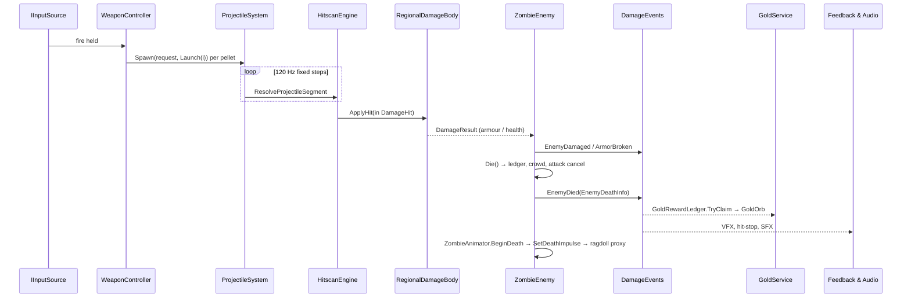

# Deaths Demolition: Architecture

This document describes the runtime architecture of the Unity project in `prototype/DeathsDemolition_PlayableConcept/`. Paths are relative to `Assets/_Prototype/` (shown as `P/`) or `Assets/_Art/` (shown as `A/`) unless written in full. Every claim points to the file it comes from. Items marked *planned* exist only in the design documents under `planning/work-packages/`.

## Contents

1. [Assemblies and module boundaries](#1-assemblies-and-module-boundaries)
2. [Boot, scenes and composition](#2-boot-scenes-and-composition)
3. [Key data contracts](#3-key-data-contracts)
4. [Event flows](#4-event-flows)
5. [Allocation and performance rules](#5-allocation-and-performance-rules)
6. [Save and profile durability](#6-save-and-profile-durability)
7. [Diagnostics and automation hooks](#7-diagnostics-and-automation-hooks)
8. [Build, CI and user-data safety](#8-build-ci-and-user-data-safety) (8.1 [R2 acceptance gates](#81-r2-acceptance-gates-wp-091))

---

## 1. Assemblies and module boundaries

### 1.1 Assembly definitions

| Assembly | Location | References | Role |
|---|---|---|---|
| `DD.Prototype.Core` | `P/Core/` | Input System only | Contracts and data that everything else depends on: config, pooling, input abstraction, camera and quality types, weapon definitions, boot |
| `DD.Prototype.Runtime` | `P/` (every folder except Core, Tests and editor code) | Core, URP, Input System, TextMesh Pro, AI Navigation, Cinemachine, ProBuilder, UGUI | All gameplay and presentation systems |
| `DD.Art.Runtime` | `A/Runtime/` | Core, Runtime, AI Navigation, URP | Art library manifests, world bootstraps, readability thresholds, visual regression |
| `DD.Art.Pipeline.Editor` | `A/Editor/` | — | Import contracts and builders: animation clip/event contracts, animator, armour, weapon, VFX, lighting and sky builders |
| `DD.Prototype.Qa` (+ `.Editor`, `.Tests*`) | `P/Diagnostics/Qa/` | Core, Runtime, Art.Runtime, Input System | QA bot, readability and window-mode gates |
| Editor assemblies | `P/Core/Editor`, `P/UI/Editor`, `P/Audio/Editor`, `P/Weapons/Editor`, `P/World/Editor`, `P/Rendering/Editor`, `P/Diagnostics/Editor` | — | Scene and asset builders, build entry point (`DdBuild`), simulators |
| Tests | `P/Tests/EditMode`, `P/Tests/EditMode/Audio`, `P/Tests/PlayMode`, `A/Tests/*`, `P/Diagnostics/Qa/Tests/*` | — | See the README test table |

Dependencies point one way: **Core → Runtime → Art.Runtime → Qa**. Core never references Runtime (`P/Core/DD.Prototype.Core.asmdef`). This is why the types that several systems share live in Core even though they are about gameplay:
- `WeaponDefinition` (`P/Core/Weapons/`)
- `CameraMode` (`P/Core/Camera/CameraModeTypes.cs`)
- `QualityTiers` (`P/Core/Quality/`)
- `EnemyTier` and `UpgradeBranch` (`P/Core/Config/PrototypeConfigEnums.cs`)
- `IInputSource` (`P/Core/Input/`)

### 1.2 Namespaces inside `DD.Prototype.Runtime`

Inside the Runtime assembly, each folder has its own namespace and a narrow crossing point:

| Folder | Namespace | Boundary rule |
|---|---|---|
| `Weapons/`, `Weapons/Projectiles/` | `DD.Prototype.Weapons` | Fires through `IWeaponHost` / `IAimSource` (`Weapons/IAimSource.cs`) and applies damage only through `Damage` contracts |
| `Damage/` | `DD.Prototype.Damage` | `DamageContracts.cs` is marked *"CROSS-TASK CONTRACT - DO NOT CHANGE THESE SIGNATURES"* |
| `Enemies/` | `DD.Prototype.Enemies` | Only `ZombieCrowdBinding.cs` touches Navigation (`ICrowdMember`) and only `ZombieSpawnBinding.cs` touches Spawn (`ISpawnedEnemy`) |
| `Navigation/` | `DD.Prototype.Navigation` | Knows nothing of enemies; talks to them only through `ICrowdMember` |
| `Spawn/`, `Rounds/` | `DD.Prototype.Spawn`, `DD.Prototype.Rounds` | Spawn owns the enemy pool and the round ledger. Rounds owns the run phase and the shop |
| `Economy/`, `Profile/`, `Achievements/` | `DD.Prototype.Economy` / `.Profile` / `.Achievements` | Gold lives only inside a run (`Economy/GoldWallet.cs`). The profile never stores gold |
| `Camera/` | `DD.Prototype.CameraSystem` | Mode state is a static service; the rig reads it |
| `Characters/` | `DD.Prototype.Characters` | Enemies drive visuals only through `IZombieAnimationDriver` |
| `Feedback/`, `Feedback/Vfx/` | `DD.Prototype.Feedback(.Vfx)` | Subscribes to events and never changes gameplay state |
| `Audio/` | `DD.Prototype.Audio` | Subscribes to events and sets mixer snapshots |
| `UI/Runtime/**` | `DD.Prototype.UI` | Reads view models and feeds (`Presentation/`) and calls the run director for player actions |
| `Diagnostics/` | `DD.Prototype.Diagnostics(.Telemetry)` | Probes and telemetry, only active with command-line flags |

---

## 2. Boot, scenes and composition

- **Scene order** (`ProjectSettings/EditorBuildSettings.asset`): Boot → MainMenu → Selection → Run → Results. `Boot` is the only valid entry scene.
- **Boot** (`P/Core/Boot/PrototypeBootstrapper.cs`):
  1. Loads `P/Core/Resources/PrototypeConfig.asset`.
  2. Applies vSync, target frame rate and the fixed timestep.
  3. Creates the persistent `PoolService.Root` and the F1 `PrototypeDebugPanel`.
  4. Loads the first scene. `PrototypeBootFlags` decides which one: session override → define → `-ddDirectToRun` → config → PlayerPrefs.
- **Config:** `PrototypeConfig` (`P/Core/Config/`) is the single data layer, split into Economy, Enemy, Feedback, Player, Progression, Round and Weapon sections. Placeholder values that are not yet approved carry `[PrototypeOnly(...)]` (`P/Core/Config/PrototypeOnlyAttribute.cs`). The census of these values is kept in `PROTOTYPE-ONLY.md`.
- **Run scene composition:**
  - `WorldBootstrap` (`P/World/`) builds or loads the world. `WorldSource { Procedural, AP005, V6 }`; the default comes from `A/Resources/DD_WorldSource.asset` and is **V6**, which loads `A/Scenes/World_V6_Greybox.unity` additively (§3.9). `-ddWorldSource` or `DD_WORLD_SOURCE` override it; the startup log prints `[World] WorldSource = …`.
  - `RunSystemsInstaller` (`P/Rounds/`) wires the run systems.
  - `PrototypeUiInstaller` (`P/UI/Runtime/Flow/`) injects the screens.
- **UI is generated in code.** `UiFactory` (`P/UI/Runtime/Kit/UiFactory.cs`) builds the canvases, and `UiSceneBuilder` (`P/UI/Editor/`) generates the meta scenes. No screen is hand-laid in a scene.

---

## 3. Key data contracts

### 3.1 WeaponDefinition v3 (WP-069)

`P/Core/Weapons/WeaponDefinition.cs` is a ScriptableObject created from the menu *Deaths Demolition/Weapon Definition v3*. "v3" is the contract generation named in the doc comment; there is no serialized version field.

- **Identity:** `weaponId` (for example `ar_1`), `id : ClassicWeaponId`, `slot` (Classic/Special), `weaponClass` (AssaultRifle, Smg, Shotgun, Lmg, Sniper, Launcher, Special), display names, `legacyNames[]`, and a silhouette.
- **Blocks:** `fire` (`WeaponFireMode { Single, Burst, Auto }`, rpm, burst and charge fields), `ammo`, `projectile`, `accuracy`, `explosive`, `rocket`, `arcChain`, `gelPuddle`, `specialLifecycle`, `upgrade`, `unlock`, `presentation` (sockets).
- **Accuracy per camera mode:**
  - `WeaponAccuracyBlock` holds a hip/ADS `SpreadPair` for each of top-down, third-person and first-person.
  - `SpreadFor(int cameraMode)` selects the pair. `P/Weapons/ClassicWeaponRuntime.cs` calls it with `CameraModeService.Current`.
- **Catalog and lookup:**
  - `ArsenalCatalog` (`Resources/Arsenal/ArsenalCatalog.asset`) validates the whole list.
  - The static `Arsenal` class does lookups without allocating.
  - `WeaponIdMigration` maps legacy ids.
  - `CreateLegacySettings()` converts a definition to the M3 `ClassicWeaponSettings`, so the older systems keep working.
- **Authoring:** assets are written deterministically by `P/Weapons/Editor/ArsenalAssetBuilder.cs`.
- **Catalog (12 definitions):** ten classics — `ar_1` Hinawa, `ar_2` Sanren, `smg_1` Shippū, `smg_2` Tetsui, `sg_1` Rappa, `sg_2` Nitō, `lmg_1` Mukade, `lmg_2` Kurogane, `sr_1` Tomi, `rl_1` Bōhiya — and the two DEC-094 Specials in the Special slot, `sw_arc` Raijū (chain lightning) and `sw_gel` Namekuji (slick gel). Balance numbers are DEC-097 as amended by DEC-099.
- **Blocks in use:** `rocket` and `explosive` drive `rl_1` (blast, dud and cluster rules, `P/Weapons/RocketImpacts.cs`); `arcChain` and `gelPuddle` drive the Specials (`SpecialImpacts`, `SpecialLinks`, `SpecialGelEffects`).
- **First-person pose:** `presentation.fpView` (`WeaponFpViewPose`, with a per-class `DefaultFor`) positions each weapon in the first-person view; `P/Weapons/FpViewPoseDriver.cs` applies it.

### 3.2 ProjectileSystem (ADR-069-1)

`P/Weapons/Projectiles/ProjectileSystem.cs` is a static simulation with no GameObject per projectile.

- **Storage:** `ProjectileState` structs in one flat array (`Capacity = 256`) plus a spawn-order index. When the array is full, the oldest projectile is retired and `OverflowCount` is incremented.
- **Stepping:**
  - Fixed step `1/120 s`, at most 8 steps per tick; any remainder is swept in one step.
  - Runs on scaled time, so pause and hit-stop freeze projectiles.
  - `ProjectileDriver` (`[DefaultExecutionOrder(60)]`) ticks it once per frame.
- **Collision:**
  - Each step sweeps the segment through `HitscanEngine.ResolveProjectileSegment`, using `Physics.RaycastNonAlloc`, or `SphereCastNonAlloc` when the projectile has a sweep radius.
  - Hits resolve through the same path as hitscan shots, inside one `DamageTransaction` resumed each step.
  - Each projectile keeps an inline set of up to 8 bodies it has already damaged (ADR-034-1).
  - Penetration budget: `TargetsLeft = 1 + PierceTargets + Penetration`.
- **Kinds:** `ProjectileKind { Bullet, Pellet, Rocket, Orb, Gel }` — Bullet for rifles, SMGs, LMGs and the sniper, Pellet for shotguns, Rocket for `rl_1`, Orb for Raijū and Gel for Namekuji.
- **Firing:** `WeaponController` calls `ProjectileSystem.Spawn(request, _classic.Launch(i))` once per pellet.
- **Events:** `ProjectileEvents` (`Spawned`, `Impact`, `Expired`) carry struct payloads.
- **Tests:** `P/Tests/EditMode/ArsenalV3Tests.cs`, `P/Tests/PlayMode/ProjectileSliceTests.cs`. Test hooks are `Step`, `SimulateFor` and `Clear`, and the system clears itself on scene unload.
- **Quality tiers:** the simulation does not change with the tier because it is a game rule (`planning/work-packages/QUALITY-TIERS-V2.md`).

### 3.3 CameraMode API (WP-070)

The types live in Core (`P/Core/Camera/CameraModeTypes.cs`) and the service in Runtime (`P/Camera/CameraModeService.cs`).

- **Types:**
  - `enum CameraMode { TopDown = 0, ThirdPerson = 1, FirstPerson = 2 }`, plus `CameraShoulder`, `CameraOccluderPolicy { FadeAll, FadeCameraLine, None }` and `CameraCursorIntent`.
  - `CameraModeSettings`: sensitivity, invert Y, FOVs (first-person defaults to 90° horizontal), shoulder, head-bob scale, reduced motion; with `Sanitize()` and `Clone()`.
  - `CameraModeProfile`: LOD bias factor, shadow distance and cascades, clip planes, occluder policy and shake scale for each mode.
- **Service contract:**
  - `Request(mode, instant)` returns a bool. Requesting the current mode is a no-op.
  - `Current` flips at the start of a transition. `Transition01` and `IsTransitioning` exist only for visual easing.
  - `Changed` fires once per accepted request.
  - `LockModeChanges(id)` / `UnlockModeChanges(id)` queue requests while locked; the death sequence uses this.
  - Transition times: TopDown↔Third 0.45 s, Third↔First 0.30 s, TopDown↔First 0.55 s; 0 with reduced motion.
  - The service never writes to disk. Look preferences are saved through `InputPreferences` (`P/Core/Input/`) and reach the service through `CameraInputPreferencesBridge`.
- **Aim:** in third- and first-person, `PlayerWeaponBinding` aims at the camera's 3D aim point (`CameraAimRay` in `P/Camera/CameraReactions.cs`).
- **Start mode:** top-down by default; the player changes mode from the pause menu, and the command-line flag `-ddCameraMode topdown|tp|fp` overrides it (`ResolveStartMode()`).
- **Feel per mode:** `P/Camera/CameraModesFeel.cs` and `P/Feedback/CameraFeelDriver.cs` (WP-073 B4) scale kick and shake per mode.
- **First-person arms:** `P/Characters/FirstPersonArms.cs` renders a copy of the player rig on the `FirstPersonView` layer while the world body stays shadow-only. It ships disabled (`PlayerSkinnedVisual.FirstPersonV3Arms = false`) until the hand-orientation pass lands.

### 3.4 QualityTiers (quality tiers v2, WP-075, DEC-100)

`P/Core/Quality/QualityTiers.cs` defines `enum QualityTier { Performans, Yuksek, Sinematik }`, shown in the UI as Performance / High / Cinematic. Each tier has its own URP asset, configured by `P/Core/Editor/QualityTierSetup.cs`.

- **Default:** `QualityTiers.DefaultTier = QualityTier.Sinematik`, and `QualitySettings` defaults to level 2 on every platform (DEC-100: Cinematic at 30 fps; High at 60 fps and Performance remain selectable).
- **Current** is derived from `QualitySettings.GetQualityLevel()`, and `Changed` is raised when it changes.
- **`Pick<T>(p, h, c)`** is the only way a feature reads a tier value, so no call site hard-codes one.
- **Built-in caps:**

  | Cap | Performance | High | Cinematic |
  |---|---|---|---|
  | LOD bias base | 1 | 2 | 2.5 |
  | Shadow distance | 45 | 60 | 80 |
  | Shadow cascades | 2 | 4 | 4 |
  | Streaming budget | 512 MB | 1024 MB | 2048 MB |

  Final values are combined with the camera mode: `LodBias = max(1, base × modeFactor)`, and shadow distance and cascades are the minimum of the tier cap and the mode value.
- **Ownership** (from the contract, `planning/work-packages/QUALITY-TIERS-V2.md`): S-05 writes the global render settings and S-01 writes the camera-local ones. Every feature owner has its own row in the contract (animation, AI, VFX, projectiles) and reads it through `Pick`.
- **Tests:** `P/Tests/EditMode/QualityTiersTests.cs`.

### 3.5 Animation event contract v3 (WP-071)

- **Runtime side** (`P/Characters/CharacterAnimationEvents.cs`, "THE ANIMATION EVENT CONTRACT", ADR-018-1):
  - `enum CharacterAnimationEvent` covers the v1 events (fire, hit windows, footsteps, death end, rise end…), the WP-032C mechanism events, the v3 events with an int payload (foot lift-off, `grab_start` / `grab_end`, `attack_recover`, `ragdoll_handoff`, weapon mechanism steps…), and the AP-022 additions `fall_start` and `telegraph_start`.
  - `Names[]` holds the canonical snake_case strings, and `Aliases` rejects spellings that are not canonical.
  - Owners subscribe to the instance event `Raised`. VFX and audio subscribe to the static `Any`.
- **Import side** (`A/Editor/ArtAnimationEventContract.cs`) validates clips whose names start with `AP022_`. Every event must:
  - use a known canonical name;
  - lie within the clip's frame range;
  - fire on frame 0 only if it is one of the whitelisted events;
  - not repeat within 2 frames;
  - if it opens or closes a hit window, have exactly one window of 3–8 frames that does not start in the first 6 frames.

  In addition, third-person / first-person pairs must put their **mechanism events** (`fire`, `eject`, `mag_in`, `bolt_back`…) on identical frames. Tests: `A/Tests/EditMode/ArtAnimationEventContractTests.cs`.
- **Animator parameters** are fixed by `CharacterAnimatorContract` (`P/Characters/CharacterAnimationSet.cs`), and controllers are generated from `CharacterAnimationSet` by `A/Editor/ArtAnimatorBuilder.cs`.
- **Reload beats (R2):** the magazine contract's events, `MagHandAttach`, `shell_in`, `rocket_in` / `rocket_seat` and the same-frame beat families are in §3.13.
- **Clip-driven attack timing:** the enemy attack state machine uses the clip's `hit_window_start` / `hit_window_end` events to move from Windup to Active to Recovery, and falls back to timers when there is no clip (`P/Enemies/EnemyAttackState.cs`, `IAttackWindowSink`).

### 3.6 Death impulse and ragdoll hand-off (WP-076, DEC-096)

- **Contract:** `readonly struct DeathImpulse` (`P/Damage/DeathImpulse.cs`) carries the unit direction, force (in `DamageForce` units, after the knockback governor), `DamageSourceKind`, `WeaponClass`, body region, world hit point, flat body speed and a `ZombieBodyState`. `DeathImpulse.Build` guarantees a unit direction (falling back to the body's forward), force ≥ 0 and speed ≥ 0.
- **Split of ownership:** S-03 (AI) fills it once in `Die()` and hands it to the animation driver through `IZombieAnimationDriver.SetDeathImpulse(in DeathImpulse)` before `BeginDeath`; S-03 knows no bones. S-06 (animation) picks the death family, onset, ragdoll hand-off and settle from it. After death, gameplay never attaches to the body again, and one owner (S-03) controls corpse lifetime.
- **Consumer:** `ZombieSkinnedVisual` (`P/Characters/ZombieSkinnedVisual.cs`) chooses a family from `ZombieDeathFamily` (FallBack, FallForward, SpinSide, LegsOut, UltraTimber, ArcElectro, GelSlip) and, at the `ragdoll_handoff` event or on a per-family timer, acquires a proxy skeleton from `RagdollProxyPool`.
- **`RagdollProxyPool`** (`P/Characters/RagdollProxyPool.cs`):
  - Zombies carry no Rigidbody. The pool holds proxy skeletons of 11 bodies and 10 joints each.
  - Default capacity is 6 concurrent ragdolls, with a hard maximum of 10.
  - A proxy stays active for 0.5–3.0 s and its pose is copied onto the zombie's bones in LateUpdate.
  - When the pool is exhausted, the authored death clip plays instead.

### 3.7 Damage contract

`P/Damage/DamageContracts.cs` defines:
- `BodyRegion { Head, UpperBody, LowerBody }` and `DamageSourceKind { Bullet, Pellet, Explosion, Chain, Ricochet }`.
- `struct DamageHit { Amount, Region, Point, Direction, ImpactForce, Source }` and `struct DamageResult`.
- `IDamageReceiver.ApplyHit(in DamageHit)` and `IExplosionReceiver`.
- The `DamageForce` constants and `DamageRegions` (region → armour slot, and the critical-hit rule).

How damage resolves:
- **Region lookup:** `HitboxRegistry` looks up the region by collider instance id. `DamageTargetResolver` falls back to the collider name, then to height ratio, and counts each fallback.
- **Armour** (`ArmorSet`, `RegionalDamageBody`): an armoured region sends the whole hit into its plate, and any damage left over once the plate breaks is discarded.
- **Explosions** spread their damage over the regions by configured shares, with linear falloff to the rim (`HitscanEngine.Explode`).

### 3.8 Attack selection and Special reactions (WP-076)

`P/Enemies/AttackStyles.cs` contains four pieces:
- **`AttackStyleProfile`:** per-style multipliers, normalised to each tier's signature style (Standard Swipe, Special Lunge, Elite Sweep, Ultra Overhead).
- **`AttackSelector.Select`:** a deterministic draw from the spawn seed, scored as tier weight × range fit × angle fit × variety × slot availability.
  - Never three of the same style in a row.
  - `-ddAiV3 0` restricts every body to its signature style.
- **`AttackSlotBoard`:** a static crowd budget.
  - Concurrent slots per style: Swipe 3, every other style 1.
  - A cooldown after each commit.
  - At most 4 wind-ups at once, or 2 while the player is grabbed. No Lunge during a grab.
- **`GrabState`:** at most one grab on the player.
  - The bite pays 60 % of its damage on hit and 40 % at the end of the grab.
  - A single hit with impact ≥ 0.85 on the holder breaks the grab.
- **Special reactions:** Raijū electrocutes bodies (`P/Enemies/ZombieShock.cs`). Namekuji puddles register in `GelPuddleRegistry`, and `ZombieGel` runs a slide → fall → downed → get-up machine; by DEC-096 zombies do not avoid the puddles.
- **Rear awareness:** `ZombieRear` marks a body as rear when it is out of the camera view and in the view's rear half-plane, and gives it a `RearLevel`; `RearSpawnShare` tracks the share of recent spawns that came up behind the camera and penalises rear spawn points above each camera mode's cap.
- **Round logs:** `AiV3RoundLog` and `SpawnRoundLog` write a per-round summary for tuning.

### 3.9 World V6 (WP-074)

- **Scene:** `A/Scenes/World_V6_Greybox.unity`, in the build list and loaded additively by `WorldBootstrap` when `WorldSource` is V6 (the default). `WorldLayout.Current` tells runtime systems which layout is active.
- **Built by code:** `A/Editor/GreyboxV6Builder.cs` builds the ±55 m layout (ring wall height 2.4 m, vista to 85 m), bakes NavMesh v5 (2,734 triangles), and writes `spawn-gates-v6.json` (22 gates: 12 outer, 10 inner; player starts and weapon points), `regions-v6.json` (5 regions, rooms R1–R6) and `acoustic-spaces-v6.json`. `A/Editor/WorldV5Dress.cs` places the AP-023 architecture and planting kit: the palace hall, *kairō* corridors, the *chūmon*, rooms, ponds, the west bamboo grove, the 1,143-tree vista band and the side doors at the corner spawns. `WorldV5Lighting`, `WorldV5Sky`, `WorldV5Ground`, `WorldV5Moss` and `WorldV5Look` finish it. It runs headlessly (`GreyboxV6Builder.BuildCli`, `-ddBake` for lighting).
- **Spawning in V6:** `SpawnWorldProfile.Resolve(layout, v6SceneLoaded)` is a pure function that picks the V6 gate table; `SpawnRoomBalance` spreads spawns across rooms.
- **Look (DEC-101/102):** `P/World/WorldAtmosphere.cs` sets the sun at 50° elevation in the north-north-west and a broken-cloud cookie; `A/Runtime/` holds the URP features (`ScreenAtmosphereFeature`, `LookV3Post`, `PlanarReflection`) and a separate renderer for the planar reflection pass. Volumetric shafts are a tier row: full on Cinematic, reduced on High, off on Performance.

### 3.10 Progression tree v2 (WP-077, DEC-095/098)

- **In-run tree:** `P/Rounds/RunTree/` loads `run-tree.json` (schema `dd-run-tree-v1`) into `RunTreeCatalog` / `RunTreeGraph`; `RunTreeState` is the per-run purchase state. `RunTreeHooks` (weapon stats, hit effects), `RunTreeEffectValues`, `RunTreeTierStats` and `RunTreeGroundFire` apply the effects. With `RunTreeNodeCards` on (the shipped config), `RoundUpgradeShop` offers tree nodes as its three cards, and a pinned path guarantees its next step (K1 hybrid offer).
- **Meta path:** `P/Profile/MetaPath/` (`MetaPathCatalog`, `MetaPathRules`, `MetaPathSnapshot`) reads `meta-tree.json` (`dd-meta-tree-v1`, 38 nodes) and is persisted through `ProfileService.Meta` inside the profile commit (§6). Selection and the run director query it for weapon locks.

### 3.11 Acoustic spaces (WP-072)

- `enum AcousticSpace { Open, Corridor, Hall }` and the static resolver `AcousticSpaces.Resolver` live in `P/Audio/Runtime/WeaponFireAudio.cs`. `AcousticSpaceMap` (`Resources/DD_AcousticSpaces.asset`) is baked from `acoustic-spaces-v6.json` by the audio catalog builder: rooms resolve to Hall and corridors to Corridor, with 1 m hysteresis, and the map answers only while the V6 scene is loaded. Weapon fire picks its wet tail per space.

### 3.12 Weapon-first hold (WP-083 B2c/B2d, R2 N2-05)

`P/Characters/WeaponHoldIk.cs` moves the R1 defect "the weapon sits on the shoulder" out of the third-person hold. The weapon's grip point becomes a pivot that rides the upper chest and looks along the aim; a two-bone solve brings the right hand to it so that `socket_weapon_r` coincides with the pivot in position and rotation (elbow out and down, pole `RightElbowPole`). The clip's hand no longer decides where the weapon is.

- **Order in LateUpdate:** after the Animator, the IK pass and `LocomotionLean`; `WeaponHoldIk` (890) → `WeaponMountAlignment` (900, lets the mount ride the socket while the hold is `Active`) → `WeaponGripIk` (910, the left hand on the placed weapon's `grip_l` / AP-022 hands-in-weapon-frame point).
- **Hold numbers:** `HipHold` (default `DefaultHipHold = (0.10, -0.12, 0.22)` m in the aim's yaw frame, relative to the upper chest). Per weapon (B2d): the support point's reach ahead of the grip is compared with `ReferenceSupportForward` (0.12 m); a longer reach pulls the pivot back along the aim by the difference, capped at `MaxPullBack` 0.35 m and eased over `PullBackSeconds` 0.15 s (a weapon switch), so the support hand lands at the same reach on every weapon.
- **Gate:** the owner's gate fades the hold over `BlendSeconds` 0.12 s for reload, switch, lowered and hurt, where the clip moves the weapon. `LastError` (socket ↔ pivot) feeds the R2 H1 measurement.
- **Why not Animation Rigging:** on the Humanoid bodies a rig works only when built after the Animator's first evaluation with its weights fixed at 1, so it cannot fade (C-00 05.10 decision A, WP-083 evidence b2c4…b2c12).
- **Default:** `WeaponHoldIk.Enabled = false` on `main`. `PlayerSkinnedVisual.Attach` adds the component only when the switch is on; the R2 tests measure it on with `DD_HOLD_IK=1`. The C-00 decision to ship it on, and the per-weapon rows still open on S-06's branch (`wp-083-b1`: C buttstock row, `sg_2` HoldDelta, `rl_1` hold off — shoulder-fired), land with S-06's B2d/B2e delivery. *Not yet on main.*

### 3.13 Reload magazine contract (WP-082, S-02 magazine contract v1)

- **State:** `P/Weapons/WeaponMagazineOwnership.cs` — who holds the magazine while a magazine weapon reloads: `MagazineOwner { Weapon, HandOld, HandNew }`, four beats `MagazineStep { Detach, HandAttach, Insert, BoltRelease }`. Forward only: a repeated beat is ignored, a later one lands the skipped ones first. A beat the clip does not send lands at its timeline mark (`MagazineMarks` = 12/21/30/40 of a 45-frame reference) plus `DeadlineGraceSeconds` 0.10 s. The end of the reload — complete, cancelled, switch, Special, death, camera change — puts the magazine back in the weapon at once. Presentation only: ammo stays on `ClassicWeaponRuntime`'s timer.
- **Clip names per beat** (`EventNames`): Detach `mag_detach` / `mag_out`; HandAttach `mag_hand_attach` (`CharacterAnimationEvent.MagHandAttach`, the one new beat); Insert `mag_insert` / `mag_in` / `rocket_in`; BoltRelease `bolt_release` / `chamber` / `rocket_seat`.
- **Reload kinds:** an empty reload lands 4 beats. A tactical reload (`reload_tac`, a round still chambered) lands 3 (Detach · HandAttach · Insert) and never a bolt release. `rl_1`'s empty tube starts at HandAttach (`rocket_in` = Insert, `rocket_seat` = BoltRelease), also 3.
- **Visual:** `P/Weapons/WeaponMagazineVisual.cs` moves the AP-021 model's `part_mag` to the left hand's `socket_mag_l` (`P/Characters/MagazineSocket.cs`, S-06 B2b) while a hand owns it, keeping its world rotation and scale, and returns it to its authored place otherwise. `WeaponController` owns both (`_magazine`, `_magazineVisual`).
- **One beat, several names** (`CharacterAnimationEvents.BeatFamily`, §12 of the AP-026-B contract): families out (`mag_out`), in (`mag_in`, `shell_in`, `rocket_in`) and seat (`chamber`, `rocket_seat`). Synonyms of one family on the **same frame** are raised once (`CollapsedCount` counts the dropped ones), so `sg_1`'s `mag_insert` + `shell_in` on one frame is one seat and one sound; on later frames each is its own beat (a shell per `shell_in`). `Synonyms` maps the contract spellings `mag_detach` / `mag_insert` / `bolt_release` onto the existing events instead of rejecting them like `Aliases`.
- **R2 gate:** H3 (`WeaponReloadMagazineTests.H3_SarjorluSilahlar_VuruslarTam_HavadaKareYok`): missing beats 0, magazine floating frames 0, hand-contact deviation ≤ 2 frames (S-06 `MagazineContactProbe`).

### 3.14 Locomotion v4 skeleton (WP-083 B3b, R2 N2-06)

`P/Characters/LocomotionV4.cs` fixes one stable id per AP-026 clip (`AP026_tp_` prefix), so the Animator's `LocomotionV4` sub-state machine is driven by one int parameter, `V4Clip` (set for one frame, AnyState → the clip's state; `None = -1`; no trigger is left armed when a clip is missing).

| Ids | Clips | Layout |
|---|---|---|
| 0–63 | starts | 4 gaits (walk, jog, run, sprint) × 8 directions (`fwd`, `fwd_r`, `right`, `back_r`, `back`, `back_l`, `left`, `fwd_l`) × lead foot |
| 64–127 | stops | same layout |
| 128–139 | pivots | 90 / 135 / 180° × side × lead foot |
| 140–141 | turn 45 in place | lead foot |

`Count = 142`. `LocomotionV4Events` (zero allocation) turns the motor's commanded velocity (`PlayerMotor.CommandedPlanarVelocity`, else a 0.2 s look-ahead) into a start (from rest, heading ≥ 0.6 m/s), a pivot (heading turns ≥ 67.5° while moving; 0.3 s cooldown) or a stop (heading < 0.3 m/s for 0.05 s); the lead foot is the one not planted. `PlayerSkinnedVisual` feeds it only while the controller carries the sub-state machine (`HasLocomotionV4`). `A/Editor/ArtAnimatorBuilder.cs` creates a state only for clips the set carries — none on `main` today, so the controller is unchanged until the AP-026 v002c hero clips are imported (S-06 WP-083). Gates L1–L6 measure the result (§8.1).

### 3.15 Weapon audio v4 and casings (WP-085, AP-027, R2 N2-07)

- **Every round is the full shot** (`P/Audio/Runtime/WeaponFireAudio.cs`, WP-085 B1): the v3 hybrid (a per-shot transient over an RPM-locked body loop) is gone. Copies of one automatic's shot overlap up to four deep; per-weapon trims bring a held string back to the level of the 8 shots/s kit the mix was chosen by. A string weapon (Auto / Burst) rings its space tail once when the trigger lets go; a single-shot weapon rings it on every shot.
- **Layers** (`WeaponLayer`): `Mechanical`, `TailOpen`, `TailCorridor`, `TailHall`, `DistanceMid`, `DistanceFar`, resolved by name (`AudioSoundId` "Weapon" + `Ar1` + layer) and silent until AP-027 delivers the id. Mechanical sits −10 dB under Body in top-down and is lifted +3 / +7 dB in TP / FP; in the Mid band it drops 12 dB and in Far it is off. `LoudnessCompMaxDb` caps the per-layer loudness compensation.
- **Distance bands** (`WeaponDistanceBand`): Near 0–12 m, Mid 12–35 m, Far beyond. The player's own shots are always Near (listener anchored on the player, ADR-021-2).
- **Space tails:** the space comes from `AcousticSpaces.Resolver` (§3.11). The v4 tail starts at the first reflection, delayed by `WeaponAudioIdentity.EarlyOffsetSeconds` (open 30 ms, corridor 11 ms, hall 21 ms). Wet level against the dry shot (`WeaponFireAudio.WetDb`): open −9 dB (+3 over spec, C-00 05.10 "yankılı"), corridor −8 dB, hall −7 dB (v003f tails). R2 S4 judges the tail's own RT60 (§8.1).
- **Casings** (`CasingAudio` in `P/Audio/Runtime/WeaponFoleyAudio.cs`): a `CasingEjected` mechanism slot becomes a drop heard after its fall time (250–700 ms, R2 S5) on the surface it lands on (AP-027 surfaces StoneSlate / WetStone / Wood / Dirt / Puddle; foliage and flesh silent). A hard surface adds one softer bounce 70–130 ms later. Casings that leave in the same frame (`sg_2`'s two shells) land 100–130 ms apart. The airborne queue holds 16 and a bounce never takes one of the last four slots from a landing. Level by camera mode: top-down −18, TP −12, FP −8 dB against the fire voice. LMGs add a belt link; `rl_1` has no casing sound.
- **The casing the player sees** (`P/Feedback/Vfx/CasingEvents.cs`, WP-087): `CasingEvents.Launched` fires once per visible casing, the frame it leaves the port, with a `CasingLaunchInfo` (shot serial, weapon, port position, launch velocity, per-shot speed jitter 0.85–1.15). `CasingEffect.PredictLanding` gives the closed-form touchdown and rest point of that throw (floor ray, gravity, one bounce). `WeaponController`'s `ShotSerial` ties the two to the shot. `CasingAudio` consumes it (WP-085, `a62d83db`): a `CasingEjected` slot waits one frame for its visible casing, matched by `ShotSerial` (0 = same frame), and the landing is heard at `PredictLanding`'s touchdown (time and place, the per-shot jitter included) with the bounce tick where the casing comes to rest. A slot no casing claims (VFX off, pool full) falls back to the nominal throw (`CasingAudio.NominalVelocity`); `FromLaunch` / `FromNominal` count the two paths. Measured sound ↔ visible touchdown 0.3–3.5 cm over FP / TP / top-down × 9 weapons (was 17–50 cm); `Wp087IsaretHizasiTests` asserts ≤ 25 cm.

### 3.16 Zombie look (AP-007 modules on main; v2 shader on main, intake in progress, WP-084)

- **On main:** `P/Characters/ZombieModuleLibrary.cs` holds the modular zombie as data (three body fits, clothing modules with colourways, four LOD meshes each, skinned to the shared rig by bone name), and `P/Enemies/ZombieAppearance.cs` dresses each spawn from its look seed. Materials are shared atlas materials (SRP batching, no per-instance material). WP-088 (05.10): every garment draws with its own atlas again — cloth garments on the cloth atlas, the tier tint only on body-atlas sub-meshes, no stale pooled material.
- **v2, S-03 WP-084 slice 1** (branch `wp-084-s03-zombie-v2`, architecture approved by C-00): a fifth module slot `SlotFace` for the AP-025-C faces (Gaunt / Swollen / Riven, 4 LODs, jaw), the O1 skin atlas + ORM in BC7, the nine masks as a 3×3 flipbook packed into a BC4 `Texture2DArray` and RL bits in `ApplyVariation`. *The intake body is not yet on main*; this section is updated when it lands.
- **v2 shader, on main** (`d0783d9b`, S-03 writing the S-05 file with C-00's approval; S-05 reviews on return): `A/Shaders/DD_TierLit.shader` + `DD_TierLitInput.hlsl` gain `#pragma shader_feature_local_fragment _ZOMBIE_MASKS` in the four passes that carry `_TIER_TINT` (a material Toggle, not `multi_compile`). One `UnityPerMaterial` layout for every variant (SRP Batcher): mask domain, tier-cloth UV rect, skin tints, dirt / blood colours, ORM flag; `_ZombieMaskArray` (Texture2DArray) and `_ZombieORM` sit outside the CBUFFER. Layer order: tier tint → skin → dirt → blood → roughness; slice indices come from `GetMeshRenderingLayer()` bits 16–20 / 21–25 / 26–30, clamped to 0..2. With the keyword off the zombie atlas materials render byte-identical (same-run parity); variant count 3 551 370 unchanged, local keywords 61 → 62. `03c3b06b` keeps the parity and variant-count measurements as `[Explicit]` diagnostics (`TierLitParityCaptureTests`, `TierLitVariantCountTests`). No material turns the keyword on until the intake lands. Gates Z2 / Z3 / Z3b / Z4 (§8.1); Z4 writes `familiesMissingFace = null` (BLOCKED) until face modules exist.

### 3.17 Menu v4, icons and loading art (WP-081, R2 N2-01 / N2-02)

- **Menu v4 phase A** (`P/UI/Runtime/Screens/MainMenuScreen.cs`): the left third is a dark spine with the game's name and one vertical rail of icon controls (PLAY, the six panes, QUIT). The focused item shows its word beside it, and every icon carries its reader name from the string table. A pane opens on the right when its icon is chosen and closes on Cancel; none is open on arrival (G5: Profile closed). The profile level and XP bar stand top-right.
- **Icon control** (`P/UI/Runtime/Kit/Components/UiIconButton.cs`): a glyph from the G1 SDF atlas, glyph ≥ 24 px (U1 legibility floor), 8 px grid, 44 px hit floor; `UiTooltip` shows the word of the one focused control.
- **Backdrop** (`P/UI/Runtime/Kit/UiBackdrop.cs`): today the Look B plate stack (far / mid / lantern glow / near bands with pointer drift, breathing lanterns, rain, left-third `SurfaceBase` 0.55 scrim).
- **Menu cinematic** (user note N2-01: a moving camera over the real map behind the menu): the C-00 decision is **B + cushions**, a soft left scrim. It lives on S-09's branch (`wp-081-v4a-r2`: `MenuLook`, scrim, cushions, edge fix, S04 shot adaptation; commits `bcde16dc`, `8ba256ec`). *Not yet on main.* Icon v2 (depth, reflection, motion shader) and Selection + panes v4 (U1b) follow.
- **Loading art rotation** (`P/UI/Runtime/Flow/KeyArtRotation.cs`, used by `UiCurtain`): a shuffle bag over the five AP-028 key arts. Each art shows once per round in a fresh order, and a round never opens with the art the last one closed on. There is no memory across sessions and nothing is written to player data (gate U3).

---

## 4. Event flows

All buses are static C# events with **struct payloads**. Producers do not know who consumes them.

| Bus | File | Events |
|---|---|---|
| `DamageEvents` | `P/Damage/DamageEvents.cs` | `ArmorBroken`, `EnemyDamaged`, `EnemyDied`, `PlayerAttacked` |
| `RunEvents` | `P/Rounds/RunEvents.cs` | `RunStarted`, `RoundStarted`, `RoundCompleted`, `RoundPoolExhausted`, `GoldChanged`, `PhaseChanged`, `CountdownTick`, `RunEnded` |
| `ProjectileEvents` | `P/Weapons/Projectiles/ProjectileEvents.cs` | `Spawned`, `Impact`, `Expired` |
| `CameraModeService` | `P/Camera/CameraModeService.cs` | `Changed`, `SettingsChanged`, `ProfilesChanged` |
| `QualityTiers` | `P/Core/Quality/QualityTiers.cs` | `Changed` |
| `CharacterAnimationEvents` | `P/Characters/CharacterAnimationEvents.cs` | `Raised` (per instance), `Any` (static) |
| `GrabState` | `P/Enemies/AttackStyles.cs` | `Started`, `Ended` |
| `CasingEvents` | `P/Feedback/Vfx/CasingEvents.cs` | `Launched` (`CasingLaunchInfo`, one per visible casing; WP-087) |
| `WeaponMagazineOwnership` | `P/Weapons/WeaponMagazineOwnership.cs` | `Stepped` (per controller: `MagazineStep`, from the clip or the deadline; WP-082) |

### 4.1 Shot → kill → reward

### 4.2 Round loop

`RunDirector` (`P/Rounds/RunDirector.cs`) moves through `RunPhase { Fighting, RoundComplete, Upgrading, Countdown, Dead }`:

1. **Fighting.** `EnemySpawnDirector` (`P/Spawn/`) resolves a `RoundPlan` (pool total, target active, ceiling ≤ 40). Every 0.45 s, `SpawnRefillClock` spawns up to 2 bodies while `RoundLedger.CanSpawn` allows it. Spawn points are picked by `SpawnPointSelector` / `SpawnWeightCalculator`, and `SpawnRelaxation` loosens the rules when no point qualifies. The spawn weighting reads `ThreatDirector`'s layer through `ThreatLevelFeed` (`P/Navigation/`).
2. **RoundComplete.** The round is complete when the pool is empty and nothing is alive (corpses do not count). The freeze is a named hold on `RunFlowClock` and never touches `Time.timeScale`. `GoldService.CollectOutstanding` credits any gold still on the floor.
3. **Upgrading.** `RoundUpgradeShop` offers three priced cards — nodes of the in-run tree (§3.10) — with one paid reroll before a purchase.
4. **Countdown.** Three seconds with the simulation running, then back to Fighting.
5. **Dead.** Player death ends the run. `RunEvents.RunEnded(RunSummary)` → `ProfileRunCommitter` commits synchronously (§6) → Results.

### 4.3 Presentation consumers

- **Feedback:** `HitFeedbackDirector`, `FeelEventRouter` and `VfxEventBinder` turn damage events into pooled effects, gated by `FeedbackBudget`.
- **Audio:** `AudioEventRouter` maps events to cues on the `AudioVoicePool`s. `MusicDirector` follows the threat layer. `PrototypeAudioDirector` moves `AudioMixerBridge` between the Run, RoundBreak and Pause snapshots as the run phase changes.
- **UI:** reads `RunHudViewModel` / `ResultsViewModel` (`P/UI/Runtime/Presentation/`) and feeds such as `ThreatHudFeed`.

---

## 5. Allocation and performance rules

The rules are written in the code and enforced by allocation scans and performance probes:

- **Hot paths allocate nothing.**
  - `HitscanEngine` (`P/Weapons/HitscanEngine.cs`): *"All buffers are static and reused. One shot allocates nothing: no LINQ, no GetComponent…, no array creation, no closure."* It uses non-alloc physics queries with fixed buffers (`OverlapBufferSize = 192`, with saturation counted).
  - `ProjectileSystem`: "Zero allocation per frame".
  - `DamageEvents`: raising an event costs zero allocations with 40 enemies under automatic fire.
  - `HitboxRegistry`: no `GetComponent` or `Find` on the bullet path; lookups go by collider instance id.
  - `ArmorSet`: allocation-free after construction.
  - `Arsenal` lookups never allocate, and `WeaponDefinition.AudioId` is cached for the fire path.
- **Pooling everywhere.**
  - `PrototypePool<T>` / `PoolService` (`P/Core/Pooling/`): a stack-based free list. Pools are prewarmed and fetched once in `Awake`, never per spawn.
  - The exhaustion policy can be `ReturnNull`, `RecycleOldest` or `GrowWithWarning`.
  - Enemies share one pool with a ceiling of 40. Gold orbs, VFX, casings and ragdoll proxies are pooled too.
- **Budgets instead of unbounded spawning.**
  - `FeedbackBudget` applies a concurrent ceiling, a per-frame cap and a proximity merge to each category.
  - `AudioVoicePool` applies retrigger, instance and priority gates.
  - `ProjectileSystem` retires its oldest projectile at 256.
  - `RagdollProxyPool` caps concurrent ragdolls.
  - Corpses linger for a shorter time when the body count nears the ceiling (`CrowdFeelSettings.CorpseLingerFor`).
- **Time:**
  - Hit-stop is a local visual time envelope (`P/Feedback/HitStopService.cs`: *"It never owns Time.timeScale"*).
  - Round freezes use named holds on `RunFlowClock`.
  - Projectiles run on scaled time.
- **Domain reload off.** Static state resets on `[RuntimeInitializeOnLoadMethod(SubsystemRegistration)]`. Over 130 call sites under `P/` use this.
- **Crowd cost:**
  - Separation uses a spatial hash (`CrowdSpatialGrid`).
  - Path repaths share a budget (`NavPathFollower`, every 0.35 s).
  - `CharacterAnimatorLod` culls animators off screen and steps them manually at distance.
- **Performance targets:**
  - DEC-100: on the default Cinematic tier, mean ≤ 33.3 ms and p99 ≤ 40 ms at 1080p (30 fps).
  - DEC-092: on the High tier, mean ≤ 16.6 ms and p99 ≤ 20 ms at 1080p.
  - Performance tier: mean ≤ 8.0 ms and p99 ≤ 10 ms.
  - They are measured with `PilotPerfProbe` in clean windows by `tools/qa/regression.sh`.

---

## 6. Save and profile durability

`P/Profile/ProfileStore.cs` keeps all its files in `Application.persistentDataPath`:

| File | Role |
|---|---|
| `prototype-profile.json` | Primary |
| `….writing` | Save candidate |
| `….bak` | Last verified backup |
| `….bak.writing` | Staging file for refreshing the backup |
| `….corrupt.<ticks>.json` | Quarantined unreadable primary, never deleted |
| `….lock` | Write lease |

**Save chain.** `ProfileSaveStage` has a fault-injection hook at every stage:

1. Sanitize, serialize (`JsonUtility`, UTF-8), and check that the text parses back.
2. Write the candidate to `.writing` and fsync it (`Flush(true)`).
3. Read the candidate back and compare it byte for byte.
4. If the current primary validates, refresh `.bak` atomically: stage it, verify it, then `File.Replace`.
5. `File.Replace(candidate → primary)`, a single rename.
6. Read the primary back to verify it. On mismatch, `RecoverAfterFailedReplace` restores from the backup.

Failures never throw; they return a `ProfileSaveResult`.

**Load and recovery** (`ProfileLoadRecovery`):
- A valid primary wins, and any orphan candidate is deleted.
- If the primary is missing, the store rolls forward to a validated candidate, then to a validated backup, then starts fresh.
- If the primary is corrupt, it is quarantined and the store falls back to the backup.
- If any file comes from a newer schema, the session opens **read-only** and no file is touched.

**Lock lease.**
- A `FileStream.Lock` byte-range lock (fcntl on Unix) is held for the life of the process.
- It is fail-closed: if another process holds it, this session is read-only.
- The lock file is never deleted.

**Schema** (`ProfileData.CurrentVersion = 4`, `P/Profile/ProfileMigration.cs`):
- Migrations are lossless: v1→v2 adds unattributed kills; v2→v3 adds a profile lineage and completion ordinal; v3→v4 adds Special pickups, flawless rounds and unlocked content.
- Ids are stored as strings, never as enum ordinals.

**Exactly-once run commits** (`P/Profile/CompletionAuthority.cs`, WP-009H):
- Each run receives a capability token `ddc1:<lineage>:<ordinal>:<nonce>`.
- Validation checks, in order: format, schema, lineage, `ordinal ≤ mark` (already applied), gap, and live capability.
- The capability is consumed only after the save is on disk, so a failed save can be retried with the same token.
- `ProfileService.ApplyRun` computes on a candidate copy, saves it, and only then publishes and raises `Changed`. Achievements (`AchievementEngine`) are evaluated inside this commit, so each one is granted exactly once.
- This design replaced an earlier ring of 8 applied ids, which let a run replay after nine further runs (documented in the project README).

**Isolation.**
- PlayMode tests run under `TestProfileIsolation` and never point the profile at the real path.
- Development players accept `-ddProfilePath`.
- `tools/smoke.sh` backs up, restores and hash-verifies every user-data file around a release smoke run.
- `ProjectIntegrityTests` restricts `PlayerPrefs` to an allow-list.

---

## 7. Diagnostics and automation hooks

- **QA bot** (`P/Diagnostics/Qa/QaRunBot.cs`, development builds and the Editor only):
  - Drives the real flow through a virtual Input System gamepad (`QaVirtualGamepad`) with a seeded, pure `QaBotBrain`.
  - Writes `qa-report.json` (schema `dd-qa-report-v1`), with a spawn-sequence hash so runs can be reproduced.
  - WP-070 B7 runs it in all three camera modes.
- **Probes** (`P/Diagnostics/`): lifecycle, round, gold, armour, economy, profile, Special-weapon, enemy-version, pilot-performance and render-texture probes. Each is armed by a `-dd…` flag.
- **Telemetry** (`P/Diagnostics/Telemetry/RunTelemetry.cs`): schema `dd-run-telemetry-v1`, local JSON under 200 KB, preallocated buffers, no identity data. `-ddTelemetry 0` disables it.
- **Crash log** (`P/Diagnostics/CrashLogReporter.cs`): writes local text files with the home directory and account name masked, keeps the newest 10 files, and uploads nothing.
- **Build stamp** (`P/Core/Build/BuildInfo.cs`): reads `Resources/build-info.json`, which `tools/build.sh` stamps and then restores to its placeholder.

---

## 8. Build, CI and user-data safety

Several agent sessions share one Mac, one Unity install and the real player's profile. The scripts in `tools/` encode the rules that make that safe (reference: `tools/README.md`).

- **Machine slots** (`tools/slot.sh`): a FIFO lock shared by every session — 2 Unity batch editors (3 when swap and load are low), 1 heavy Blender job, 1 smoke run and 1 `player` slot. Locks record the owner's pid and start time, so a reused pid reads as stale; acquisition is re-entrant for child processes of the owner.
- **Stall watchdog** (`dd_unity_watched` in `tools/dd-env.sh`): a Unity batch run whose log stops growing for 20 minutes is killed (its own pid only), retried once, then reported as 124.
- **Compile gate** (`tools/compile-check.sh`): after a multi-session batch, opens the project in batchmode in the CI checkout with a warm Library and counts `error CS` lines. Green requires Unity exit 0 **and** a compile trace in the log; "Multiple Unity instances" is reported busy (75), and a non-zero exit without CS errors is "did not run" (3), never green.
- **Main CI** (`tools/main-ci.sh`): a detached CI worktree at the commit under test runs the full EditMode suite and the PlayMode core suites (`tools/ci-suites.txt`), holding the `player` slot for the whole run. `summary.md` maps each red test to its owner session (`tools/ci-owners.tsv`) and flags reds that are new since the previous run.
- **User-data guard** (`tools/userdata-guard.sh`): every PlayMode or Player run is wrapped as snapshot → run → restore in one shell. Restore writes back exactly the snapshot, deletes keys the run added, and hash-verifies the result. A player-scope window holds the `player` slot, refuses to start while a game Player is alive (exit 30), and refuses to restore display settings that deviate from known-good values (exit 31, nothing written). Only the coordinator may change user data outside this.
- **Player launches** (`tools/player-run.sh`): every Player — captures, bots, perf probes — goes through the `player` slot, so no two Players share the audio device and focus, and none runs during CI.
- **Release** (`tools/build.sh release --smoke`): LZ4HC build, footprint against the 5 GB cap (DEC-093), then a flagless smoke run that checks the main menu, the run scene, zero exceptions, the default world line in the log, and that user data came back unchanged.

### 8.1 R2 acceptance gates (WP-091)

- **Contract:** `tools/qa/r2-gates.json` (schema `dd-r2-gates-v1`) holds every R2 gate as data. Areas: H hero, L locomotion, Z zombie, S sound, P perf, U UI. Each gate has an id, a kind (`gate` / `report` / `human`), an owner session, `checks` (key, op `<=` / `>=` / `==`, limit) and `report` keys; optionally `tests` (required NUnit full names) and `measuredBy` (suite, a `test.sh --filter`, quiet window or not, owner env with the one `{KPROJ}` placeholder). The prose rules are in `tools/qa/r2-measure-contract.md`. `tools/qa/tests/test_r2_gates.py` pins the approved thresholds, so an unreviewed change is a red test.
- **Writer:** a measuring test calls `R2Olcum.Yaz(gate, source, values, samples)` (`P/Tests/Shared/R2Olcum.cs`, shared by EditMode and PlayMode). With `DD_R2_MEASURE_DIR` set it writes `r2-<gate>.json` (`dd-r2-measure-v1`, stamped with `DD_R2_COMMIT`); without it, it writes nothing and the test only asserts. The `double?` overload writes a key that cannot be measured yet as `null` with a note, which makes the gate BLOCKED. Before writing, the test asserts that the thing it measures is in the recording ("the source must be in the recording").
- **Judge:** `tools/qa/r2_gates.py` validates the contract and judges one gate from the bound artifacts: PASS / FAIL / BLOCKED, or REPORT for report entries, which never fail. Human gates (H5, L6, Z5, S6, U4) take a `dd-r2-review-v1` file; KABUL_DÜZELTMELERLE passes only with every MUST closed. `wp078_report.py` binds it as the `R2` step of an R2 manifest (`wp078_accept.py --round R2`). `measurement_steps` turns `measuredBy` into guarded sessions: stage `r2` after A3 for `quiet: false`, stage `r2q` in the quiet window after A4. `tools/qa/r2_load_time.py` writes P5 (Selection → Run load time against R1) from the chain's own bot sessions.
- **Consistency lint (C-00B B-02, PR [ErdemEmirOzer/deaths-demolition#1](https://github.com/ErdemEmirOzer/deaths-demolition/pull/1), pending):** `tools/qa/r2_gates_lint.py` reads the JSON, the prose and every `R2Olcum.Yaz` call statically. It names missing or extra keys, gates nobody writes, `measuredBy` filters that run no test or miss the writer, `[Explicit]` tests the chain never runs, and prose that disagrees with the JSON.
- **H1 elbow:** `elbowMaxDeg` (the support arm's elbow, 180 = straight) is report-only until the hero v2 import, then a check ≤ 165.
