# 02 — Akışlar, Mimari ve Teknolojiler

Bu dosyadaki diyagramlar yalnızca onaylanmış kararların ilişkisini gösterir. Sınıf yapısı, Unity paketi veya henüz seçilmemiş teknik çözüm tanımlamaz.

## Teknoloji sınırı

| Alan | Onaylanan seçim |
|---|---|
| Ürün | Bilgisayar oyunu |
| Oyun motoru | Unity `2022.3.22f1` |
| Render pipeline | URP `14.0.10` |
| Modelleme, render ve asset üretimi | Blender |
| İçerik kaynakları | Lisanslı kütüphaneler ve şirket içi üretim; Adobe Illustrator ve ihtiyaç duyulan diğer Adobe araçları |
| Üretim yönetimi | Alan paketleri ve otomatik kapılar |
| Ağ modeli | Güncel kapsamda ağ yok; tek oyunculu ve çevrimdışı |
| Kalıcı veri | Yerel profil, açılan içerik, başarım ve istatistikler |
| Oyun dili | İngilizce |

## FLOW-001 — Ana koşu döngüsü

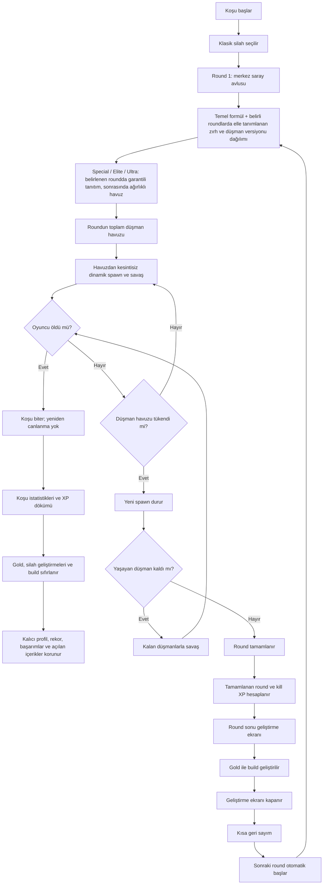

## FLOW-002 — Koşu verisi ile kalıcı profil ayrımı

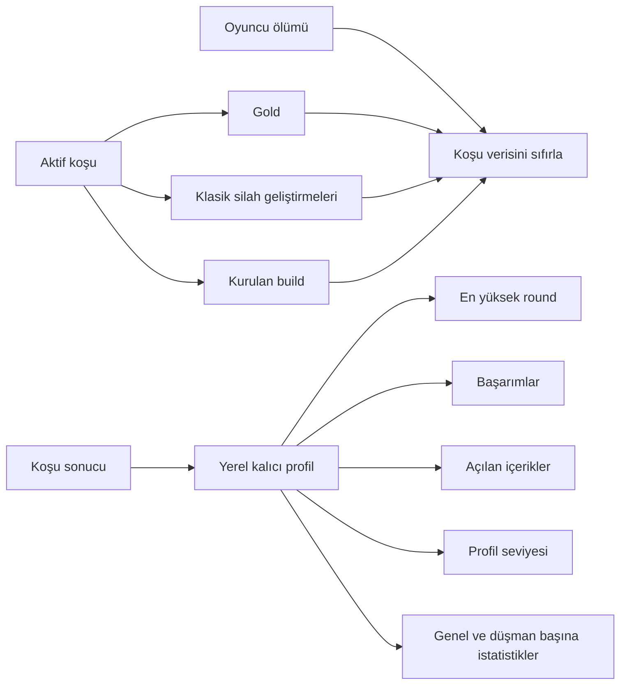

## FLOW-003 — Profil XP akışı

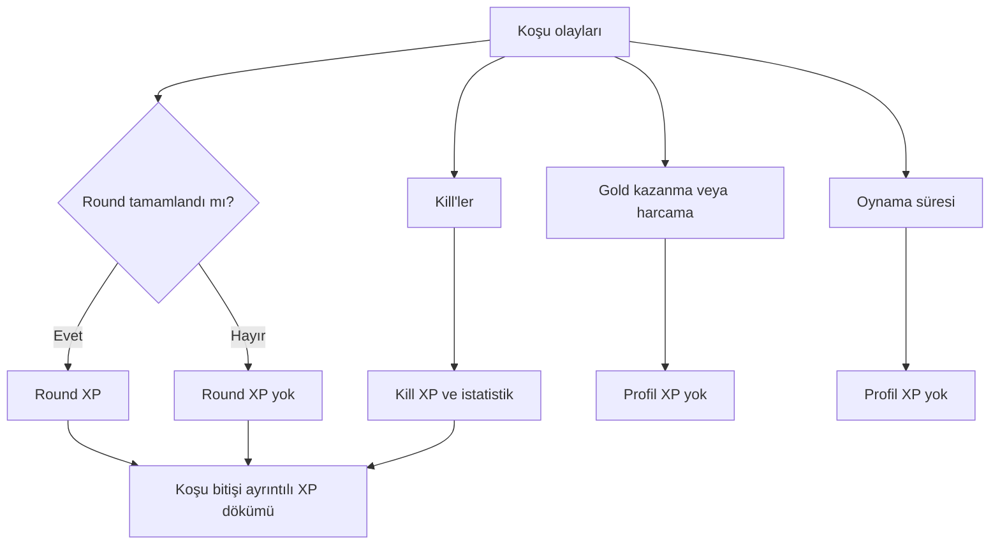

## FLOW-004 — Hareket, nişan ve kamera

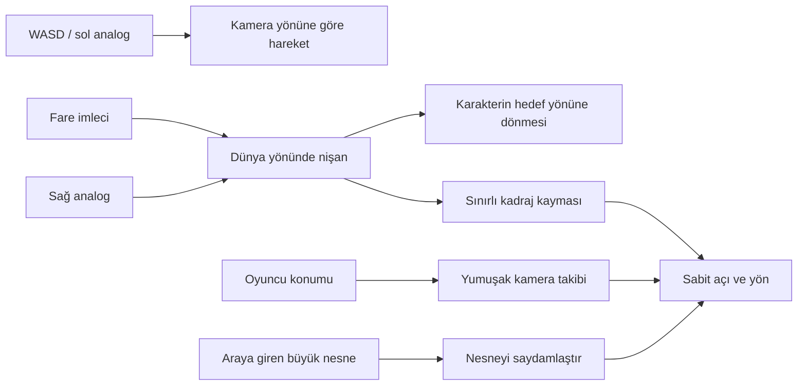

Hareket ve nişan birbirinden bağımsızdır. Gamepad sağ analog hem nişanı hem de nişan yönündeki sınırlı kadraj kaymasını belirler.

## FLOW-005 — Silah durumu

```mermaid
stateDiagram-v2
    [*] --> KlasikSilah: Koşu başında seçim
    KlasikSilah --> KlasikSilah: Round sonu geliştirme
    KlasikSilah --> SpecialYerde: Başlangıç roundundan sonra ihtimal kontrolü; geçerli ilerleme aralığında rastgele spawn
    SpecialYerde --> KlasikSilah: Yerde bekleme süresi dolar
    SpecialYerde --> SpecialAktif: Oyuncu alır
    SpecialAktif --> KlasikSilah: Kullanım süresi dolar
```

- Special Weapon yerdeyken ayrı kaybolma süresi kullanır.
- Aktifken sınırsız mermiye sahiptir ve reload gerektirmez.
- Aktif süre boyunca klasik silah kaybolmaz, geçici olarak devre dışıdır.
- Round sonu geliştirmeleri Special Weapon'ı etkilemez.
- Uygun roundda genellikle bir, ileri roundlarda nadir ihtimalle iki Special Weapon çıkabilir.
- Aynı anda yalnızca bir Special Weapon yerde bulunur; yerde bekleyen veya aktif kullanılan Special Weapon süreci bitmeden sonraki spawn olmaz.

## FLOW-006 — Dinamik spawn noktası seçimi

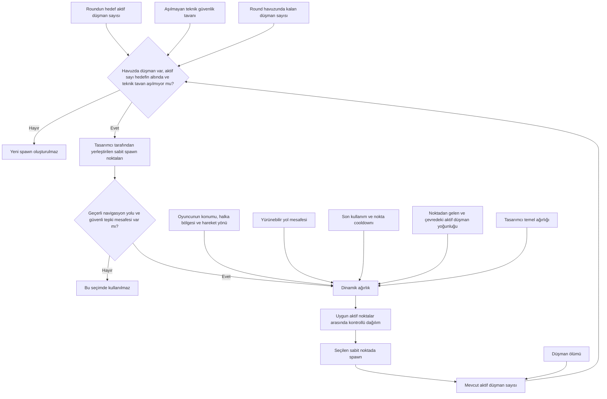

Çok uzak bir noktanın ağırlığı sıfır olabilir. Sistem bütün düşmanları sürekli aynı noktadan çıkarmaz ve oyuncunun hemen yanında spawn oluşturmaz. Düşman öldükçe aktif sayı azalır ve round havuzunda düşman kaldığı sürece sistem hedef sayıyı yeniden tamamlayabilir.

## FLOW-007 — Doğrudan isabet ve bölgesel zırh

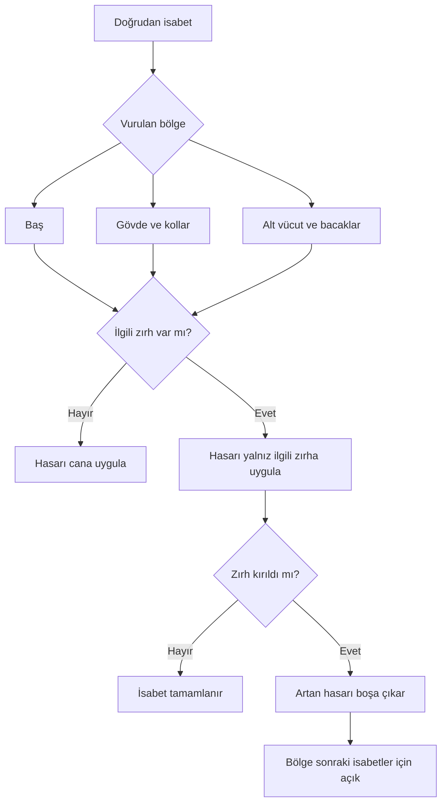

## FLOW-008 — Patlama ve zırh

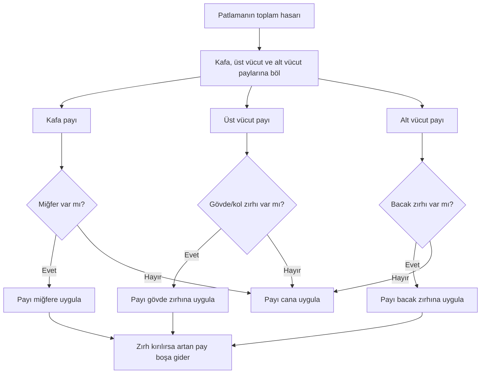

- Toplam patlama hasarı zırh parçası sayısına göre çoğalmaz.
- Üç zırh da mevcutsa bir parça kırılana kadar patlama can hasarı oluşturmaz.
- Açık bölgeden cana giden patlama payında bölgesel kritik çarpan kullanılmaz.

## FLOW-009 — Haritanın topolojik yapısı

Bu diyagram ölçü veya kesin yerleşim planı değildir; yalnızca onaylanan bölge bağlantılarını gösterir.

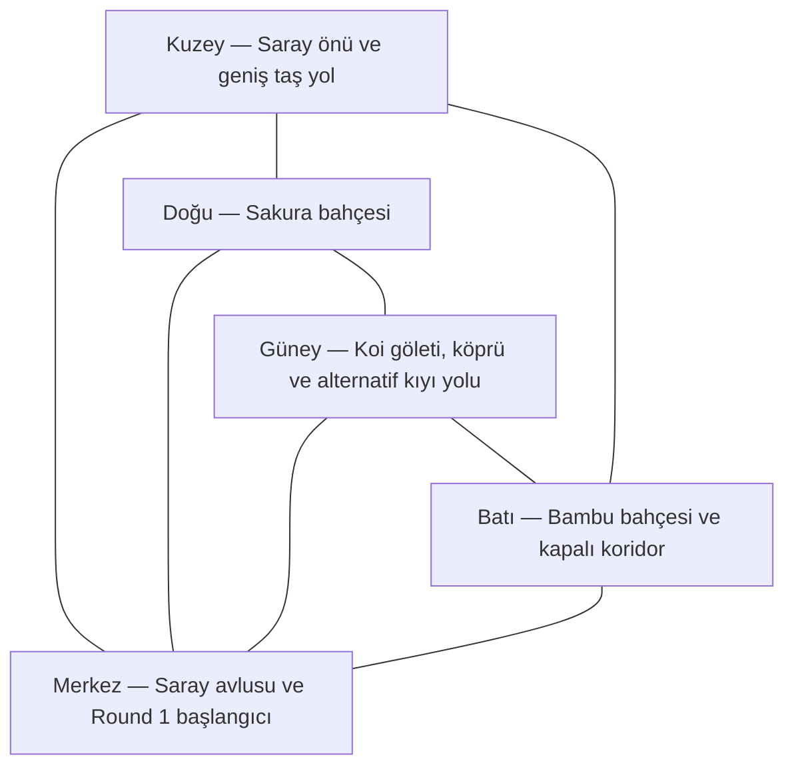

- Dış bağlantılar kesintisiz halka oluşturur.
- Merkez bağlantıları radyal kestirmelerdir.
- Merkez her zaman geçilebilir ve halka iki yönde dolaşılabilir.
- Harita Round 1'den itibaren tamamen açıktır.

## FLOW-010 — Oyuncu hasarı ve otomatik can yenilenmesi

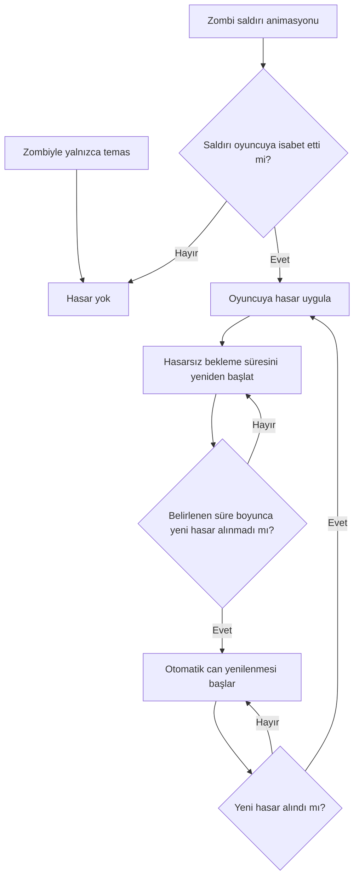

- Hasardan sonra koruma veya dokunulmazlık süresi yoktur.
- Aynı anda isabet eden birden fazla saldırının hasarı üst üste uygulanabilir.
- Oyuncu hasar aldığında hareket, nişan ve ateş kesilmez; görsel, işitsel ve kamera geri bildirimi verilir.
- Oyuncu zombilerin içinden geçemez; zombiler oyuncunun yolunu fiziksel olarak kapatabilir.
- Zombiler birbirleriyle yumuşak ayrışma kullanır; üst üste binmeden birbirlerini hafifçe iterek sürü halinde akar.

## FLOW-011 — Meta akış

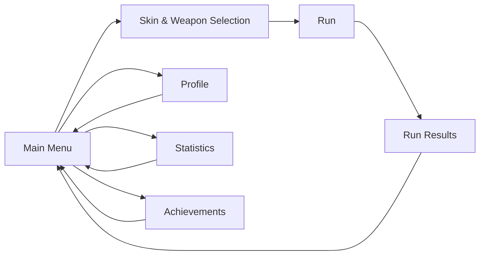

Akışın sade olması UI tasarımı ve kalite hedefini düşürmez.

- Skin & Weapon Selection her koşudan önce açılır.
- Aynı oyun oturumunda son kullanılan skin ve klasik silah hazır seçili gelir.
- Oyuncu doğrudan başlayabilir veya seçimleri değiştirebilir.
- Oyun yeniden açıldığında varsayılan skin ve klasik silah seçimine dönülür.

Run Results tek ekranda şunları gösterir:

- Ulaşılan round.
- Genel kill ve düşman versiyonu başına kill sayıları.
- Ayrıntılı XP dökümü.
- Profil seviyesi ilerlemesi.
- Açılan içerikler.
- Başarımlar.

Yeni içerikler Run Results ekranında vurgulanarak otomatik açılır; Claim işlemi gerekmez ve sonraki Skin & Weapon Selection ekranında kullanılabilir olur.

## FLOW-012 — Gold kazanma ve toplama

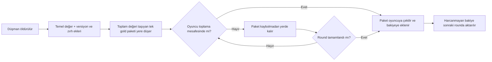

Gold yalnızca düşman ölümlerinden gelir; çevre objeleri ve round tamamlama ek gold üretmez.

## FLOW-013 — Çalışma paketi ve rapor döngüsü

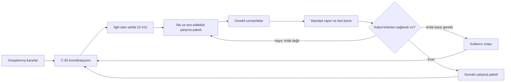

## FLOW-014 — Paralel çalışma Git koordinasyonu

```mermaid
flowchart LR
    WP["Çalışma paketi kimliği"] --> OWNER["Branch/worktree ve commit sorumlusu"]
    OWNER --> FILES["Dosya sahipliği ve dirty-state kontrolü"]
    FILES --> WORK["Paralel veya sıralı uzman çalışması"]
    WORK --> INTEGRATE["Tek entegrasyon sorumlusu"]
    INTEGRATE --> TESTS["Derleme ve test kapısı"]
    TESTS --> COMMIT["Atomik ve geri döndürülebilir commit"]
    COMMIT --> QUEUE["Belgelenmiş entegrasyon sırası"]
```

Paylaşılan branch üzerinde force push, rebase veya reset yapılmaz; kimlik bilgileri ve sırlar repoya yazılmaz.

## FLOW-015 — Adaptif ses ve atmosfer

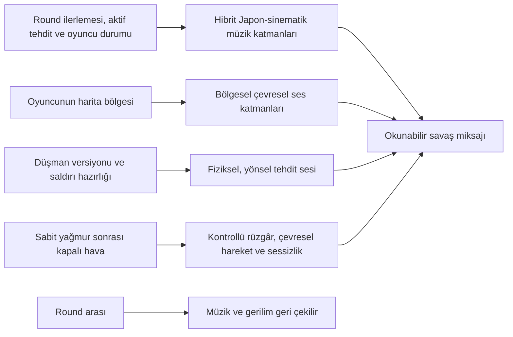

Büyük gün/gece veya hava dönüşümü kullanılmaz. Adaptif katmanlar oynanış okunabilirliğini ve önemli savaş uyarılarını bastırmaz.

## Sistem sınırları

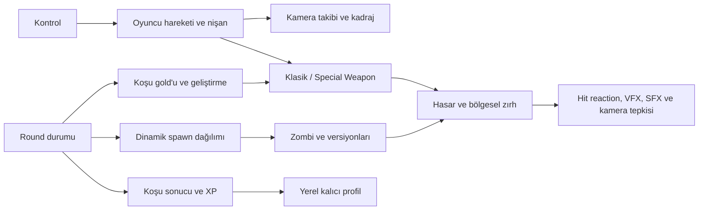

Bu sınırlar onaylanan sistem ilişkilerini gösterir; sınıf sayısı, veri formatı veya Unity uygulama yöntemi henüz kararlaştırılmamıştır.

## İçerik üretim akışı

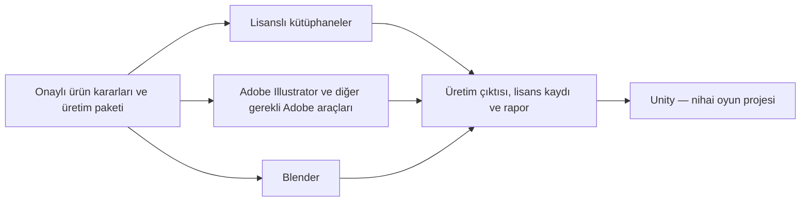

Cascadeur bu akıştan çıkarılmıştır. Aktarım formatları ve teknik import sözleşmeleri `Production Baseline Audit & Stabilization` kapsamında tanımlanacaktır.

## Kayıt kuralı

- Yeni akış veya mimari kararı yalnızca kullanıcı tarafından verildiğinde veya açıkça onaylandığında eklenir.
- Diyagramlar onaylanmış kuralların görsel karşılığıdır; boşlukları varsayımla doldurmaz.
